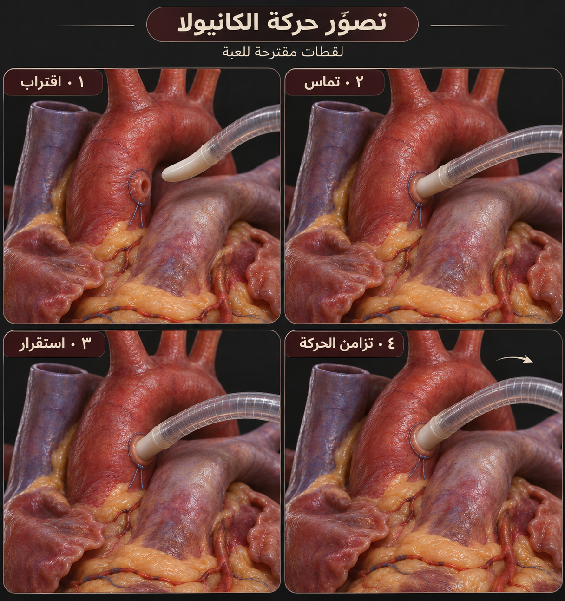

# OHS-CANNULATION-ANIMATION-001 — Storyboard experiment

**Owner verdict, 2026-11-04: rejected as insufficiently realistic.** Retained for history; it is not the accepted visual target. See [reference correction 002](../cannulation-realism-002/REFERENCE-REVIEW.md).

Date: 2026-11-04. The owner requested an example of how cannulation animation could look. The illustrative case chosen here is an arterial perfusion cannula at an already prepared, authored ascending-aortic attachment site.

تصوّر بصري من أربع لقطات: اقتراب، تماس، استقرار، ثم تزامن الحركة. المقصود إظهار علاقة حركة الكانيولا بالنسيج والأنبوب الخارجي في اللعبة. هذه لوحة لقطات ثابتة، وليست فيديو أو محاكاة منفذة أو إرشادًا لإجراء الجراحة.

## Proposed animation behavior

| Visual beat | Intended game behavior |
|---|---|
| Approach | A visible gap closes smoothly toward the pre-authored site; tool geometry and camera remain consistent |
| Contact | Small local tissue displacement corresponds to contact, without whole-organ squashing or visible clipping |
| Seated state | The authored seated state occludes the distal tip naturally; attachment ownership becomes explicit |
| Coupled motion | The secured cannula follows the local attachment position and orientation; external tubing bends smoothly without sliding or kinking at the site |

These are animation states, not operative steps or clinical timing. Site preparation, insertion technique, fixation technique and perfusion activation are outside this illustration. A seated visual state does not itself establish a connected or active flow state. The future implementation must validate local collision and attachment behavior separately from its appearance.

## Provenance and limitations

Generated with the session image-generation tool, using [OHS-HEART-APPEARANCE-001](../heart-appearance-001/README.md) as a style reference. The original output `exec-0b0df95e-6385-4980-acf4-216043d2266d.png` remains in the workspace; the repository copy is unchanged. No manufacturer mesh or product specification was supplied, and no asset license is newly asserted.

The port, suture, cannula geometry and anatomy are illustrative and unvalidated. The still panels do not establish deformation magnitude, tip depth, collision correctness, mechanical properties, temporal continuity or Android performance. Differences between contact and seating would need to be made clear in an actual moving prototype. A brief independent concept review checked the intended motion relationships; it was not a clinical or device review.

This artifact contains no 3D mesh, animation clip, rig, solver or playable interaction. For a future prototype, use reviewed geometry, timestamped tool/tissue states and the contact contract in [proposal 002](../../proposals/OHS-PROPOSAL-002-ANDROID-REALISM.md), rather than deriving anatomical dimensions from this image.
