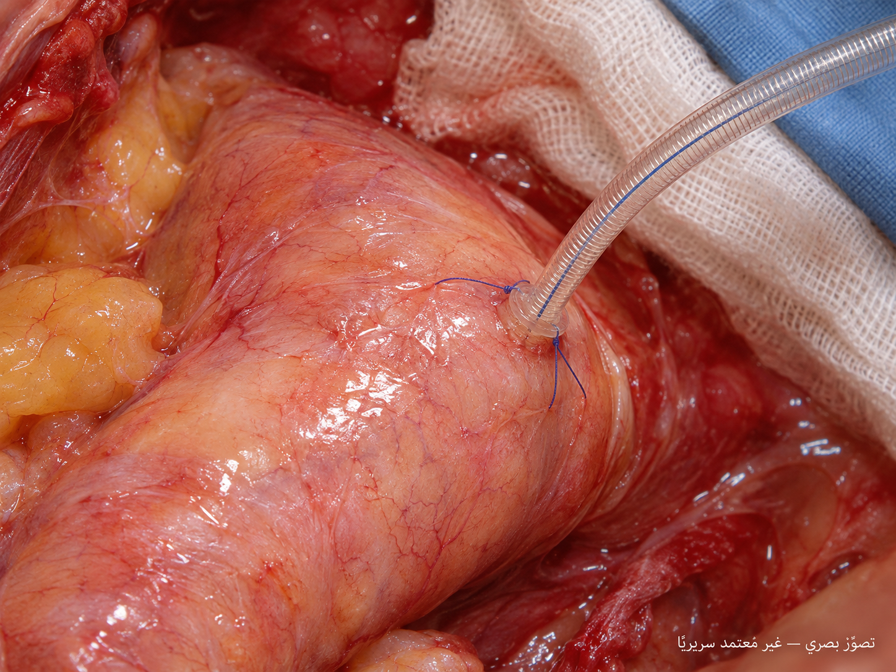

# OHS-CANNULATION-REALISM-002 — Appearance and motion experiment

Date: 2026-11-04. The owner requested improvement of **both appearance and motion**, rejecting storyboard 001. The requested 99% resemblance has not been demonstrated or assigned a valid measurement method.

## Reference-guided appearance target

هذه صورة مولّدة لتصحيح اتجاه المظهر بالاستناد إلى مراجع فعلية. ليست صورة مريض ولا لقطة من تطبيق أندرويد، ولم تُقَس لها نسبة تشابه. شكل الأداة وخامات النسيج وموضع الاتصال ما زالت تحتاج مراجعة.

The image-generation tool received the manufacturer's catalogue page and the cited operative figure as visual references. The target changes the earlier opaque oversized device and raised tissue socket toward a slender reinforced transparent body and a less conspicuous contact boundary. Device details, anatomy, sutures and material response remain synthetic approximations. The image cannot establish motion quality or geometric accuracy.

Original output: `exec-0253ac87-f4b0-4b8b-ac9a-fd9418a47999.png`. The repository copy is unchanged. No manufacturer logo, catalogue layout or original clinical photograph is included as a repository image.

**Reference credit:** Shinichi Taguchi, Atsuo Mori, Ryo Suzuki and Osamu Ishida, *Simplicity, skills, and pitfalls of ascending aortic cannulation for type A aortic dissection* (2013), [Figure 4](https://link.springer.com/article/10.1186/1749-8090-8-161/figures/4), [CC BY 2.0](https://creativecommons.org/licenses/by/2.0/). Changes: used as a visual reference for a newly generated scene; no patient-identical reconstruction or matching clinical scenario is claimed. The paper concerns a different cannula and pathology. Device-family reference: [Medtronic 2024 catalogue, printed page 14](https://www.medtronic.com/content/dam/medtronic-wide/public/western-europe/products/cardiac-vascular/cardiovascular/cannulae/cannula-catalog-interactive-2024-en-gb.pdf). Manufacturer images remain reference-only; no manufacturer approval or asset-reuse license is inferred.

## Motion work

A separate original Blender prototype is being evaluated for **seated attachment motion**. Its current tissue rendering does not match the appearance target above and has not been accepted for visual realism. It must be described as a limited motion experiment, with its actual output settings and limitations recorded when delivered. It is not an insertion procedure or a validated cannulation simulator.

The [reference review](REFERENCE-REVIEW.md) records what was inspected, why storyboard 001 was rejected, and what would be needed to substantiate resemblance claims.
