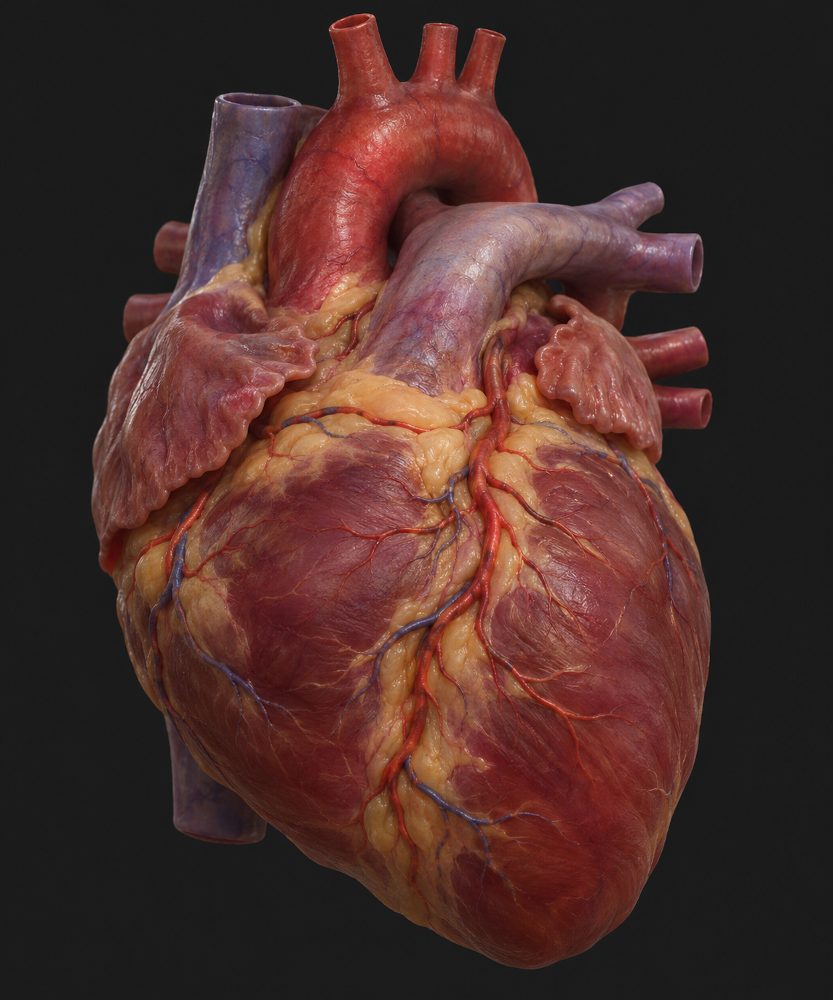

# OHS-HEART-APPEARANCE-001 — Visual experiment

Date: 2026-11-03. Requested by the owner as a heart-only appearance experiment.

صورة تجريبية لمظهر القلب: أنسجة حمراء بنية، دهون سطحية، أوعية تاجية ولمعان رطب معتدل. الغرض هو مراجعة اتجاه المظهر البصري قبل بناء الأصل ثلاثي الأبعاد.

This is an AI-generated **2D appearance concept**, produced with the session image-generation tool from a text description. No reference image or third-party mesh was supplied. It does not contain a 3D mesh, materials, rig, animation or Android implementation. No open-source asset license or clinical validation is asserted for this generated image.

The requested appearance emphasizes an asymmetric whole-heart silhouette, differentiated myocardium/fat/vessels, visible coronary detail, moist surface response and neutral lighting. Its anatomy and vessel routing have not been accepted by a specialist; use verified anatomical sources when authoring geometry. The image is a visual discussion reference, not anatomical ground truth or proof of achievable phone rendering.

Source image: `exec-4c11b47b-ddb9-47e9-8b5d-04ae969ecb99.png`, retained unchanged in the execution workspace. The repository copy is `heart-appearance.png`.

Related plan: [OHS-PROPOSAL-002, revision 2](../../proposals/OHS-PROPOSAL-002-ANDROID-REALISM.md).
