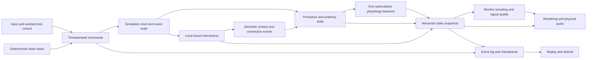

# Technical architecture and feasibility decisions

> **Historical desktop baseline:** the owner's current platform is Android. For animation, assets, rendering and tool interaction, use [OHS-PROPOSAL-002](../proposals/OHS-PROPOSAL-002-ANDROID-REALISM.md). The content below preserves the earlier plan; unrelated clinical/production assumptions are not newly validated by the Android review.

Revision: 2026-11-03. All components below are planned. Evidence: [engine research](research/04-engine-tech.md), [physiology research](research/02-physiology-perfusion.md). No performance figure here is a measured result.

## Stack decision

Start the feasibility phase with **Unreal Engine 5.8**, pinning a patch and toolchain after a packaged-build check. Use C++ for the authoritative simulation boundary and engine integration; use Blueprints for presentation and task authoring where appropriate. Blender is the offline art tool. Evaluate Pulse 4.4.0 as the first physiology candidate. Evaluate bounded local tissue deformation with XPBD-style constraints; retain simpler authored deformation if it meets the explicitly narrower task contract. SOFA is initially an offline comparison tool, not mandatory runtime middleware or ground truth.

**Unity 6.3 LTS** is the fallback if its equivalent interaction fixture offers better correctness, maintainability, or iteration speed. **Godot** remains the alternative if engine freedom and licensing outweigh ecosystem advantages. Choose once feasibility evidence exists, before producing the whole OR. A C ABI can preserve core logic but cannot make engine migration free.

Version and license evidence is in the research report. Do not adopt abandoned iMSTK as an implicitly maintained dependency, a GPL Unreal bridge, or a CC BY-SA anatomy asset in the proposed Unreal runtime. The item-level license gate comes before engine import.

## Component boundaries

| Component | Owns | Must not do |
|---|---|---|
| Case/Task runtime | Prerequisites, resources, actor ownership, transitions | Treat dialogue playback as completed surgery |
| Anatomy/Topology store | Persistent structures, regions, cuts, connections and damage | Lose IDs on a mesh swap or LOD change |
| Tissue worker | Supported local contact, displacement, attachment and stitch states | Alter patient volume by visual particle count |
| Physiology adapter | Backend actions, units, state, supported/unsupported capabilities | Merge two patients or fabricate monitor values |
| Observation model | Samples, delays, filtering, dropouts, device artifacts | Confuse poor signal with a true physiological change |
| Presentation | Mesh transforms/materials, audio, UI and camera | Write authoritative clinical state |
| Replay store | Versioned inputs, snapshots, seeds and assumptions | Claim cross-hardware bitwise determinism without evidence |

## Interaction implementation order

1. **Tool control and contact:** instrument jaws/tips, collision layers, task plane/depth/orientation, explicit active hand and assistant holding.
2. **Grasp/retract:** one bounded vessel/tissue patch, anchors and release, measurable contact/damage abstractions.
3. **Authored incision:** planned corridors and topology transitions with visible wall/lumen, stable labels, collision and material continuity.
4. **Needle/stitch:** curved path, entry/exit anchors, thread constraints, edge apposition, obstruction/leak abstraction.
5. **Assisted knot:** explicit completion action and tension state; self-contact physical knot research deferred.
6. **Broader instruments:** functional clamps, cannula connection, suction and exposure tools; only then expand manual operative stages.

Each step needs a repeatable defect case as well as a success case. Raycast contact can assist selection, but raycasts alone are not a model of tissue deformation. Hard contact, continuous collision checks and bounded step sizes need stress tests for fast tool motion and thin vessels.

## Clocks, units, threading, and persistence

One authoritative clock orders input, team actions and state changes. Geometry uses meters, seconds and kilograms at the core boundary; the Unreal adapter converts scene units. Physiology uses explicitly typed mL, mL/s, mmHg and concentrations where suitable, with declared conversion functions. Never pass an unlabelled scalar between modules.

Use fixed-step simulation and bounded catch-up. Determine physiology step size by convergence and backend constraints, not rendering rate. An initial local-tissue candidate is 120 Hz, subject to evidence; slower carefully modeled interaction may be preferable to unstable nominal high rates. Render interpolated snapshots. Avoid blocking GPU readback in control loops. If overload would drop causal steps, pause/report the simulation fault rather than silently slowing the patient while the clock advances.

Save scenario/content/model versions, tool and attachment states, task queues, measurements awaiting results, accumulated exposure, random state and backend state. Reject incompatible saves with a clear explanation unless a tested migration exists. Practice rewind creates a new attempt; original observations remain inspectable.

## Proposed performance gates

Hardware is **unselected**. First benchmark report must name CPU, GPU, RAM, VRAM, OS, driver, resolution, quality, build and scene hash. Suggested first target is 1080p/60 fps on an agreed desktop; no minimum PC specification is promised before measurement.

| Metric | Initial engineering target |
|---|---|
| Desktop frame time | p95 at or below 16.67 ms; report p99 and worst stalls |
| GPU presentation | p95 below 12 ms in representative operative view |
| CPU main thread | p95 below 6 ms; separate from overlapping worker/GPU time |
| Tissue worker | Candidate budget below 4 ms per 120 Hz update; verify convergence |
| Soak | 30-minute representative interaction without growing memory, lost events or solver failure |
| Future PC VR | Separate 90 Hz / 11.11 ms stereo budget and device-specific latency tests |

These are proposed budgets, not promises or additive frame components. Disable secondary visual effects before reducing correctness. Haptics require a separate device-specific high-rate loop with bounded output, watchdog and tracking-loss behavior; ordinary controller vibration must not be described as tissue force.

## Feasibility exit record

Publish the exact build, cleared asset manifest, interaction videos, numeric traces, test fixtures, failure cases, performance profile and reviewer notes. Select the engine/backend with a short decision record explaining rejected alternatives. If a gate fails, either repair it within its time box, choose the fallback, or reduce the fidelity claim; do not proceed on screenshots alone.
