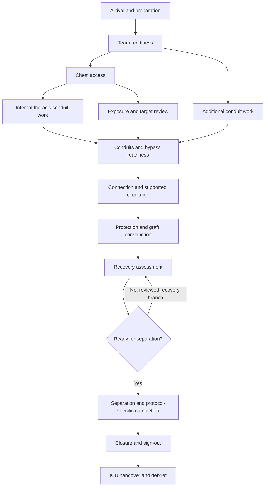

# Research 01 — Surgical workflow and medical content requirements

**Re-researched:** 2026-11-03. **Status:** planning evidence, awaiting clinical review. This replaces the earlier draft; Git history preserves it. No clinical protocol, operating instructions, or validated training curriculum is supplied here.

## Recommendation and evidence boundary

Use **adult elective on-pump coronary artery bypass grafting (CABG) through median sternotomy** as the first complete procedure. This is a design recommendation: it exercises anatomy, exposure, instrument handling, conduits, extracorporeal circulation, myocardial protection, anastomosis, recovery and teamwork within one coherent case. Do not start by attempting every open-heart operation.

Separate the **first playable slice** from the **eventual complete case**. The slice should cover one reviewed distal coronary anastomosis on an exposed, arrested heart with a functioning simulated bypass circuit. The complete case should eventually span arrival through ICU handover. A fixed three-graft case is a content option, not a definition of CABG or proof of realism.

The illustrative case may use LIMA–LAD and a reviewed additional conduit/target combination. The AHA's official summary of the **2021 ACC/AHA/SCAI Guideline for Coronary Artery Revascularization** prefers the radial artery over saphenous vein for the second most important significantly stenosed target after LAD. Consequently, “SVG is simpler to model” must not become “SVG is always the best clinical choice.” Document why each fictional patient's graft plan was selected. [AHA guideline summary][S1]

Surgical aortic valve replacement is a later candidate; mitral repair and off-pump CABG require separate exposure, geometry and interaction investigations. Do not claim a percentage of reusable work until the shared systems exist.

**Evidence labels used below:** “source finding” means a source was opened and read; “proposed” denotes software design; “review required” means clinical approval or measurement remains outstanding. A source's institutional prestige does not settle disagreements between pages.

## What the fresh research changes

The old draft combined specialist teaching notes, search snippets, approximate timings and precise drug parameters in one apparent procedure. This revision corrects five planning problems:

1. **No universal recipe.** The AATS primer explicitly acknowledges variation in cannulation sequence and technique. Its harvest chapter also describes alternative approaches to pericardial exposure. Encode dependencies and accepted variants, not one mandatory click order. [AATS CPB fundamentals][S2]; [AATS conduit harvest][S3]
2. **No guessed timing benchmarks.** Previous phase durations were largely marked uncertain but placed in a convincing timeline. They are not retained as “normal” scoring thresholds. Obtain reviewed recordings or a documented timing dataset before calibration.
3. **No mortality lottery.** National complication percentages do not identify the consequences of a particular player's actions. The previous proposal to use aggregate event rates as baseline random failures is withdrawn. Use explicit scenario causes and uncertainty; do not imply a validated patient-outcome predictor.
4. **No unreviewed dose table.** Current AATS CPB Fundamentals lists 400 U/kg initial heparin while CPB Troubleshooting lists 100 units/kg; both were opened during this review. These are conflicting teaching-page statements, not two interchangeable game presets. Do not choose between them by averaging or majority vote. [Fundamentals][S2]; [Troubleshooting][S4]
5. **No universal reversal/removal sequence.** The TSRA operative dictation separates venous removal, reversal and arterial removal. The game needs separately represented events and a reviewed protocol variant, rather than a single “decannulate” button. [TSRA operative dictation][S5]

The 2023 AmSECT standards specify institution-specific anticoagulation algorithms that account for ACT device performance; they also support protocol-driven closed-loop communication. These support configurable, reviewed scenarios rather than hard-coded universal thresholds. [AmSECT standards, sections 3 and 8][S6]

## Proposed complete-case task graph

The following is an **authoring model**, not a clinical checklist. Its “completion evidence” is data the simulator needs to represent; tolerances and accepted techniques require clinician review. Abbreviations: S surgeon; A assistant/harvester; AN cardiac anesthesia; P perfusionist; SN scrub nurse/technologist; CN circulating nurse. Staffing and roles vary locally.

| Phase / clinical anchor | Proposed lead and representative equipment | Proposed observable completion evidence |
|---|---|---|
| 01 Arrival, identity, consent and sign-in [S7] | CN + AN; case record, monitors | Fictional patient, planned procedure and risks agree; unresolved concern remains visible |
| 02 Anesthesia, monitoring and positioning [S8] | AN + CN; anesthesia workstation, airway equipment, arterial/central monitoring, TEE | Baseline observations saved; device connections and patient positioning represented |
| 03 Preparation and pre-incision team briefing [S7], [S8] | Whole team; drapes, preparation supplies, images | Shared case plan, equipment availability and sterility checks recorded |
| 04 Chest access and exposure [S8] | S + A; scalpel, electrosurgery, sternal saw/retractor | Anatomical layers change consistently; damage and exposure states persist |
| 05a Internal thoracic conduit preparation [S3] | S + A; IMA retractor, atraumatic forceps, clips, scissors | Conduit identity, continuity, usable length and damage state recorded |
| 05b Additional conduit preparation, potentially parallel [S3] | A + SN; harvest instruments; endoscopic equipment if that variant is authored | Conduit inventory updates without teleporting anatomy; donor-site state retained |
| 06 Pericardial exposure and target confirmation [S5] | S + A; stays/retraction, imaging reference | Visible anatomy agrees with the case's coronary map and planned grafts |
| 07 Bypass readiness and anticoagulation confirmation [S6] | AN + P + S; ACT device, circuit checks | Sample time, device, reported result, protocol version and acknowledgements stored |
| 08 Cannulation and circuit connection [S2] | S + A + P; cannulas, purse-string materials, tubing clamps, vent | Connection graph, positioning, security and air state become inspectable simulation variables |
| 09 Transition to CPB and myocardial protection [S2] | S + P + AN; pump, oxygenator, cross-clamp, cardioplegia circuit | Systemic support, coronary isolation, myocardial protection and rhythm remain distinct states |
| 10 Graft construction and assessment [S9] | S + A + SN; fine needle holder, atraumatic forceps, fine scissors, sutures | Each graft has proximal/distal connectivity, orientation, patency, tension and leak state |
| 11 Reperfusion and recovery preparation [S5] | S + P + AN; vent, TEE, pacing/defibrillation equipment as appropriate | Air-management review, clamp status, rhythm, temperature and support state recorded separately |
| 12 Assessment and separation from bypass [S2] | S + AN + P; monitoring, TEE, ventilator | Support transition can succeed, pause or return to prior support; no automatic success from animation |
| 13 Reversal, individual cannula removal and hemostasis [S5], [S6] | S + AN + P + A; removal/closure materials, laboratory checks | Protocol-specific dependencies, suction route, bleeding and retained connections tracked |
| 14 Drains, pacing provisions and layered closure [S5] | S + A + SN; drains, closure instruments, sternal fixation materials | Device inventory reconciles; closure geometry and retained-item record remain consistent |
| 15 Counts, sign-out and transfer preparation [S7] | CN + SN + AN + S; transport monitors and handover record | Counts and recovery concerns reconciled; unresolved events cannot silently disappear |
| 16 ICU reception and handover [S10] | AN + surgery representative + receiving ICU team | Monitoring transfer and accepted responsibility recorded; scenario facts populate handover |

**Source findings behind the graph:** WHO locates checks before anesthesia, before incision and before leaving the operating room; its checklist includes counts and recovery concerns. AATS describes CABG setup and conduit/anastomosis work. TSRA's operative dictation supplies the overall operative backbone. AmSECT adds perfusion communication and recording requirements. These are complementary references, not a single globally mandated sequence. [S2], [S3], [S5], [S6], [S7], [S8], [S9]

This diagram is deliberately coarse. For example, do not enforce the pictured relative order of conduit preparation and pericardial work across every case. Each authored variant must list its actual dependencies. If recovery requires returning to CPB, the graph must re-establish the relevant prerequisites rather than jump blindly to an earlier animation.

## Proposed task and anatomy data contract

Every task needs an identifier, responsible actor, required equipment, prerequisites, allowable concurrent tasks, resource locks, observable result, failure/recovery branches, source links and clinical review status. Store three distinct event types: **requested**, **acknowledged**, **completed**. A voiced acknowledgment cannot substitute for a completed physical state change.

Each instrument needs a physical tip/jaw model, permitted grasp region, functional state and tissue-contact events. Representative catalogue entries include scalpel, sternal saw, sternal/IMA retractors, electrosurgery handpiece, DeBakey-type forceps, fine needle holder, fine scissors, clip applicator, vascular clamps, suction, cannulas and suture/needle assemblies. Model function first; branded appearance requires separate asset clearance. Instrument sizes and mesh dimensions are still **review required**.

Minimum anatomy for authoring includes layered anterior chest access; sternum and ribs; pleura and lungs where relevant to exposure; pericardium; chambers and great vessels; coronary targets; conduit origins and donor regions. Coronary labels must attach to geometry and connectivity, not float over an attractive generic heart. Include a reviewable coordinate convention, physical units, named landmarks, vessel routes and collision surfaces. These are proposed content requirements, not a claim that an available mesh satisfies them.

The anastomosis model should retain needle passages, tissue contacts, edge apposition, lumen obstruction, local tension and leaks. Fine needle-holder/forceps use and assessment of a completed connection are present in the AATS teaching chapter; free grafts also require an inflow connection. [AATS anastomoses][S9] The proposed first implementation may use constrained interaction and authored topology, but must disclose that fidelity level instead of describing it as arbitrary microsurgery.

## Team communication and time

**Proposed dialogue examples, not verbatim clinical scripts:** “Confirm bypass readiness”; “Readiness confirmed”; “Bypass established”; “Cross-clamp state confirmed”; “Protection delivery recorded”; “Request separation assessment”; “Separation complete”; “Recovery concerns acknowledged.” The responding actor must report measured simulated state and refuse impossible actions. Local clinicians should rewrite the vocabulary and ownership before recording audio. Log who spoke, who acknowledged and what state changed. Closed-loop communication is supported by AmSECT; exact wording here is original design. [S6]

Use separate clocks for simulation time, bypass support exposure, cross-clamp exposure and player session time. If waiting is accelerated, the same acceleration must apply to physiology, temperature, protection intervals and team tasks. Pause for instruction should freeze the case consistently. Time compression factors and session lengths are design settings, not published clinical norms. Do not score fast work as good work when it damages tissue or bypasses necessary observations.

## Complications as causal scenarios

AATS CPB Troubleshooting describes cannulation-related dissection, drainage and circuit problems, and difficulty restoring unsupported circulation. Use it to define review topics, not to copy its drug instructions. [S4] Proposed scenario coverage:

| Scenario family | What must be observable | Boundary for v1 |
|---|---|---|
| Tissue/conduit injury | Local geometry or material damage, bleeding source, changed usability | Limited authored injury sites with persistent consequences |
| Connection/drainage problem | Connection topology, pressure/flow mismatch, reservoir and heart state | Small reviewed fault library; no arbitrary invisible penalty |
| Inadequate protection | Protection history, rhythm/motion and myocardial state | Explicit reduced model; no claimed cellular injury prediction |
| Defective graft | Wrong target, twist, excessive tension, leak or obstruction | Measurable local defects; flow estimate labelled by model fidelity |
| Recovery difficulty | Rhythm, support dependence, ventilation and pump-function observations | Reviewed recovery branch or scenario stop, with explanation |
| Bleeding or reversal-related problem | Source, time history, anticoagulation context and team response | Distinguish local surgical bleeding from systemic abstraction |
| Count/handover failure | Missing object or missing information trace | Correctable discrepancy, not a random delayed catastrophe |

Postoperative stroke, kidney injury, infection and long-term graft failure exceed an intraoperative slice. They may appear in authored follow-up teaching scenarios later, but must not be generated as supposedly accurate personal predictions from a few game variables.

## Validation gate and remaining questions

Before implementing clinical rules, obtain review from a cardiac surgeon, cardiac anesthesiologist, perfusionist and experienced cardiac scrub/circulating professional. Proposed deliverables: annotated task graph; reviewed fictional patient and graft map; equipment list; accepted sequence variants; contraindicated state transitions; observed failure cues; and signed, versioned parameter sources. No review is claimed to have happened.

Content review should check anatomy, physical access, instrument suitability, team responsibilities, emergency recovery and what the simulator omits. Later testing should compare recorded expert and novice interactions without claiming that resemblance, face validity or favorable feedback establishes transfer to real surgery.

Unresolved choices: exact graft configuration; institution/protocol represented; adult anatomy variant; myocardial-protection strategy; scope of playable conduit harvest; closure detail; timing evidence; and availability of specialist reviewers. Resolve these through a reviewed case specification rather than expanding the simulator to every technique.

The **2024 EACTS/EACTAIC/EBCP CPB guideline** was published in February 2025; the EACTS landing page and DOI were verified. Its full text was blocked in this research browser, so this report does not claim a fresh full-text numeric review. [EACTS publication page][S11]

## Search and source audit

Searches run on 2026-11-03 included AATS CABG/CPB/anastomosis chapters, WHO surgical checklist, adult AmSECT 2023 standards, the 2021 revascularization guideline and cardiac OR-to-ICU handover studies. The sources below were opened; the 2024 guideline's landing page was accessible but its linked full text was not. No search snippet alone sets a gameplay threshold. Sources are references only; no illustration, checklist artwork, footage or instrument model has been licensed or imported.

| ID | Opened source / verified scope |
|---|---|
| S1 | AHA official 2021 guideline summary; conduit preference and patient-centered planning |
| S2 | AATS TSRA, *Cardiopulmonary Bypass Fundamentals*; workflow and explicitly variable technique |
| S3 | AATS TSRA, *Mammary Takedown, Saphenous Vein Harvest, and Targets*; conduit choices/exposure variants |
| S4 | AATS TSRA, *CPB Troubleshooting*; complication topics and documented dosing conflict |
| S5 | TSRA, *Coronary Artery Bypass Grafting with Cardiopulmonary Bypass—Operative Dictations*; representative operative backbone |
| S6 | AmSECT, *Standards and Guidelines for Perfusion Practice*, February 2023; adult practice framework |
| S7 | WHO, *Surgical Safety Checklist*, revised January 2009; three checks and sign-out content |
| S8 | AATS TSRA, *Setting up*; preparation, monitoring and access |
| S9 | AATS TSRA, *Coronary Artery Anastomoses*; task and instrument references |
| S10 | Gleicher et al., *Improving cardiac operating room to intensive care unit handover using a standardised handover process*, 2017; DOI 10.1136/bmjoq-2017-000076, PMID 29450275. Small quality-improvement study, not game validation |
| S11 | EACTS publication page; title, February 2025 publication and DOI 10.1093/ejcts/ezae354 |

[S1]: https://professional.heart.org/en/science-news/2021-acc-aha-scai-guideline-for-coronary-artery-revascularization/top-things-to-know
[S2]: https://www.aats.org/tsra-primer-cardiopulmonary-bypass-fundamentals
[S3]: https://www.aats.org/tsra-primer-mammary-takedown-saphenous-vein-harvest-and-targets
[S4]: https://www.aats.org/tsra-primer-cpb-troubleshooting
[S5]: https://tsraweb.com/topic/29-coronary-artery-bypass-grafting-with-cardiopulmonary-bypass-operative-dictations/
[S6]: https://amsect.org/Portals/0/2023%20AmSECT%20Standards%20and%20Guidelines%20for%20Perfusion%20Practice.pdf
[S7]: https://www.who.int/docs/default-source/patient-safety/9789241598590-eng-checklist.pdf
[S8]: https://www.aats.org/tsra-primer-setting-up
[S9]: https://www.aats.org/tsra-primer-coronary-artery-anastomoses
[S10]: https://pmc.ncbi.nlm.nih.gov/articles/PMC5699157/
[S11]: https://www.eacts.org/clinical-practice-guideline/2024-eacts-eactaic-ebcp-guidelines-on-cardiopulmonary-bypass-in-adult-cardiac-surgery/
