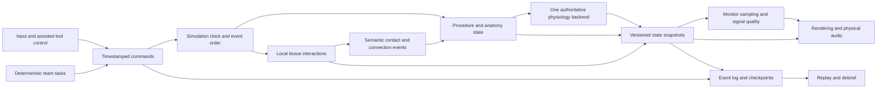
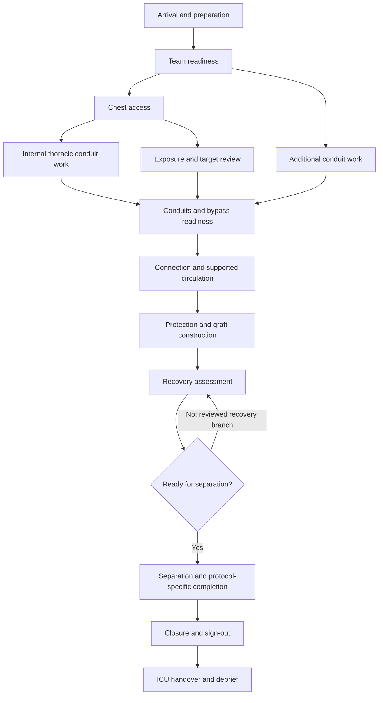

# OHS-PROPOSAL-001 — Codex Research & Design Proposal

**مقترح كودكس الموحّد لمحاكاة جراحة القلب المفتوح**

| Field | Value |
|---|---|
| Proposal ID | OHS-PROPOSAL-001 |
| Consolidator | Codex, using the existing multi-agent research and integrated design |
| Revision | 1 |
| Date | 2026-11-03 |
| Status | Open proposal for comparison and improvement |
| Scope | Planning only; no implementation authorization |
| Source commit | 8b77ee2d5814cbdc3847d825d3201f9b3605efaf |
| Evidence status | Web research and internal document review; no clinical sign-off or runtime validation |

هذا الملف يجمع الخطة الحالية ومصادرها في مقترح واحد. أي وكيل آخر يستطيع قراءته ونقده واقتراح بديل أفضل. اختيار المحرك، طريقة المحاكاة، الأصول، نطاق اللعبة والمدة كلها توصيات قابلة للتغيير وفق الأدلة؛ وليست قرارات نهائية ملزمة.

This is a consolidated snapshot of the existing research and design. It does not add new research, select a winning proposal, or start game development. The phrase “planning complete” in the source material means that its documentation pass finished; it does not mean its recommendations are final or medically validated.

## Review prompt for any agent

Read this proposal as one candidate. The owner's goal is a highly accurate, realistic open-heart surgery simulation game for personal/noncommercial use. The current task remains planning only.

1. State what this proposal gets right and which claims you could verify. Distinguish source evidence, design judgment, estimates, and untested assumptions.
2. Identify the most consequential weaknesses or contradictions in anatomy, procedure, physiology/CPB, tissue and sutures, input, team behavior, licensing, performance, assessment, and production scope.
3. Recheck important clinical, software and licensing claims against current primary sources. Include exact URLs, access dates and source versions; report blocked or unavailable evidence. Do not infer clinical validity from plausible graphics, published equations, or a library name.
4. Compare credible alternatives, including a different engine/backend, narrower first task, original assets, and different interaction methods. Do not assume Unreal, Pulse, the proposed schedule, or this author's decisions are best.
5. For each proposed change, show the current choice, your replacement, supporting evidence, expected benefit, tradeoffs, uncertainty, and the experiment needed to decide. Better means better supported within the owner's constraints, not merely newer, longer, or more ambitious.
6. Keep medical targets protocol-specific and unapproved parameters out of executable instructions. Keep asset permissions item-specific. Personal use does not clear public redistribution rights.
7. Produce a clearly named competing or revised proposal and a short comparison table. If repository writing is requested, a suitable next filename is `docs/proposals/OHS-PROPOSAL-002-<agent-name>.md`; use the next available ID and reference this proposal's ID, revision and source commit.

Suggested comparison columns: decision, current proposal, alternative, evidence, fidelity gain/loss, technical feasibility, license/redistribution implications, cost/time assumptions, validation experiment, and recommendation. Use “retain”, “replace”, or “unresolved”; do not invent numerical scores to imply precision.

Preserve this snapshot for comparison unless the owner asks to revise it. Put proposed changes in the reviewer’s separately named proposal or review, identifying this proposal's section, issue, evidence and recommendation. The modular files under `docs/plan/` remain the editable source material; they should change only when a proposed revision is actually taken into that working plan. This prevents two competing documents from silently becoming different “current plans.” A review invitation does not authorize game implementation, paid purchases, contacting clinicians, or publication outside the requested repository workflow. Unresolved owner inputs remain listed in the plan; make reversible planning assumptions explicit.

## Contents

1. [Master plan](#section-01)
2. [Scope and fidelity](#section-02)
3. [Clinical simulation model](#section-03)
4. [Technical architecture](#section-04)
5. [Assets and presentation](#section-05)
6. [Gameplay and assessment](#section-06)
7. [Roadmap and validation](#section-07)
8. [Research: surgical workflow](#section-08)
9. [Research: physiology and perfusion](#section-09)
10. [Research: assets and licenses](#section-10)
11. [Research: engine technology](#section-11)
12. [Research: visual and audio realism](#section-12)
13. [Research: gameplay and assessment](#section-13)
14. [Research: production and validation](#section-14)
15. [Internal gap review](#section-15)
16. [Asset-candidate register](#section-16)

## Snapshot provenance

All consolidated source files below are read from the exact source commit above. Relative links are rebased for this document, reference-style citations are expanded to direct links, and heading levels are nested for navigation. Source conclusions and limitations are retained. The original files are still available for focused reading; this snapshot is not automatically updated when they change.

## 01 — Master plan

Source: [PLAN.md](../../PLAN.md) at `8b77ee2`.

### Open Heart Surgery Simulation — Master Plan

**Updated: 2026-11-03 · Planning complete · Research, integrated design and internal document review finished.**

Build a serious, highly realistic open-heart surgery simulation game for personal/noncommercial use. Realism means coherent anatomy, instruments, tissue interaction, physiology, teamwork, visuals and sound. This plan does not certify medical accuracy or clinical training effectiveness. No game code was changed in this task; the existing small Python heartbeat example is not the planned simulator.

#### Recommended starting point

Develop a **desktop PC game centered on one adult elective on-pump CABG case**, played primarily as the surgeon with simulated anesthesia, perfusion, assistant and nursing roles. Start with **one coronary anastomosis on an exposed, arrested heart with functioning simulated bypass support**, one modeled defect/recovery path and a replay/debrief. Expand to the complete arrival-to-ICU workflow only after that interaction works convincingly.

Use **Unreal Engine 5.8 as the feasibility candidate**, **Blender** for asset preparation, and **Pulse 4.4.0 as the first physiology candidate** behind a replaceable interface. These choices are conditional on build, licensing, interaction, CPB and performance experiments. Unity 6.3 LTS is the practical fallback; Godot remains an alternative. A custom reduced physiology backend is an explicit scope/funding decision if Pulse cannot support the case. See the sourced [engine](../plan/research/04-engine-tech.md) and [physiology](../plan/research/02-physiology-perfusion.md) reports.

Initially use bounded tissue regions, authored cut paths, constrained needle handling and explicitly assisted knots. Record each task's fidelity. Unrestricted surgery, calibrated knot mechanics, VR and force feedback need separate feasibility work before becoming release commitments.

#### Read the detailed plan

| Document | What it specifies |
|---|---|
| [01 — Scope and fidelity](../plan/01-scope-and-fidelity.md) | Intended experience, assumptions, platform, first slice, full-case boundaries and stopping rules |
| [02 — Clinical simulation model](../plan/02-clinical-simulation-model.md) | Task graph, anatomy/instrument contracts, physiology coupling, units, observations and verification cases |
| [03 — Technical architecture](../plan/03-technical-architecture.md) | Engine/backend decisions, module boundaries, tools/tissue/stitches, clock, replay and performance gates |
| [04 — Assets and presentation](../plan/04-assets-and-presentation.md) | Anatomy/OR/tool priorities, Blender pipeline, provenance, tissue materials, motion and audio |
| [05 — Gameplay and assessment](../plan/05-gameplay-and-assessment.md) | Modes, desktop controls, team tasks, consequences, debrief, accessibility and assessment limits |
| [06 — Roadmap and validation](../plan/06-roadmap-and-validation.md) | Milestones, dependencies, responsible roles, acceptance matrix, cost model and risks |
| [Asset candidates](../plan/ASSET_LICENSES.csv) | Item URLs, creators, license evidence, redistribution conditions and blocked candidates |
| [Final gap review](../plan/research/00-gap-review.md) | Source spot checks, resolved contradictions, remaining gates and review limits |
| [Progress and upload record](../plan/PROGRESS.md) | Completed stages, repository checkpoints, upload outcomes and remaining work |

#### Fresh research

All seven domains were researched again on 2026-11-03 using primary sources where available. Each report separates evidence, proposals and remaining uncertainty; earlier drafts remain in Git history.

1. [Surgical procedure and team workflow](../plan/research/01-surgical-procedure.md)
2. [Physiology, anesthesia and perfusion](../plan/research/02-physiology-perfusion.md)
3. [Assets and licensing](../plan/research/03-assets-licensing.md)
4. [Engine and simulation technology](../plan/research/04-engine-tech.md)
5. [Visual and audio realism](../plan/research/05-visual-audio-realism.md)
6. [Gameplay, controls and assessment](../plan/research/06-game-design-assessment.md)
7. [Production and validation](../plan/research/07-production-validation.md)

The [research prompts](../plan/research/PROMPTS.md) are retained with updated evidence rules. Reports are a targeted planning review, not a systematic literature review. Source availability, licensing checks, runtime tests and expert clinical review are different kinds of evidence.

#### Decisions and why they matter

| ID | Planning decision | Reason / reconsideration gate |
|---|---|---|
| D01 | One adult elective on-pump CABG case first | Broad enough to exercise the coupled systems; narrow enough to author and review |
| D02 | Anastomosis slice before full operation | Tests the hardest input/tissue/physiology connection early |
| D03 | Desktop first, offline core | Avoids assuming VR/haptic hardware; precision assistance is recorded honestly |
| D04 | Provisional Unreal + Blender | Native integration and presentation candidate; must pass licensing/build/interaction tests |
| D05 | Evaluate Pulse before funding custom CPB | Existing extracorporeal support is a starting point, not proof of surgical CPB fidelity |
| D06 | One state owner and one simulation clock | Prevents disconnected monitors, double-counted volume and inconsistent time compression |
| D07 | Cleared permissive/original anatomy baseline | Public repository distribution and engine compatibility must both be satisfied |
| D08 | Deterministic authored staff logic | Readiness, requests and completion stay tied to real simulated state |
| D09 | Descriptive multi-dimensional debrief | Avoids equating speed or a single score with surgical competence |
| D10 | Clinical and runtime validation are future gates | This research task cannot establish either by assertion |

#### Material changes from the old drafts

- The current direct BodyParts3D archive license differs from the old page; acquisition provenance must identify which terms apply. ShareAlike anatomy is not assumed compatible with Unreal. See exact evidence in [asset research](../plan/research/03-assets-licensing.md).
- Pulse ECMO capability is not treated as a ready CABG/CPB implementation. Pump-supported arrest, reservoir behavior, protection and recovery need explicit experiments.
- Conflicting clinical teaching details are recorded; universal dosing tables and guessed surgical-time scoring thresholds are not adopted as executable rules.
- National complication percentages are not used as random player-failure odds. Every modeled event needs a defined causal scenario.
- OSATS, cognitive-training studies and haptic studies support different claims. None validates this game's automated score or transfer to surgery.
- The existing Python example is acknowledged as pre-existing demonstration code, correcting the old skeleton's statement that no code existed.

#### Delivery path

**Case and cleared anatomy → tool/tissue and CPB feasibility → coupled anastomosis slice → clinical/usability review → complete-case alpha → reviewed desktop release.** Additional procedures, PC VR and haptics follow separate gates.

The initial estimate is **47–84 full-time working weeks before contingency**, or roughly **14–27 months including 25–40% contingency**, under the staffing/reviewer assumptions in the roadmap. A 3-month feasibility result, 6-month slice and 12-month alpha are scope guides, not guarantees. A solo part-time effort or substantial custom simulation research can take longer. Re-estimate after the first feasibility experiments.

The next implementation step, when requested, is to select one fictional case and target region, verify one anatomy sample's rights/geometry, package the engine fixture, and run tool/stitch and CPB experiments. No implementation or purchase is part of this planning task.

#### Open inputs and limits

Target PC/GPU, available weekly hours, team skills, budget, reviewer access, preferred input devices and eventual distribution scope remain unknown. The plan uses reversible defaults and does not require an answer to finish planning. Before implementation commitments, these determine hardware targets, schedule and which tasks can be manual.

No downloaded meshes, licensed media package, clinical sign-off, performance benchmark, validated physiology extension or educational transfer study exists from this task. Those are measurable future deliverables. User instruction remains: **plan only, and upload each completed planning stage to the repository**.

## 02 — Scope and fidelity

Source: [docs/plan/01-scope-and-fidelity.md](../plan/01-scope-and-fidelity.md) at `8b77ee2`.

### Scope, intended experience, and fidelity contract

Planning revision: 2026-11-03. These are proposed product decisions. Research evidence is in [surgical workflow](../plan/research/01-surgical-procedure.md), [game design](../plan/research/06-game-design-assessment.md), and [production](../plan/research/07-production-validation.md).

#### Product definition

Create a serious, visually convincing single-player open-heart surgery game for an adult audience interested in anatomy and procedural reasoning. The player acts primarily as the surgeon with a simulated assistant, scrub/circulating staff, cardiac anesthesiologist, and perfusionist. Outcomes should follow modeled actions, anatomy, support conditions, and case parameters. The game is not a patient-specific predictor or a credentialing tool.

The first complete case is an **adult elective on-pump CABG through median sternotomy**. A fictional reviewed graft map should include LIMA–LAD and one additional conduit/target only if that case rationale is clinically defensible. Graft count and conduit choice are case data, not universal surgical rules. The first playable vertical slice is much smaller: **one distal anastomosis on an exposed, arrested heart with simulated bypass support, an observable defect/recovery path, and a debrief**.

No game is implemented by this planning task. Existing Python example code remains unchanged.

#### Defaults and unresolved owner inputs

| Decision | Planning default | When to revisit |
|---|---|---|
| Platform | Windows desktop first; keyboard and mouse | Before engine/hardware benchmark |
| Intended use | Personal, noncommercial educational game | Before public distribution or changing claims |
| Connectivity | Offline core; local saves and debrief | Only if collaboration is later requested |
| Engine candidate | Unreal, contingent on performance and license gates | End of feasibility phase |
| Artwork | Blender; item-cleared permissive anatomy plus original surgical detail | Before importing each source asset |
| Team | Small team or experienced solo developer with specialist review access | Before committing dates/budget |
| Languages | Externalized UI text; English clinical terminology first | Before recording dialogue; add Arabic if desired |
| PC VR / haptics | Optional later tracks, never required to play desktop | After desktop slice is usable and measured |

Hardware, budget, weekly availability, and clinical contacts were not supplied. The plan does not assume the user owns a powerful GPU, VR headset, haptic device, or paid software.

#### What “as close as possible to real” means here

Each fidelity dimension has a separate review. A visual pass cannot excuse a failed physiological or workflow review.

| Dimension | Required observable behavior | Evidence needed before claiming fidelity |
|---|---|---|
| Anatomy | Correct orientation, layers, vessel continuity, surgical landmarks and scale | Annotated source provenance and specialist geometry review |
| Workflow | Valid dependencies, parallel tasks, team ownership and recovery paths | Versioned case protocol and multidisciplinary review |
| Interaction | Tool tips contact tissue; damage and constraints persist; authored assistance is visible | Contact/stitch scenarios and usability observations |
| Physiology | Support, bleeding, rhythm, ventilation and protection cause coherent state changes | Conservation checks, sensitivity traces, clinical review of selected cases |
| Appearance/audio | Tissue motion, field visibility, equipment, monitor signals and sounds agree | Recorded scenario review, material/landmark checks |
| Human factors | Readable field, useful cameras, stable input, interpretable feedback | User sessions across gaming/clinical experience levels |
| Assessment | Feedback cites actual events and separates assistance from performance | Reviewed rubric; later studies for educational claims |

Fidelity levels are recorded per task: **manual modeled**, **constrained modeled**, **team-operated modeled**, **authored presentation**, or **omitted**. Never label an assisted animation as free manual surgery. A learning mode can expose hidden states; case mode displays clinically plausible observations with their modeled delay and uncertainty.

#### Scope ladder

| Tier | Included | Exit condition |
|---|---|---|
| Feasibility | One reviewed vessel patch, needle/forceps interaction, local tissue response, circulation/CPB toy cases, license evidence | Hard risks are measured; chosen stack supports the slice |
| Vertical slice | One graft attachment task, bounded needle/stitch handling, supported circulation, controlled defect/leak, team cues, save/replay/debrief | Interaction and causal feedback meet [validation gates](../plan/06-roadmap-and-validation.md) |
| Full-case alpha | Arrival to handover, including exposure, conduit work, bypass/protection, grafting, recovery, closure and counts | Every phase has declared fidelity; no dead-end workflow or disappearing injuries |
| Desktop v1 | One polished reviewed case plus focused practice modules and a small failure library | Reproducible build, rights-cleared assets, performance, usability and content review |
| Later | Additional patient/coronary variation, valve surgery, richer harvest/closure, optional PC VR and force feedback | New scope has separate content, interaction, licensing and validation gates |

Initial full-case alpha may use team-operated or authored stages for conduit harvest, anesthesia induction, and portions of closure. Their physical consequences and team dependencies still exist. A debrief labels these stages. Expanding them to manual tasks is subsequent work, not an undisclosed shortcut.

Explicitly deferred: unrestricted cutting anywhere, arbitrary tissue tearing, clinically calibrated knot mechanics, complete coagulation/drug pharmacology, patient CT import, live medical devices, competitive speed leaderboards, multiplayer, standalone mobile/Quest, and autonomous language-model medical reasoning. These can only return through a scoped design change.

#### Success and stopping rules

The slice succeeds when a player can complete a bounded surgical task, observe why a deliberate error changes the connection or patient state, recover through an allowed path, and understand a truthful debrief. It fails if progression depends on arbitrary clicks, anatomy looks convincing but has wrong topology, assistance is hidden, or physiology is a disconnected HUD animation.

If fine needle control remains unusable after the defined interaction spike, ship a clearly constrained procedural experience and narrow the skill claims. If anatomical/clinical review is unavailable, retain an experimental status. If a required content license conflicts with the engine, replace the asset or change the stack before production. Scope reduction must be documented rather than hidden behind better graphics.

## 03 — Clinical simulation model

Source: [docs/plan/02-clinical-simulation-model.md](../plan/02-clinical-simulation-model.md) at `8b77ee2`.

### Clinical state, procedure graph, and physiology design

Revision: 2026-11-03. Proposed software model, not instructions for performing surgery. Sources and uncertainty are detailed in [research 01](../plan/research/01-surgical-procedure.md) and [research 02](../plan/research/02-physiology-perfusion.md). No numerical clinical protocol is approved by this plan.

#### Three models with one authoritative state

Keep the procedure task graph, physiological state, and physical anatomy distinct but coupled. Procedure completion follows verified state changes; it does not write an arbitrary healthy value into the patient. Likewise, an animated clamp must change the actual connection graph before physiology or monitors respond.

The task graph includes arrival/preparation, anesthesia/monitoring, team briefing, chest access, conduit preparation, exposure/target review, bypass readiness, circuit connection, supported circulation/protection, graft construction, recovery, separation, protocol-specific reversal/removal, closure, sign-out and ICU handover. The [research graph](../plan/research/01-surgical-procedure.md#proposed-complete-case-task-graph) records representative roles and equipment. Accepted sequences vary; the final case needs an explicit local/protocol variant.

#### Proposed authoring schemas

| Record | Required fields |
|---|---|
| Case | ID/version; fictional patient parameters; anatomy version; coronary/graft map; chosen protocol; objectives; initial state; enabled complications; reviewer status |
| Task | ID; owner; prerequisites; permitted concurrency; equipment/resources; request/acknowledgment/completion events; completion observations; failure/recovery branches; assistance level |
| Structure | Persistent ID; anatomical name; coordinate system/scale; surface and collision meshes; layer; connectivity/lumen graph; contact/damage parameters; provenance |
| Instrument | ID; geometry; tip/jaw function; degrees of freedom; grasp/contact rules; sterile status; failure state; target tissues |
| Connection | Endpoints; open/clamped/connected state; resistance/leak abstraction; secured state; simulated air flag; source task |
| Parameter | Name; value or distribution; units; source and location; population/context; model mapping; uncertainty; reviewer; approval/version |
| Observation | Channel; true state source; sampling clock; delay/filter; unit; signal quality; last valid sample; artifact mode |
| Event | Ordered ID; simulation time; actor; action; affected structure; inputs; before/after state; observation evidence; assistance; cause parent; scenario/build versions |

All schemas are design contracts only; there is no executable data file or drug-dose configuration in this task.

#### Coupled variables

The first circulation model should track compartment volumes/pressures, native heart contribution, circuit flow, reservoir balance, oxygen transport at an explicitly reduced level, temperature, rhythm/mechanical state, ventilation support, blood loss and replacement. Add myocardial-protection history and graft connectivity as scenario-specific subsystems. Anticoagulation/coagulation begin as reviewed coarse states with delayed observations, not claims of complete hemostatic physiology.

Evaluate Pulse first behind an adapter, using small analytical/reduced-model fixtures to check expected behavior. If Pulse cannot support the required CPB transitions, explicitly choose a funded custom reduced backend or narrow the scenario. Neither candidate is assumed to provide validated open-reservoir surgical CPB out of the box. The adapter must prove that ownership of blood volume, flows, oxygen transport, actions and time is unambiguous. Never run two independent authoritative circulation models and choose whichever vital sign looks better.

Illustrative engineering equations, to be reviewed for the selected model:

- Each compartment obeys `dV/dt = sum(inflow) - sum(outflow) + external sources - external sinks`.
- A resistance element may use `Q = (P_upstream - P_downstream) / R`; this is a lumped approximation, not universal vascular mechanics.
- For linear compliance, use `P = (V - V0) / C`; cardiac elastance requires time-varying chamber parameters and defined boundary conditions.
- Whole-system blood accounting includes patient, bypass reservoir/tubing, field loss, suction/cell-salvage abstractions, and administered volume. Display particles do not create or remove authoritative blood.

Record units at every interface. Validate conversions between liters/milliliters, seconds/minutes, pressure and temperature. Add physiologic complexity only when a case objective requires it and a calibration/validation method exists.

#### State-to-observation examples

| Trigger | Authoritative change | Visible/audible consequences | Test obligation |
|---|---|---|---|
| Needle misses/tears modeled vessel margin | Attachment geometry, damage, local leak coefficient | Visible defect and leak when the modeled pressure difference supports it | Defect persists after camera changes/save/load |
| Suction collects field fluid | Field-to-suction transfer according to selected route | Smaller pool; tubing/collection response | No double-counted blood; route affects returned/lost volume |
| Venous drainage becomes inadequate | Circuit inflow/reservoir and cardiac loading change | Flow/pressure/reservoir cues, team notification | Support cannot continue indefinitely from an empty reservoir |
| Cross-clamp state changes | Relevant vascular connections change | Flow distribution and protection-dependent mechanical state | Clamp alone must not imply both complete arrest and adequate protection |
| Electrical rhythm changes | Electrical state; mechanical response follows separate modeled rules | ECG, mechanical motion, arterial waveform can diverge | No universal beat-per-ECG animation |
| Pulse sensor has poor signal during support | Observation quality changes | Pleth/SpO2/tone use the selected sensor policy | Sensor artifact must not change actual oxygen transport |
| Assistance snaps a needle trajectory | Input trajectory constrained and logged | Visible assistance indicator; outcome still evaluated | Debrief and comparisons use the correct assistance category |

Some effects in this table require further clinical review; the purpose is to prevent disconnected systems, not assert the exact magnitude or timing of real responses.

#### Team and workflow behavior

Use deterministic task/state logic for staff. A command can be requested, acknowledged, delayed, refused with a reason, or completed. Only completion changes the relevant state. Equipment and actor resources are reserved to prevent one assistant performing two physical tasks at once. The player can inspect outstanding requests.

Recovery paths must preserve history: return to support rechecks prerequisites; repair does not erase prior damage; counting a missing object remains unresolved until the inventory is reconciled. Avoid real-time generative clinical advice. Optional narrative variation must never alter clinical rules.

#### Time, uncertainty, and model failure

Use one authoritative simulation clock with recorded task timestamps. Maintain separate exposure counters and wall-clock playtime. Pausing a teaching session freezes every relevant solver and actor; fast-forward advances all coupled subsystems consistently and is unavailable during unsupported interaction states. Planned sample delays remain expressed in simulation time.

For unsupported input or solver instability, stop at the last valid checkpoint, flag the model failure, and exclude the segment from assessment. Do not silently clamp a wildly wrong state back to normal. Carefully bounded numerical protection is allowed only when logged and justified.

Do not assign population mortality probabilities to random game failures. A selected scenario may include initial uncertainty, but its mechanism, seed, and limits are recorded. No postoperative risk estimate is presented as a real patient prediction.

#### Minimum physiology verification suite for future implementation

1. Closed-circuit baseline: stable state and conserved accounted volume over declared duration.
2. Known transfer/bleed: integrated loss equals compartment changes within specified tolerance.
3. Pump-only support: correct ownership of systemic flow when mechanical heart activity is absent.
4. Pump/drainage restriction: monotonic, explainable responses without invented volume.
5. Clamp/protection combinations: independent effects and defined unsupported states.
6. Rhythm/sensor separation: electrical activity, mechanical output, and measured pulse can differ.
7. Leak/repair: pressure-dependent modeled loss and retained event history.
8. Step-size sensitivity: outputs remain within agreed envelopes when the solver step is reduced.
9. Save/load/replay: state and observables reproduce within declared build/hardware tolerances.
10. Boundary/fault tests: invalid units, negative volume, missing sample, adapter disconnect, and recovery branch.

Clinical envelopes and numeric tolerances must be approved in the future fixture set. Passing software invariants is necessary but does not validate biological fidelity.

## 04 — Technical architecture

Source: [docs/plan/03-technical-architecture.md](../plan/03-technical-architecture.md) at `8b77ee2`.

### Technical architecture and feasibility decisions

Revision: 2026-11-03. All components below are planned. Evidence: [engine research](../plan/research/04-engine-tech.md), [physiology research](../plan/research/02-physiology-perfusion.md). No performance figure here is a measured result.

#### Stack decision

Start the feasibility phase with **Unreal Engine 5.8**, pinning a patch and toolchain after a packaged-build check. Use C++ for the authoritative simulation boundary and engine integration; use Blueprints for presentation and task authoring where appropriate. Blender is the offline art tool. Evaluate Pulse 4.4.0 as the first physiology candidate. Evaluate bounded local tissue deformation with XPBD-style constraints; retain simpler authored deformation if it meets the explicitly narrower task contract. SOFA is initially an offline comparison tool, not mandatory runtime middleware or ground truth.

**Unity 6.3 LTS** is the fallback if its equivalent interaction fixture offers better correctness, maintainability, or iteration speed. **Godot** remains the alternative if engine freedom and licensing outweigh ecosystem advantages. Choose once feasibility evidence exists, before producing the whole OR. A C ABI can preserve core logic but cannot make engine migration free.

Version and license evidence is in the research report. Do not adopt abandoned iMSTK as an implicitly maintained dependency, a GPL Unreal bridge, or a CC BY-SA anatomy asset in the proposed Unreal runtime. The item-level license gate comes before engine import.

#### Component boundaries

| Component | Owns | Must not do |
|---|---|---|
| Case/Task runtime | Prerequisites, resources, actor ownership, transitions | Treat dialogue playback as completed surgery |
| Anatomy/Topology store | Persistent structures, regions, cuts, connections and damage | Lose IDs on a mesh swap or LOD change |
| Tissue worker | Supported local contact, displacement, attachment and stitch states | Alter patient volume by visual particle count |
| Physiology adapter | Backend actions, units, state, supported/unsupported capabilities | Merge two patients or fabricate monitor values |
| Observation model | Samples, delays, filtering, dropouts, device artifacts | Confuse poor signal with a true physiological change |
| Presentation | Mesh transforms/materials, audio, UI and camera | Write authoritative clinical state |
| Replay store | Versioned inputs, snapshots, seeds and assumptions | Claim cross-hardware bitwise determinism without evidence |

#### Interaction implementation order

1. **Tool control and contact:** instrument jaws/tips, collision layers, task plane/depth/orientation, explicit active hand and assistant holding.
2. **Grasp/retract:** one bounded vessel/tissue patch, anchors and release, measurable contact/damage abstractions.
3. **Authored incision:** planned corridors and topology transitions with visible wall/lumen, stable labels, collision and material continuity.
4. **Needle/stitch:** curved path, entry/exit anchors, thread constraints, edge apposition, obstruction/leak abstraction.
5. **Assisted knot:** explicit completion action and tension state; self-contact physical knot research deferred.
6. **Broader instruments:** functional clamps, cannula connection, suction and exposure tools; only then expand manual operative stages.

Each step needs a repeatable defect case as well as a success case. Raycast contact can assist selection, but raycasts alone are not a model of tissue deformation. Hard contact, continuous collision checks and bounded step sizes need stress tests for fast tool motion and thin vessels.

#### Clocks, units, threading, and persistence

One authoritative clock orders input, team actions and state changes. Geometry uses meters, seconds and kilograms at the core boundary; the Unreal adapter converts scene units. Physiology uses explicitly typed mL, mL/s, mmHg and concentrations where suitable, with declared conversion functions. Never pass an unlabelled scalar between modules.

Use fixed-step simulation and bounded catch-up. Determine physiology step size by convergence and backend constraints, not rendering rate. An initial local-tissue candidate is 120 Hz, subject to evidence; slower carefully modeled interaction may be preferable to unstable nominal high rates. Render interpolated snapshots. Avoid blocking GPU readback in control loops. If overload would drop causal steps, pause/report the simulation fault rather than silently slowing the patient while the clock advances.

Save scenario/content/model versions, tool and attachment states, task queues, measurements awaiting results, accumulated exposure, random state and backend state. Reject incompatible saves with a clear explanation unless a tested migration exists. Practice rewind creates a new attempt; original observations remain inspectable.

#### Proposed performance gates

Hardware is **unselected**. First benchmark report must name CPU, GPU, RAM, VRAM, OS, driver, resolution, quality, build and scene hash. Suggested first target is 1080p/60 fps on an agreed desktop; no minimum PC specification is promised before measurement.

| Metric | Initial engineering target |
|---|---|
| Desktop frame time | p95 at or below 16.67 ms; report p99 and worst stalls |
| GPU presentation | p95 below 12 ms in representative operative view |
| CPU main thread | p95 below 6 ms; separate from overlapping worker/GPU time |
| Tissue worker | Candidate budget below 4 ms per 120 Hz update; verify convergence |
| Soak | 30-minute representative interaction without growing memory, lost events or solver failure |
| Future PC VR | Separate 90 Hz / 11.11 ms stereo budget and device-specific latency tests |

These are proposed budgets, not promises or additive frame components. Disable secondary visual effects before reducing correctness. Haptics require a separate device-specific high-rate loop with bounded output, watchdog and tracking-loss behavior; ordinary controller vibration must not be described as tissue force.

#### Feasibility exit record

Publish the exact build, cleared asset manifest, interaction videos, numeric traces, test fixtures, failure cases, performance profile and reviewer notes. Select the engine/backend with a short decision record explaining rejected alternatives. If a gate fails, either repair it within its time box, choose the fallback, or reduce the fidelity claim; do not proceed on screenshots alone.

## 05 — Assets and presentation

Source: [docs/plan/04-assets-and-presentation.md](../plan/04-assets-and-presentation.md) at `8b77ee2`.

### Asset pipeline, anatomy, visuals, and audio

Revision: 2026-11-03. Detailed source evidence is in [assets research](../plan/research/03-assets-licensing.md), the [candidate register](../plan/ASSET_LICENSES.csv), and [realism research](../plan/research/05-visual-audio-realism.md). No third-party asset has been acquired, inspected in 3D, or approved for shipping.

#### Baseline acquisition plan

Use direct BodyParts3D archive geometry under its updated CC BY 4.0 terms for thoracic context; evaluate a pinned HRA v1.2 heart; make the surgical target surfaces, coronary wall/lumen details and essential instrument geometry in Blender. Combining unrelated atlas donors requires deliberate registration and review, not automatic overlay. Use original procedural tissue materials and sound; optional cleared CC0/CC BY props can speed the background environment.

A usable asset must pass four different checks: rights, acquisition/version provenance, anatomical or functional suitability, and runtime performance. The candidate register establishes only the current research evidence. Blank acquisition/hash fields are intentional. Public GitHub asset upload is redistribution even for a personal project.

Z-Anatomy is excluded from the Unreal baseline because of its ShareAlike/engine compatibility issue. NIH entries with missing license fields remain blocked. Noncommercial alternatives stay separate from any future commercial package. Reference videos, device photographs and published diagrams are links for research, not downloadable game assets.

#### Asset priority and acceptance

| Priority | Content | Acceptance requirement |
|---|---|---|
| P0 | One coronary target, conduit segment, needle, fine holder and forceps | Reviewable scale, lumen/wall, tips, grasp/puncture regions, contact mesh and stable IDs |
| P1 | Heart/great vessels/pericardium and exposed thorax | Correct orientation, attachments, exposure, landmark continuity and deformation ownership |
| P1 | CPB circuit, clamps, cannulas, suction and monitors | Connection topology and device state correspond to simulation; no decorative disconnected circuit |
| P2 | Access layers, saw/retractor, harvesting field, closure/drains | Each modeled phase has its declared interaction level and failure states |
| P2 | Patient/staff hands and nearby equipment | Credible grips, sterile field, occlusion, practical reach and collision |
| P3 | Whole OR, staff bodies, distant props, ambience | Context and performance without obscuring the operation |

#### Blender-to-engine workflow

1. **Intake:** record original URL, creator, exact file/version, license evidence, credit, modification permissions and engine compatibility. Hash acquired files. Keep blocked sources out of build paths.
2. **Anatomy audit:** establish units/axes, chest/heart orientation, coronary connectivity, donor relationships and named landmarks. Document missing layers and surgical regions.
3. **Surgical topology:** create separate render, collision and solver meshes; author wall thickness/lumen and cut/attachment regions. Do not rely on globally decimated atlas surfaces for suturing.
4. **Deformation:** define ownership of baseline heartbeat, respiratory displacement, positioning and local contact. Attach vessels/fat/sutures consistently. Avoid double-deforming the same vertices.
5. **Materials:** separate myocardium, fat, pericardium, vessel wall, bone, muscle, skin, blood film/pools, cautery and cloth. Use state-driven masks and cleared texture inputs.
6. **Export:** pin names, axes, units, pivots, scale, LODs, contact IDs, material slots and animation settings. Validate one round trip before bulk conversion.
7. **Review:** inspect neutral lighting and surgical lighting, maximum retraction, exposed sections, normals, collision alignment, readability and performance. Save source/derived relationships and review outcome.

Future ledger fields also include local paths, evidence snapshots, exact credit text, changes, software/dependency license, clinical reviewer/build, technical reviewer/build, and release status. Produce credits from the same manifest used by packaging. Do not choose a project-wide content license that overrides upstream licenses.

#### Visual/audio coherence

The operative field receives most of the detail budget. Stable lighting, fine-tool visibility, useful contrast, correct coronary routes and tissue response matter more than distant equipment. Use subsurface/wet-surface shading where appropriate; calibrate material appearance under both neutral and operating lights. More gloss or more blood alone does not establish realism.

Drive heart motion from mechanical state; keep ECG electrical phase separate. Include arrested, low-function and abnormal-motion states with reviewed transitions. Blood visuals derive from authoritative loss, pool and suction state; color/visibility settings cannot change physiology. Smoke/cautery and instrument sounds require matching device activation and contact state.

Monitor audio comes from the observation model, including signal quality and delays. Original alarm designs must not be advertised as IEC compliant without the relevant standard review and testing. Pump, suction and tool loops start/stop with actual equipment state. Dialogue reports actor-specific request, acknowledgment and completion. Captions identify speakers and meaningful device sounds.

Provide a stable surgeon view, deliberate camera orbit/reposition and a magnified task view. Avoid automatic dramatic camera movement during fine manipulation. Patient and team placement should preserve real spatial constraints while keeping the desktop task usable; assistance and camera privileges are declared in the task record.

#### Reference and acceptance pack

For each slice, prepare an original annotated landmark diagram, material comparison sheet, tool-tip close-ups, supported deformation range, motion/monitor synchronization clips, sound-event matrix and license manifest. These are future deliverables, not artifacts already generated. Clinical reviewers judge anatomy and causal cues; art reviewers judge presentation; both record disagreements rather than replacing one review with the other.

## 06 — Gameplay and assessment

Source: [docs/plan/05-gameplay-and-assessment.md](../plan/05-gameplay-and-assessment.md) at `8b77ee2`.

### Gameplay, controls, team behavior, and assessment

Revision: 2026-11-03. Design proposal grounded in [gameplay research](../plan/research/06-game-design-assessment.md); medical and motor-skill effectiveness remain unvalidated.

#### Play loop

Inspect the fictional case and operative field, choose the next task, prepare tools/team, manipulate tissue, observe the result, reassess, and review the attempt. A useful game challenge is understanding and managing the consequences of actions within the modeled case. Difficulty changes assistance, information and case complexity; it never secretly changes anatomy or physiological rules.

| Mode | Player experience | Feedback |
|---|---|---|
| Orientation | Explore anatomy, identify structures and learn instruments/camera | Labels, demonstrations and no competence rating |
| Guided task | Follow one bounded interaction with reasons for prerequisites | Hints, trajectory support, pause and explicit assistance |
| Practice | Repeat the task under consistent conditions | Adjustable assistance and optional delayed feedback |
| Integrated case | Follow the complete reviewed task graph with ongoing team activity | Persistent consequences, save/pause and end-case debrief |
| Focused scenario | Investigate one supported complication | Evidence-based causal replay and a targeted repeat exercise |

The first slice opens with a prepared operative field and established simulated support. The player practices one graft attachment, inspects a modeled defect, corrects it if the scenario allows, and receives a debrief. That slice does not claim to simulate the entire operation.

#### Controls to prototype

Use mouse motion in an explicit task plane, dedicated depth adjustment, a separate orientation/roll mode, remappable jaw control, and adjustable precision gain. Provide explicit active-hand switching; the other instrument can hold a reviewed constraint through assistant support. Camera controls must not accidentally manipulate tools. A magnified view improves visibility without changing anatomical scale.

Needle passage initially follows bounded curved trajectories with observable entry/exit choices. Knot completion is assisted and labeled. Record snapping, damping, auto-orientation, holding assistance, input device and precision gain. Scores from different assistance/device profiles are not equivalent.

Prototype target acquisition, curved passage and exposure-plus-manipulation before polishing menus. Measure unintended contact, positioning error, mode-switch mistakes, completion and comfort. Pilot sessions establish reasonable tolerances; no unsupported millimeter precision claim is made from a mouse or optical hand tracker.

#### Team and UI

The surgeon can direct the assistant, request an instrument, ask for anesthesia/perfusion status, and request an allowed transition. Task states are visible: requested, acknowledged, active, complete or unable. Staff continue authored responsibilities; actions take simulation time and require resources. A confirmation is not proof that a physical event occurred.

Show critical patient observations, instrument state and pending communication without covering the coronary target. Detailed laboratory/circuit information opens on demand with source/sample time. An invalid or stale reading must be identifiable. Team notifications identify the observation or failed prerequisite rather than inventing a hidden diagnosis.

Keep free-form generative medical decisions out of the initial runtime. Optional speech input may map to the same deterministic commands after an ambiguity check. No network service is required for core play.

#### Consequences and debrief

Record action, actor, structure, contact, state change, available observation, assistance and cause. A leak or obstructed graft must follow the modeled geometry/connection, not a random health deduction. The tutorial can block unsupported actions; case mode can allow modeled errors and explain their consequences. Interface faults and unsupported model states are reported separately from player errors.

Debrief uses separate dimensions: procedural completeness, tissue handling, modeled connection quality, use of observations, team coordination and efficiency. Show evidence clips and timelines. Do not average a severe unresolved defect away with speed points, reproduce a copyrighted assessment form without clearance, or call an automated metric “validated OSATS.” Before reviewed thresholds exist, use descriptive feedback rather than clinical pass/fail.

A short debrief asks what the player noticed, presents synchronized operative/monitor events, explains the modeled causal chain and offers one repeat exercise. This is inspired by educational debrief research, not a replacement for an expert facilitator. Counterfactual replay is another simulated run, not a real-patient prediction.

#### Accessibility and content choices

Provide remapping, left-handed layouts, hold/toggle alternatives, scalable UI, color-independent cues, captions, separate sound levels, camera-motion options and reduced graphic intensity. Preserve important cues when reducing blood/smoke; supply an equivalent cue if required. Keep accessibility controls distinct from clinical hints and record assistance where comparisons depend on it.

Local saves retain task queues, tools, physiology, delayed observations, event history, content/model versions and random state. Practice rewind starts a separate attempt. Time compression is allowed only in supported stable periods and advances every subsystem consistently.

#### Assessment boundary

Clinical reviewers must inspect the task, source rules, feedback and omissions. User sessions must separate familiarity with game controls from clinical experience. Reliability, learning, retention and transfer require different evidence and later study designs. This game receives no medical certification or skill credential from completing this plan.

## 07 — Roadmap and validation

Source: [docs/plan/06-roadmap-and-validation.md](../plan/06-roadmap-and-validation.md) at `8b77ee2`.

### Delivery roadmap, acceptance gates, and risk ownership

Revision: 2026-11-03. Estimates are planning assumptions for an experienced full-time developer with intermittent art and clinical review support. No staffing, purchase, expert approval or release date is committed. See [production research](../plan/research/07-production-validation.md) for evidence and limitations.

#### Milestones and critical path

The critical path is **reviewable case → cleared anatomy → usable interaction → coupled physiology → slice review → full-case coverage → release evidence**. Environment polish, additional procedures and VR must not consume the capacity needed to prove that path.

| Milestone | Effort assumption | Deliverables | Exit gate and fallback |
|---|---|---|---|
| M0: Planning handoff | This documentation task | Seven fresh research reports, integrated plan, candidates, decisions and gap review | Internal documentation review; no implementation implied |
| M1: Case and license baseline | 1–2 weeks | Fictional case, first target, protocol/source map, reviewer roster, initial cleared asset sample | Surgeon/perfusion/anesthesia review scheduled; rights sufficient for chosen engine. Otherwise remain experimental or choose another asset |
| M2: Feasibility | 6–10 weeks | Packaged engine fixture; tool/tissue/stitch experiment; Pulse CPB evaluation; measured performance; decision records | Prove bounded task and causal states. If Pulse fails, fund custom backend or narrow case; if input fails, reduce manual claims |
| M3: Vertical slice | 8–12 weeks after M2 | One graft task, supported circulation, one defect/recovery, team cues, replay/debrief, art sample | All slice gates below pass; no expansion merely because visuals look good |
| M4: Full-case alpha | 12–24 weeks after M3 | One complete workflow with declared assisted stages, closure/handoff, selected failures | Complete graph coverage, persistent state, no unmodeled critical transitions |
| M5: Reviewed beta | 12–20 weeks after M4 | Usability corrections, art/audio refinement, reviewed variants, packaging/credits, regression suite | Clinical-content, technical and license reviews resolved within declared scope |
| M6: Desktop release candidate | 8–16 weeks after M5 | Reproducible package, local save migration policy, settings, credits, known-limits document | No critical defects; measured target hardware and explicit release claims |

The sequential estimate totals **47–84 working weeks before contingency**, about 11–19 full-time calendar months. Add **25–40% contingency** for integration, rework and review availability: roughly 14–27 months under these assumptions. This reconciles the 3/6/12/24-month scope guide in the production report. Part-time work, custom CPB research, or a new tissue topology method can exceed this range. Re-estimate at M2 and M3 from actual progress.

#### Initial backlog and dependencies

| ID | Work package | Depends on | Responsible role | Acceptance artifact |
|---|---|---|---|---|
| P01 | Author fictional anatomy/graft/protocol case | M0 | Clinical lead + designer | Annotated case and approved/unknown rules |
| P02 | Acquire one permitted anatomy sample and tools | P01 target | Technical artist | Hashes, licenses, geometry audit |
| P03 | Package selected engine with sample | P02 | Engine developer | Repeatable build and dependency manifest |
| P04 | Precision input and contact fixture | P03 | Interaction developer | Target/passage/traction traces and usability notes |
| P05 | Bounded incision/stitch/assisted knot | P04 | Interaction developer + surgeon reviewer | Success/defect/recovery fixture |
| P06 | Pulse CPB capability evaluation | P01 | Simulation developer + perfusion/anesthesia reviewers | Supported/unsupported matrix and physiology traces |
| P07 | One clock, events and coupled defect | P05 + P06 decision | Simulation developer | Conservation, synchronization and replay evidence |
| P08 | Team requests and monitor observation model | P07 | Gameplay developer | Requested/acknowledged/completed traces and artifact case |
| P09 | Slice materials/audio/camera | P02 + P07 | Technical artist + audio designer | State-coherent close-up review pack |
| P10 | Debrief and accessibility | P08 | Designer + UI developer | Evidence-based feedback and settings test |
| P11 | Independent content/usability review | P09 + P10 | Clinical reviewers + test lead | Findings with severity and retest disposition |
| P12 | Complete-case expansion | P11 gate passed | Team | Phase-by-phase fidelity register and regression scenarios |

One person may fill several roles, but cannot silently substitute their own approval for a promised independent clinical review. No reviewers have been contacted in this task.

#### Slice acceptance matrix

All thresholds below are either objective software requirements or **proposed engineering criteria**. Biological/skill thresholds require preapproved scenario-specific evidence before implementation testing.

| Area | Required check | Pass evidence |
|---|---|---|
| Anatomy | Review named coronary routes, target/neighbor structures, layers, scale, lumen and instrument approach | All blocking anatomy findings resolved in recorded review |
| Workflow | Exercise every supported transition and at least one invalid/recovery path per critical transition | No unreachable required state, bypassed prerequisite, lost task or duplicate resource ownership |
| Contact/stitch | Replay defined normal and fast-motion/thin-wall fixtures | No unsupported attachment or unresolved tunnelling in those fixtures; supported limits documented |
| Volume/substances | Baseline, leak, prime, suction route and support transition | Accounting residual within fixture-specific tolerance; no unexplained mass creation |
| Physiology | Pump-supported arrest, drainage limitation, oxygenator change, recovery, artifact | Reviewed direction/time envelopes and explicit unsupported behavior |
| Time/replay | Pause, time compression, checkpoint/resume and same-build replay | Events and state agree within declared tolerances; observations retain delay |
| Presentation | Cross-check motion, ECG, pulse, pump, clamp, leak, suction and captions | No contradictory causal cues across the authored scenarios |
| Performance | Named hardware; 30-minute representative soak | Targets in [architecture](../plan/03-technical-architecture.md) met or transparently revised before scope freeze |
| Usability | Pilot target selection, needle passage and two-tool exposure across user experience levels | Recorded failure modes corrected; acceptable input thresholds established before comparative assessment |
| Rights | Audit every asset and dependency in package | No unknown/blocked item; required credits and licenses included |
| Claims | Compare marketing/help/debrief against actual supported behavior | No claimed clinical certification, arbitrary surgery, calibrated forces or transfer without evidence |

Pilot size and study power are different questions. Small iterative sessions can expose interface problems but cannot justify statistical claims of clinical learning or transfer. Design any later educational study for its actual outcome and review requirements.

#### Cost and capacity model

No purchases are made or subscriptions activated. Free tools/assets do not imply free development. Before M1, create a budget using **planned hours × actual quoted rate**, plus workstation gaps, storage/build usage, content work, reviewer sessions and contingency. Record donated time as capacity rather than pretending it is guaranteed.

| Cost bucket | Default | Trigger for spending decision |
|---|---|---|
| Engine/editor and Blender | Use eligible no-upfront-cost route | Eligibility changes or necessary paid functionality |
| Anatomy/instruments | Cleared free base + original work | Retopology/details exceed available art time |
| Clinical review | Obtain actual availability/quotes | Mandatory before any “clinically reviewed” milestone |
| Compute/storage | Existing capable PC if verified; budgeted LFS/build use | Measured hardware or storage shortfall |
| VR/haptics | Zero in desktop baseline | Separate device/SDK feasibility decision |
| Audio/voice | Original procedural cues and temporary text/captions | Reviewed script ready for recorded voices |

Use actual quotes rather than fabricated medical consulting rates. If the budget is near zero, narrow scope and timeline; do not remove clinical review while retaining the same accuracy claim.

#### Risk register

| Risk | Severity | Owner | Trigger / mitigation |
|---|---|---|---|
| Inaccurate anatomy or clinical rules | Critical | Clinical lead | Conflicting/missing evidence → block rule/claim until resolved |
| Tissue/stitch controls cannot represent task | High | Interaction lead | Failed M2 fixture → bounded assistance, narrower claims or alternate input |
| Pulse does not support surgical CPB | High | Simulation lead | Failed transition/circuit experiment → custom-model scope/cost decision |
| Asset/engine rights conflict | Critical | Asset lead | Unknown/incompatible terms → reject import; substitute or change engine |
| Coupled systems violate mass/time | Critical | Simulation lead | Conservation/replay failure → stop expansion and repair ownership |
| Reviewer access unavailable | High | Producer | Missed clinical gate → experimental status; no false sign-off |
| Schedule overwhelmed by full-case scope | High | Producer | Slice not passing → defer manual harvest/closure, VR and extra procedures |
| Performance requires expensive hardware | High | Engine lead | Measured budget fail → optimize active field/effects; publish narrower target |
| Scores measure game familiarity | High | Assessment lead | Pilot confounding → familiarization, descriptive feedback, no competence claims |
| Public repository includes restricted data | Critical | Asset lead | Missing provenance → quarantine outside build/repo and use cleared synthetic content |
| Unsupported solver state produces false clinical result | Critical | Simulation lead | Invalid state → checkpoint stop and model-failure label |
| Upload credentials fail | Delivery blocker | Repository owner/environment | Preserve local staged commits and package; restore authenticated write access |

#### Definition of plan completion versus game completion

The plan is complete when research, coherent decisions, implementation work packages, evidence limits, measurable gates and remaining owner inputs are documented and internally checked. Upload is a separate delivery requirement and must be reported honestly if blocked.

The game is complete only after future implementation, validation and packaging gates pass for its declared scope. This documentation task cannot confer clinical validity, runtime performance, asset inspection or educational effectiveness.

## 08 — Research: surgical workflow

Source: [docs/plan/research/01-surgical-procedure.md](../plan/research/01-surgical-procedure.md) at `8b77ee2`.

### Research 01 — Surgical workflow and medical content requirements

**Re-researched:** 2026-11-03. **Status:** planning evidence, awaiting clinical review. This replaces the earlier draft; Git history preserves it. No clinical protocol, operating instructions, or validated training curriculum is supplied here.

#### Recommendation and evidence boundary

Use **adult elective on-pump coronary artery bypass grafting (CABG) through median sternotomy** as the first complete procedure. This is a design recommendation: it exercises anatomy, exposure, instrument handling, conduits, extracorporeal circulation, myocardial protection, anastomosis, recovery and teamwork within one coherent case. Do not start by attempting every open-heart operation.

Separate the **first playable slice** from the **eventual complete case**. The slice should cover one reviewed distal coronary anastomosis on an exposed, arrested heart with a functioning simulated bypass circuit. The complete case should eventually span arrival through ICU handover. A fixed three-graft case is a content option, not a definition of CABG or proof of realism.

The illustrative case may use LIMA–LAD and a reviewed additional conduit/target combination. The AHA's official summary of the **2021 ACC/AHA/SCAI Guideline for Coronary Artery Revascularization** prefers the radial artery over saphenous vein for the second most important significantly stenosed target after LAD. Consequently, “SVG is simpler to model” must not become “SVG is always the best clinical choice.” Document why each fictional patient's graft plan was selected. [AHA guideline summary](https://professional.heart.org/en/science-news/2021-acc-aha-scai-guideline-for-coronary-artery-revascularization/top-things-to-know)

Surgical aortic valve replacement is a later candidate; mitral repair and off-pump CABG require separate exposure, geometry and interaction investigations. Do not claim a percentage of reusable work until the shared systems exist.

**Evidence labels used below:** “source finding” means a source was opened and read; “proposed” denotes software design; “review required” means clinical approval or measurement remains outstanding. A source's institutional prestige does not settle disagreements between pages.

#### What the fresh research changes

The old draft combined specialist teaching notes, search snippets, approximate timings and precise drug parameters in one apparent procedure. This revision corrects five planning problems:

1. **No universal recipe.** The AATS primer explicitly acknowledges variation in cannulation sequence and technique. Its harvest chapter also describes alternative approaches to pericardial exposure. Encode dependencies and accepted variants, not one mandatory click order. [AATS CPB fundamentals](https://www.aats.org/tsra-primer-cardiopulmonary-bypass-fundamentals); [AATS conduit harvest](https://www.aats.org/tsra-primer-mammary-takedown-saphenous-vein-harvest-and-targets)
2. **No guessed timing benchmarks.** Previous phase durations were largely marked uncertain but placed in a convincing timeline. They are not retained as “normal” scoring thresholds. Obtain reviewed recordings or a documented timing dataset before calibration.
3. **No mortality lottery.** National complication percentages do not identify the consequences of a particular player's actions. The previous proposal to use aggregate event rates as baseline random failures is withdrawn. Use explicit scenario causes and uncertainty; do not imply a validated patient-outcome predictor.
4. **No unreviewed dose table.** Current AATS CPB Fundamentals lists 400 U/kg initial heparin while CPB Troubleshooting lists 100 units/kg; both were opened during this review. These are conflicting teaching-page statements, not two interchangeable game presets. Do not choose between them by averaging or majority vote. [Fundamentals](https://www.aats.org/tsra-primer-cardiopulmonary-bypass-fundamentals); [Troubleshooting](https://www.aats.org/tsra-primer-cpb-troubleshooting)
5. **No universal reversal/removal sequence.** The TSRA operative dictation separates venous removal, reversal and arterial removal. The game needs separately represented events and a reviewed protocol variant, rather than a single “decannulate” button. [TSRA operative dictation](https://tsraweb.com/topic/29-coronary-artery-bypass-grafting-with-cardiopulmonary-bypass-operative-dictations/)

The 2023 AmSECT standards specify institution-specific anticoagulation algorithms that account for ACT device performance; they also support protocol-driven closed-loop communication. These support configurable, reviewed scenarios rather than hard-coded universal thresholds. [AmSECT standards, sections 3 and 8](https://amsect.org/Portals/0/2023%20AmSECT%20Standards%20and%20Guidelines%20for%20Perfusion%20Practice.pdf)

#### Proposed complete-case task graph

The following is an **authoring model**, not a clinical checklist. Its “completion evidence” is data the simulator needs to represent; tolerances and accepted techniques require clinician review. Abbreviations: S surgeon; A assistant/harvester; AN cardiac anesthesia; P perfusionist; SN scrub nurse/technologist; CN circulating nurse. Staffing and roles vary locally.

| Phase / clinical anchor | Proposed lead and representative equipment | Proposed observable completion evidence |
|---|---|---|
| 01 Arrival, identity, consent and sign-in [S7](https://www.who.int/docs/default-source/patient-safety/9789241598590-eng-checklist.pdf) | CN + AN; case record, monitors | Fictional patient, planned procedure and risks agree; unresolved concern remains visible |
| 02 Anesthesia, monitoring and positioning [S8](https://www.aats.org/tsra-primer-setting-up) | AN + CN; anesthesia workstation, airway equipment, arterial/central monitoring, TEE | Baseline observations saved; device connections and patient positioning represented |
| 03 Preparation and pre-incision team briefing [S7](https://www.who.int/docs/default-source/patient-safety/9789241598590-eng-checklist.pdf), [S8](https://www.aats.org/tsra-primer-setting-up) | Whole team; drapes, preparation supplies, images | Shared case plan, equipment availability and sterility checks recorded |
| 04 Chest access and exposure [S8](https://www.aats.org/tsra-primer-setting-up) | S + A; scalpel, electrosurgery, sternal saw/retractor | Anatomical layers change consistently; damage and exposure states persist |
| 05a Internal thoracic conduit preparation [S3](https://www.aats.org/tsra-primer-mammary-takedown-saphenous-vein-harvest-and-targets) | S + A; IMA retractor, atraumatic forceps, clips, scissors | Conduit identity, continuity, usable length and damage state recorded |
| 05b Additional conduit preparation, potentially parallel [S3](https://www.aats.org/tsra-primer-mammary-takedown-saphenous-vein-harvest-and-targets) | A + SN; harvest instruments; endoscopic equipment if that variant is authored | Conduit inventory updates without teleporting anatomy; donor-site state retained |
| 06 Pericardial exposure and target confirmation [S5](https://tsraweb.com/topic/29-coronary-artery-bypass-grafting-with-cardiopulmonary-bypass-operative-dictations/) | S + A; stays/retraction, imaging reference | Visible anatomy agrees with the case's coronary map and planned grafts |
| 07 Bypass readiness and anticoagulation confirmation [S6](https://amsect.org/Portals/0/2023%20AmSECT%20Standards%20and%20Guidelines%20for%20Perfusion%20Practice.pdf) | AN + P + S; ACT device, circuit checks | Sample time, device, reported result, protocol version and acknowledgements stored |
| 08 Cannulation and circuit connection [S2](https://www.aats.org/tsra-primer-cardiopulmonary-bypass-fundamentals) | S + A + P; cannulas, purse-string materials, tubing clamps, vent | Connection graph, positioning, security and air state become inspectable simulation variables |
| 09 Transition to CPB and myocardial protection [S2](https://www.aats.org/tsra-primer-cardiopulmonary-bypass-fundamentals) | S + P + AN; pump, oxygenator, cross-clamp, cardioplegia circuit | Systemic support, coronary isolation, myocardial protection and rhythm remain distinct states |
| 10 Graft construction and assessment [S9](https://www.aats.org/tsra-primer-coronary-artery-anastomoses) | S + A + SN; fine needle holder, atraumatic forceps, fine scissors, sutures | Each graft has proximal/distal connectivity, orientation, patency, tension and leak state |
| 11 Reperfusion and recovery preparation [S5](https://tsraweb.com/topic/29-coronary-artery-bypass-grafting-with-cardiopulmonary-bypass-operative-dictations/) | S + P + AN; vent, TEE, pacing/defibrillation equipment as appropriate | Air-management review, clamp status, rhythm, temperature and support state recorded separately |
| 12 Assessment and separation from bypass [S2](https://www.aats.org/tsra-primer-cardiopulmonary-bypass-fundamentals) | S + AN + P; monitoring, TEE, ventilator | Support transition can succeed, pause or return to prior support; no automatic success from animation |
| 13 Reversal, individual cannula removal and hemostasis [S5](https://tsraweb.com/topic/29-coronary-artery-bypass-grafting-with-cardiopulmonary-bypass-operative-dictations/), [S6](https://amsect.org/Portals/0/2023%20AmSECT%20Standards%20and%20Guidelines%20for%20Perfusion%20Practice.pdf) | S + AN + P + A; removal/closure materials, laboratory checks | Protocol-specific dependencies, suction route, bleeding and retained connections tracked |
| 14 Drains, pacing provisions and layered closure [S5](https://tsraweb.com/topic/29-coronary-artery-bypass-grafting-with-cardiopulmonary-bypass-operative-dictations/) | S + A + SN; drains, closure instruments, sternal fixation materials | Device inventory reconciles; closure geometry and retained-item record remain consistent |
| 15 Counts, sign-out and transfer preparation [S7](https://www.who.int/docs/default-source/patient-safety/9789241598590-eng-checklist.pdf) | CN + SN + AN + S; transport monitors and handover record | Counts and recovery concerns reconciled; unresolved events cannot silently disappear |
| 16 ICU reception and handover [S10](https://pmc.ncbi.nlm.nih.gov/articles/PMC5699157/) | AN + surgery representative + receiving ICU team | Monitoring transfer and accepted responsibility recorded; scenario facts populate handover |

**Source findings behind the graph:** WHO locates checks before anesthesia, before incision and before leaving the operating room; its checklist includes counts and recovery concerns. AATS describes CABG setup and conduit/anastomosis work. TSRA's operative dictation supplies the overall operative backbone. AmSECT adds perfusion communication and recording requirements. These are complementary references, not a single globally mandated sequence. [S2](https://www.aats.org/tsra-primer-cardiopulmonary-bypass-fundamentals), [S3](https://www.aats.org/tsra-primer-mammary-takedown-saphenous-vein-harvest-and-targets), [S5](https://tsraweb.com/topic/29-coronary-artery-bypass-grafting-with-cardiopulmonary-bypass-operative-dictations/), [S6](https://amsect.org/Portals/0/2023%20AmSECT%20Standards%20and%20Guidelines%20for%20Perfusion%20Practice.pdf), [S7](https://www.who.int/docs/default-source/patient-safety/9789241598590-eng-checklist.pdf), [S8](https://www.aats.org/tsra-primer-setting-up), [S9](https://www.aats.org/tsra-primer-coronary-artery-anastomoses)

This diagram is deliberately coarse. For example, do not enforce the pictured relative order of conduit preparation and pericardial work across every case. Each authored variant must list its actual dependencies. If recovery requires returning to CPB, the graph must re-establish the relevant prerequisites rather than jump blindly to an earlier animation.

#### Proposed task and anatomy data contract

Every task needs an identifier, responsible actor, required equipment, prerequisites, allowable concurrent tasks, resource locks, observable result, failure/recovery branches, source links and clinical review status. Store three distinct event types: **requested**, **acknowledged**, **completed**. A voiced acknowledgment cannot substitute for a completed physical state change.

Each instrument needs a physical tip/jaw model, permitted grasp region, functional state and tissue-contact events. Representative catalogue entries include scalpel, sternal saw, sternal/IMA retractors, electrosurgery handpiece, DeBakey-type forceps, fine needle holder, fine scissors, clip applicator, vascular clamps, suction, cannulas and suture/needle assemblies. Model function first; branded appearance requires separate asset clearance. Instrument sizes and mesh dimensions are still **review required**.

Minimum anatomy for authoring includes layered anterior chest access; sternum and ribs; pleura and lungs where relevant to exposure; pericardium; chambers and great vessels; coronary targets; conduit origins and donor regions. Coronary labels must attach to geometry and connectivity, not float over an attractive generic heart. Include a reviewable coordinate convention, physical units, named landmarks, vessel routes and collision surfaces. These are proposed content requirements, not a claim that an available mesh satisfies them.

The anastomosis model should retain needle passages, tissue contacts, edge apposition, lumen obstruction, local tension and leaks. Fine needle-holder/forceps use and assessment of a completed connection are present in the AATS teaching chapter; free grafts also require an inflow connection. [AATS anastomoses](https://www.aats.org/tsra-primer-coronary-artery-anastomoses) The proposed first implementation may use constrained interaction and authored topology, but must disclose that fidelity level instead of describing it as arbitrary microsurgery.

#### Team communication and time

**Proposed dialogue examples, not verbatim clinical scripts:** “Confirm bypass readiness”; “Readiness confirmed”; “Bypass established”; “Cross-clamp state confirmed”; “Protection delivery recorded”; “Request separation assessment”; “Separation complete”; “Recovery concerns acknowledged.” The responding actor must report measured simulated state and refuse impossible actions. Local clinicians should rewrite the vocabulary and ownership before recording audio. Log who spoke, who acknowledged and what state changed. Closed-loop communication is supported by AmSECT; exact wording here is original design. [S6](https://amsect.org/Portals/0/2023%20AmSECT%20Standards%20and%20Guidelines%20for%20Perfusion%20Practice.pdf)

Use separate clocks for simulation time, bypass support exposure, cross-clamp exposure and player session time. If waiting is accelerated, the same acceleration must apply to physiology, temperature, protection intervals and team tasks. Pause for instruction should freeze the case consistently. Time compression factors and session lengths are design settings, not published clinical norms. Do not score fast work as good work when it damages tissue or bypasses necessary observations.

#### Complications as causal scenarios

AATS CPB Troubleshooting describes cannulation-related dissection, drainage and circuit problems, and difficulty restoring unsupported circulation. Use it to define review topics, not to copy its drug instructions. [S4](https://www.aats.org/tsra-primer-cpb-troubleshooting) Proposed scenario coverage:

| Scenario family | What must be observable | Boundary for v1 |
|---|---|---|
| Tissue/conduit injury | Local geometry or material damage, bleeding source, changed usability | Limited authored injury sites with persistent consequences |
| Connection/drainage problem | Connection topology, pressure/flow mismatch, reservoir and heart state | Small reviewed fault library; no arbitrary invisible penalty |
| Inadequate protection | Protection history, rhythm/motion and myocardial state | Explicit reduced model; no claimed cellular injury prediction |
| Defective graft | Wrong target, twist, excessive tension, leak or obstruction | Measurable local defects; flow estimate labelled by model fidelity |
| Recovery difficulty | Rhythm, support dependence, ventilation and pump-function observations | Reviewed recovery branch or scenario stop, with explanation |
| Bleeding or reversal-related problem | Source, time history, anticoagulation context and team response | Distinguish local surgical bleeding from systemic abstraction |
| Count/handover failure | Missing object or missing information trace | Correctable discrepancy, not a random delayed catastrophe |

Postoperative stroke, kidney injury, infection and long-term graft failure exceed an intraoperative slice. They may appear in authored follow-up teaching scenarios later, but must not be generated as supposedly accurate personal predictions from a few game variables.

#### Validation gate and remaining questions

Before implementing clinical rules, obtain review from a cardiac surgeon, cardiac anesthesiologist, perfusionist and experienced cardiac scrub/circulating professional. Proposed deliverables: annotated task graph; reviewed fictional patient and graft map; equipment list; accepted sequence variants; contraindicated state transitions; observed failure cues; and signed, versioned parameter sources. No review is claimed to have happened.

Content review should check anatomy, physical access, instrument suitability, team responsibilities, emergency recovery and what the simulator omits. Later testing should compare recorded expert and novice interactions without claiming that resemblance, face validity or favorable feedback establishes transfer to real surgery.

Unresolved choices: exact graft configuration; institution/protocol represented; adult anatomy variant; myocardial-protection strategy; scope of playable conduit harvest; closure detail; timing evidence; and availability of specialist reviewers. Resolve these through a reviewed case specification rather than expanding the simulator to every technique.

The **2024 EACTS/EACTAIC/EBCP CPB guideline** was published in February 2025; the EACTS landing page and DOI were verified. Its full text was blocked in this research browser, so this report does not claim a fresh full-text numeric review. [EACTS publication page](https://www.eacts.org/clinical-practice-guideline/2024-eacts-eactaic-ebcp-guidelines-on-cardiopulmonary-bypass-in-adult-cardiac-surgery/)

#### Search and source audit

Searches run on 2026-11-03 included AATS CABG/CPB/anastomosis chapters, WHO surgical checklist, adult AmSECT 2023 standards, the 2021 revascularization guideline and cardiac OR-to-ICU handover studies. The sources below were opened; the 2024 guideline's landing page was accessible but its linked full text was not. No search snippet alone sets a gameplay threshold. Sources are references only; no illustration, checklist artwork, footage or instrument model has been licensed or imported.

| ID | Opened source / verified scope |
|---|---|
| S1 | AHA official 2021 guideline summary; conduit preference and patient-centered planning |
| S2 | AATS TSRA, *Cardiopulmonary Bypass Fundamentals*; workflow and explicitly variable technique |
| S3 | AATS TSRA, *Mammary Takedown, Saphenous Vein Harvest, and Targets*; conduit choices/exposure variants |
| S4 | AATS TSRA, *CPB Troubleshooting*; complication topics and documented dosing conflict |
| S5 | TSRA, *Coronary Artery Bypass Grafting with Cardiopulmonary Bypass—Operative Dictations*; representative operative backbone |
| S6 | AmSECT, *Standards and Guidelines for Perfusion Practice*, February 2023; adult practice framework |
| S7 | WHO, *Surgical Safety Checklist*, revised January 2009; three checks and sign-out content |
| S8 | AATS TSRA, *Setting up*; preparation, monitoring and access |
| S9 | AATS TSRA, *Coronary Artery Anastomoses*; task and instrument references |
| S10 | Gleicher et al., *Improving cardiac operating room to intensive care unit handover using a standardised handover process*, 2017; DOI 10.1136/bmjoq-2017-000076, PMID 29450275. Small quality-improvement study, not game validation |
| S11 | EACTS publication page; title, February 2025 publication and DOI 10.1093/ejcts/ezae354 |

## 09 — Research: physiology and perfusion

Source: [docs/plan/research/02-physiology-perfusion.md](../plan/research/02-physiology-perfusion.md) at `8b77ee2`.

### Research 02 — Physiology, anesthesia and perfusion

> Re-researched: **2026-11-03**. Planning only; no engine or game implementation was tested. Scope: fictional adult elective on-pump CABG. **Verified** means a cited source was inspected; **proposed** means a software design requiring implementation and review. A plausible model is not evidence of clinical accuracy.

#### 1. Recommendation and corrections

Use one authoritative physiology backend behind a game-independent interface. Evaluate **Pulse 4.4.0** first, but make the choice conditional on a CPB feasibility experiment. Develop a bounded, custom lumped-parameter CPB model only if the experiment fails and sufficient modeling/review capacity exists. Do not blend two independently evolving patients or replace inconvenient engine values with decorative monitor numbers.

The previous draft overstated certainty. Remove the claims that Pulse is the only maintained validated option, that custom CPB automatically offers “full” fidelity, that performance costs are negligible, and that reproducing published equations removes every licensing concern. Remove drug doses and immediate deterministic outcome rules that were not tied to a specific validated scenario. Current documentation does not support the draft's blanket assertions that drug plasma concentrations are “currently incorrect” or every response takes 30–60 seconds. The present [Pulse drug methodology](https://pulse.kitware.com/_drugs_methodology.html) instead describes qualitative/expert validation, incomplete interactions, and limits for delayed mechanisms. These remain material limitations.

Retain the distinction between ECMO and surgical CPB. Neither a product's validation label nor a realistic waveform demonstrates that its combination of cardioplegic arrest, cross-clamping, reservoir drainage and myocardial recovery is valid.

#### 2. Candidate engines: verified capabilities and permission boundaries

| Candidate | Evidence and limits for this project | License and disposition |
|---|---|---|
| **Pulse 4.4.0** | The [version history](https://pulse.kitware.com/version.html) identifies 4.4.0 as August 2026; a [release announcement](https://www.kitware.com/pulse-v4-4-0-release/) appeared September 30. C++ core with C, C#, Java and Python interfaces; official Unity and Unreal integrations are linked from the [project home](https://pulse.kitware.com/). Plugin compatibility with our eventual engine/version remains untested. | Apache-2.0; personal/noncommercial use permitted. Preserve license, relevant notices and modification notices; no share-alike requirement. Inspect each pinned plugin and dependency separately. First feasibility candidate. |
| **BioGears** | [Maintainer repository](https://github.com/BioGearsEngine/core) describes a C++ whole-body engine with standalone and integration use. The inspected README calls its latest deployment beta. No verified ready-made CABG/CPB workflow was found in this review; absence from inspected material is not proof that no extension exists. No comparative runtime benchmark was performed. | Apache-2.0 in the repository; preserve applicable license/NOTICE material. Personal/noncommercial use permitted, no share-alike. Alternative evaluation candidate, not a demonstrated CPB replacement. |
| **CircAdapt Framework** | [Official documentation](https://framework.circadapt.org/latest/) targets customizable cardiovascular mechanics and hemodynamics. Attractive for research comparison; whole-body CPB suitability was not established. | [Custom EULA](https://framework.circadapt.org/latest/license.html) defines users as academic researchers, restricts sublicensing and requires permission for redistribution of developer improvements. Hobby use and public game redistribution are not established by “noncommercial.” Exclude from the dependency plan unless the intended use is expressly licensed. |
| **OpenCOR / libOpenCOR** | A modeling environment/library for CellML, not a turnkey cardiac surgery patient. Distinguish products: [legacy OpenCOR](https://opencor.ws/licensing.html) is GPL-3.0; [libOpenCOR](https://github.com/opencor/libopencor) and the separate [new webapp](https://github.com/opencor/webapp) declare Apache-2.0. Each model has its own provenance and rights. | Personal use allowed by these software licenses. GPL distribution obligations differ from Apache notice obligations. Pin exact product and model revision; do not describe all OpenCOR software with one license. Useful for offline model experiments. |
| **HumMod** | Broad integrative physiology, but the [official terms](https://hummod.org/agreement/) expressly distinguish personal experimentation from integration. No ready-made game CPB interface was verified. | XML descriptions: GPL-2.0. Other products/integration: custom permission requirements. Use as a standalone research reference only; do not assume embeddability. |
| **Custom 0-D model** | A closed-loop compartment model can represent the chosen scenario explicitly. [Smith et al., 2004](https://pubmed.ncbi.nlm.nih.gov/15036180/) demonstrates a minimal model of ventricular interaction and valve dynamics; it does not validate our CPB extension. | Original implementation can have our chosen code license. Check any copied model files, code, figures and parameter datasets separately. More controllable scope, substantially greater validation burden. |

**Pulse-specific evidence.** Its [ECMO methodology](https://pulse.kitware.com/_extracorporeal_membrane_oxygenation_methodology.html) documents VA/VV connections, gas exchange, fluid administration and clinical-data comparisons for VV gas exchange. The pump is an ideal flow source, some cannulation sites share lumped nodes, and anticoagulation, thrombosis and hemolysis are absent. This supports an extracorporeal starting point, not a CPB claim. Its [cardiovascular methodology](https://pulse.kitware.com/_cardiovascular_methodology.html) uses a lumped circulation and template ECG; the arrhythmia text states later actions do not affect hemodynamics in certain arrested rhythms. This makes externally pumped circulation during arrest a required experiment rather than a presumed incompatibility. Documentation and the pinned implementation may differ.

#### 3. Proposed coupled state model

All requirements below are **proposed abstractions**, to be inspected by a cardiac anesthesiologist and perfusionist alongside the surgical reviewer.

Represent native systemic/pulmonary circulation and the extracorporeal circuit in one volume and substance ledger. Suggested components: chambers and vascular compartments; venous drainage; reservoir; pump; oxygenator; heat exchanger; arterial return; surgical vent; cardiotomy suction; blood collection and external loss. Each connection has direction rules, resistance, contents and clamp state. Procedure phases change connections and permissible actions, not an arbitrary “patient health” score.

| Subsystem | Required state and coupling | Explicit boundary |
|---|---|---|
| Circulation | Pressure, volume, flow, resistance, compliance, contractility, preload/afterload; distinguish native cardiac output, pump flow and effective systemic perfusion. | A compartment cannot resolve local jet trauma or coronary wall stresses. |
| Reservoir and pump | Drainage, actual reservoir volume, suction return, pump command versus delivered flow, pressure and low-level/bubble sensor states. | Centrifugal RPM must not equal fixed flow. A pump curve requires selected-device data or a clearly synthetic curve. |
| Oxygen transport | Hemoglobin mass/concentration, arterial and venous oxygen content, saturation, metabolic demand and oxygenator transfer. | Saturation alone cannot represent oxygen delivery. Do not claim regional brain/kidney injury prediction. |
| Temperature | Blood/circuit and patient tissue stores, sensor location and lag, exchanger transfer, temperature-dependent demand. | One scalar temperature cannot represent outlet, core and peripheral measurements. |
| Rhythm and myocardium | Separate electrical rhythm, mechanical contraction, coronary supply, clamp/protection state and recovery state. | An arrested but perfused patient is not automatically dead; no instant full recovery when the clamp is removed. |
| Bleeding and dilution | Site-specific leak linked to source pressure; lost blood, retained field blood, suction destinations, prime and product contents. | Visual blood quantity must reflect this ledger, never generate extra fluid or oxygen capacity. |
| Gas exchange/ventilation | Native lung and oxygenator contributions, sweep gas, delivered oxygen fraction, ventilator state and gas measurement site. | Airway end-tidal CO2 is not an interchangeable reading of oxygenator exhaust CO2 or arterial CO2. |
| Chemistry/coagulation | Model only supported substances mechanistically; separate measured ACT, drug exposure and abstract coagulation state. | ACT is not a complete coagulation model; [Pulse blood chemistry](https://pulse.kitware.com/_blood_chemistry_methodology.html) identifies missing cellular/coagulation mechanisms. |

For the first playable slice, use bounded representations of myocardial protection, anticoagulation and delayed injury. State explicitly in the fidelity register that these are scenario models. Potassium, calcium, lactate, glucose, renal output and acid–base results must either come from a coupled validated subsystem or be labeled scenario-controlled observations. Do not invent precise biochemical trajectories to fill a monitor.

The heart mesh and audio subscribe to physiological snapshots. Sinus contraction, low contractility, fibrillation and arrest require distinct motion; mechanical motion must follow ventricular state rather than ECG artwork alone. Surgical errors enter the backend as documented events, such as a leak area or obstruction, with one owner responsible for converting that event to physiology.

#### 4. Medical reference anchors and parameter governance

These are **source-checking anchors**, not universal treatment rules or final game settings. The [2024 EACTS/EACTAIC/EBCP adult CPB guideline](https://doi.org/10.1093/ejcts/ezae354), published in 2025, describes usual indexed flows of 2.2–2.8 L/min/m² under moderate hypothermia-to-normothermia, recommends MAP 50–80 mmHg after ensuring adequate anesthesia/flow, and recommends a minimum indexed oxygen delivery of 280 mL/min/m² to reduce stage-1 AKI risk. It also supports individualized assessment. These recommendations do not establish deterministic organ-damage thresholds.

The [STS/SCA/AmSECT anticoagulation guideline, 2018](https://www.sts.org/sites/default/files/documents/Anticoagulation-During-Cardiopulmonary-Bypass-Guideline-2018.pdf) treats ACT thresholds as method-dependent; commonly cited 480-second and some approximately 400-second thresholds cannot be mixed without identifying the assay/system. The selected fictional protocol must record the device and justification. Heparin response and reversal must not be a universal linear dose-to-ACT equation.

The [2015 temperature guideline](https://pmc.ncbi.nlm.nih.gov/articles/PMC4631211/) distinguishes arterial outlet, venous inflow and patient temperature. Examples include outlet blood below 37°C and an outlet–inflow gradient no greater than 10°C; it offers tighter rewarming guidance once outlet temperature is at least 30°C. Record the exact recommendation context instead of penalizing any temperature difference generically.

Every parameter needs this record before it affects assessment:

`id | meaning | unit | compartment/site | population | procedure phase | source URL + section/table | source date | value/range | evidence type | assay/device | uncertainty | reviewer/date | model version | assessment enabled?`

Keep three independent ranges: **reference physiology**, **scenario starting envelope**, and **alert/assessment limits**. A lab reference interval is not automatically an intraoperative target. Coefficients chosen for numerical stability or gameplay carry `synthetic`, never `clinical`.

Use explicit dimensions: volume mL internally; flow mL/s internally with L/min displays; pressures mmHg or a documented SI conversion; concentration g/dL versus g/L; oxygen content mL O2/dL; saturation fraction internally versus percent on screen; temperature °C; ACT seconds; substance amounts with explicit mg/µg/IU distinctions. For a unit test, `1 L/min = 1000/60 mL/s`. Oxygen delivery derived from L/min flow and mL O2/dL content requires the 10 dL/L conversion; indexing divides by m². Validate concentration changes after prime against conserved substance mass.

#### 5. Anesthesia and credible monitors

Initial player scope is surgeon with an anesthesia teammate, not an unrestricted drug calculator. Plan reviewed actions for induction/maintenance, ventilation, analgesia, neuromuscular blockade, vasoactive support and anticoagulation/reversal. Each action needs indication context, route, delay, duration, contraindication handling and a measured response. Anesthesia, analgesia and paralysis are separate states. Require a visible request–acknowledgment–effect sequence so an intervention cannot happen instantly because a dialogue line played.

Do not import the old dose table as implementation data. A later expert-approved formulary must cite current product labeling and the chosen institutional-style fictional protocol, reconcile units, then verify the selected engine's actual drug files and response limitations. Pending that review, model teammate decisions within authored scenarios rather than accepting arbitrary dose combinations.

Monitors need values **plus** timestamp, sample source, validity, confidence/status, filtering and delay:

- ECG: electrical rhythm and electrode/cautery artifact; rate may differ from palpable/mechanical pulse.
- Arterial pressure: waveform and time-averaged MAP; damped line, disconnection and transducer offset as independent observation faults.
- CVP and optional pulmonary artery measures: named locations, waveform quality and catheter validity. These are not direct volume meters.
- Pulse oximetry: a measurement model, not exact arterial saturation. [FDA documentation](https://www.fda.gov/medical-devices/products-and-medical-procedures/pulse-oximeters) records accuracy limitations including poor circulation and skin-related factors. Test low-pulsatility dropout without a fabricated universal skin-tone correction.
- Capnography: airway sampling and ventilation/perfusion dependence; show missing data when sampling is invalid.
- Temperature: separate outlet/inflow and selected patient sites.
- Blood gases, hemoglobin/hematocrit, electrolytes, lactate, glucose and ACT: sample time, result delay, site and model/source limitation.
- Urine output and fluid balance: accumulated volume and elapsed time; prevent one frame's low flow from diagnosing injury.

A stale value must look stale. Alarm acknowledgment changes alarm presentation, not patient state. Fault scenarios must retain access to alternate observations so identifying artifact is playable.

#### 6. Feasibility experiment and acceptance gates

**Planned experiment; not performed in this planning task.** Budget an initial two-week engineering spike, then re-estimate. Pin Pulse core, plugin, data files, dependencies and target platform. Reproduce upstream scenarios before evaluating the game adapter. Capture results and failures in a versioned matrix.

Test: stabilized adult phenotype → extracorporeal support → reduction of native mechanical function → pump-supported arrest → restoration of native function → weaning. Add independent perturbations to pump flow, venous drainage, oxygenator gas, volume and temperature. Inspect the source paths for any unsupported connection or arrest behavior.

Proceed with Pulse only if the chosen API exposes required state/actions, pump-supported arrest works without patched monitor values, conservation checks pass, transitions can be saved/restored, and a perfusionist accepts the limited scenario behavior. If custom circuit edits are needed, record their maintenance and revalidation cost. If it fails, explicitly choose between funding a custom backend and reducing the initial scenario; do not hide the limitation.

The custom candidate starts with a minimal closed-loop circulation and circuit; add complexity only to satisfy a scenario or observation. Determine integration step and solver through convergence experiments. A higher update rate alone does not make the model more accurate. Keep physiology time independent from rendering, process all elapsed simulation steps, and make pause, acceleration and replay use the same clock.

#### 7. Verification and validation plan

| Check | Required evidence before claiming support |
|---|---|
| Conservation | Sum patient, circuit, field, collected and discarded volume; account for every external source/sink. Check hemoglobin and transported substances independently. |
| Numerical stability | Finite values, permitted pressure/volume domain, nonnegative mass, bounded fractions; compare output under smaller timestep with declared tolerances. Never silently clamp large errors. |
| Baseline | Stable synthetic patient and circuit over a defined interval; acceptable drift agreed before testing. |
| Hemorrhage/prime | Lost mass leaves its source; prime dilutes concentration; suction only returns its actual contents to its configured destination. |
| CPB transition | Native and pump contributions reconcile; systemic support during arrest is possible only with a functioning connected circuit. |
| Obstruction/reservoir | Drainage restriction changes reservoir balance and available delivered flow; low-level detection precedes the authored hazardous condition. |
| Oxygenator | Sweep and oxygen-fraction perturbations produce reviewed directional changes without creating gas or blood mass. |
| Protection/recovery | Clamp and protection timers interact; removing a clamp does not erase accumulated scenario injury. |
| Observations | Artifact changes monitor output without silently changing true physiology; sampling delays survive save/load. |
| Reproducibility | Same initial state, parameters, seed and ordered actions reproduce results within declared numeric tolerance; record platform/version. |

Use different data for tuning and evaluation where available. Record reference population, individual traces versus aggregate means, and mismatch limits. Run expert review of both successful and failed cases; separate face plausibility from quantitative validity and educational transfer. An engine-to-engine match is a useful regression comparison, not independent clinical validation.

#### 8. Search record and remaining uncertainty

Fresh queries included `Pulse ECMO methodology 4.4 2026`, `CircAdapt academic researcher license`, `OpenCOR libOpenCOR license`, `2024 EACTS EACTAIC EBCP oxygen delivery`, `STS anticoagulation 480 400`, `minimal haemodynamic model Smith Chase 2004`, and `FDA pulse oximeter limitations`. Official source pages above were inspected on **2026-11-03**. The 2024 guideline publisher/PMC HTML intermittently failed; its recommendation tables and relevant text were checked through the [Europe PMC full-text XML](https://www.ebi.ac.uk/europepmc/webservices/rest/PMC11947607/fullTextXML). The Smith paper identity was verified as PMID **15036180**, DOI **10.1016/j.medengphy.2003.10.001**; only its abstract was used here.

Unresolved: executable Pulse arrest/ECMO behavior; exact current plugin build compatibility; CPB-specific validation datasets and reuse rights; selected pump/oxygenator characteristics; expert-approved scenario envelopes and formulary; computational cost on the eventual hardware. No compiled integration, clinical expert approval or runtime performance measurement is claimed. These are implementation gates, not missing research disguised as settled facts.

## 10 — Research: assets and licenses

Source: [docs/plan/research/03-assets-licensing.md](../plan/research/03-assets-licensing.md) at `8b77ee2`.

### Research 03 — Assets, provenance and Blender production

Research refreshed **2026-11-03**. Planning only: no third-party binaries were acquired or added to this repository. License statements were checked against publisher pages or public item APIs; suitability for surgery remains unvalidated. The [candidate register](../plan/ASSET_LICENSES.csv) records candidates, not installed assets.

#### Recommendation and corrections

Use **directly acquired BodyParts3D archive geometry, a pinned HRA heart, original Blender instruments and tissue surfaces, CC0 room materials, and original procedural audio** as the baseline. Spend the art budget on the open chest, coronary target and instrument tips. An anatomical atlas supplies starting shapes, not interactive surgical models.

Four corrections materially change the earlier report:

1. **BodyParts3D is now CC BY 4.0 at the official archive.** Its license page records a 2025-02-27 update; the old lifesciencedb page still displays BY-SA 2.1 Japan. Acquire through the archive page linking the new license and retain that provenance. Do not silently relicense a Z-Anatomy derivative. [Current license](https://dbarchive.biosciencedbc.jp/en/bodyparts3d/lic.html), [update history](https://dbarchive.biosciencedbc.jp/en/bodyparts3d/update.html), [older license page](https://lifesciencedb.jp/bp3d/info/license/index.html).
2. **Keeping a ShareAlike mesh in a separate file does not establish Unreal compatibility.** Epic's EULA §6(c) expressly lists CC BY-SA among non-compatible licenses. Z-Anatomy is therefore blocked from the proposed Unreal runtime unless separately licensed or the engine decision changes. [Unreal EULA](https://www.unrealengine.com/eula/unreal).
3. **HRA v1.3 was previously recommended while its exact license was uncertain.** This refresh pins the independently traceable **v1.2 library** for assessment. A newer organ requires its release metadata and geometry inspection, not an automatic upgrade. [Official library and license](https://hubmapconsortium.github.io/ccf/pages/ccf-3d-reference-library.html).
4. The earlier inventory mixed license checks with unverified geometry claims and marketplace descriptions. This shortlist separates **license evidence**, **downloadability**, **anatomical acceptance** and **shipping approval**. No candidate currently passes all four because this is planning only.

#### Anatomy shortlist

| Candidate and creator | License evidence; adaptation/public repository rights | Intended use and gate |
|---|---|---|
| **BodyParts3D release 4.0**, Kousaku Okubo / Database Center for Life Science; [downloads](https://dbarchive.biosciencedbc.jp/en/bodyparts3d/download.html) | [CC BY 4.0](https://dbarchive.biosciencedbc.jp/en/bodyparts3d/lic.html). Personal/commercial adaptation and redistribution permitted with credit and changes recorded. Downloads include `isa_BP3D_4.0_obj_99.zip` and `partof_BP3D_4.0_obj_99.zip`. | Preferred thorax, skeleton and vessel context. Record organ IDs, release, hashes and source license; reconcile old package notices before import. Atlas reduction level is not surgical quality. |
| **HRA / HuBMAP Heart, Male, library v1.2**, Browne, Schlehlein and library collaborators; [exact GLB](https://github.com/hubmapconsortium/ccf-releases/blob/main/v1.2/models/VH_M_Heart.glb) | [Library CC BY 4.0 and citation](https://hubmapconsortium.github.io/ccf/pages/ccf-3d-reference-library.html). Adaptation/public redistribution allowed with attribution and change notices. | Preferred heart candidate. Inspect exterior, chambers, great vessels and coronaries. Do not reuse prior v1.3 mesh counts as facts about this file. Cadaver-derived geometry does not establish living-heart motion. |
| **HRA Heart, Female, library v1.2**, same library; [exact GLB](https://github.com/hubmapconsortium/ccf-releases/blob/main/v1.2/models/VH_F_Heart.glb) | Same verified library license. | Later diversity candidate after coherent thorax registration; unrelated donors must not become an anatomically inconsistent composite. |
| **Z-Anatomy**, Gauthier Kervyn and collaborators; [repository](https://github.com/Z-Anatomy/Models-of-human-anatomy) | CC BY-SA 4.0 stated, with included NC/NC-SA exceptions. Compliant adaptations permitted by source terms; **blocked in Unreal baseline**. | Offline reference or alternative-engine route. Inspect individual provenance; inner-ear and kidney exceptions prevent uniform labeling of whole-atlas exports. |
| **NIH 3D Heart, Male, 3DPX-021000**, HRA; [entry](https://3d.nih.gov/entries/3DPX-021000) | Readable entry showed an empty Licensing field. **NIH-entry license UNVERIFIED**; acquire through verified HRA source instead. | Discovery/provenance cross-check, not independently cleared for inclusion. |
| **NIH 3D Human Heart 3d Model, 3DPX-022787**, Sourav Pan / Biology Notes Online; [entry](https://3d.nih.gov/entries/3DPX-022787) | Prior report claimed CC0; current readable entry did not expose the license. **UNVERIFIED; blocked pending metadata.** | Illustration candidate, not automatically patient-derived or suitable for surgery. |
| **TotalSegmentator v2.0.1 dataset**, Jakob Wasserthal / University Hospital Basel; [record](https://zenodo.org/records/10047292) | CC BY 4.0 verified in [record API](https://zenodo.org/api/records/10047292). Compliant data/mesh adaptation and redistribution permitted. | Optional thorax reference. Its 1,228 CT images / 117 structures do not constitute a complete coronary surgical dataset. Select and inspect one adult case. |
| **TotalSegmentator v3.0.0 dataset**, same creator; [record](https://zenodo.org/records/22688904) | CC BY 4.0 verified in [record API](https://zenodo.org/api/records/22688904). | Newer alternative published 2026-09-10: 1,939 images / 117 structures, including pediatric cases. Pin release and case selection. |

NIH hosts contributor-selected licenses; federal hosting does not put every entry in the public domain. Users must independently verify conclusions from models. [NIH terms §4.3 and §5](https://3d.nih.gov/terms).

**Other sources:** [Visible Human](https://www.nlm.nih.gov/research/visible/getting_data.html) is available under linked [NLM terms](https://www.nlm.nih.gov/databases/download/terms_and_conditions.html), requiring acknowledgement and version/currentness disclosure. It is a segmentation/reference route, not a ready surgical asset. [Open Anatomy](https://www.openanatomy.org/) lists six atlases mainly covering other regions; this search did not establish a suitable adult CABG heart asset and license. Embodi3D and additional Sketchfab hearts remain **UNVERIFIED** until individually selected. [MM-WHS](https://zmiclab.github.io/zxh/0/mmwhs/) requires recipients not to disseminate data to third parties: exclude it from the public pipeline without permission explicitly covering intended derivatives.

Dataset, segmentation software and model weights have separate terms. A dataset's CC BY license does not clear every inference tool or specialized weight set. Do not assume restricted outputs become unrestricted by converting them to meshes.

#### Instruments, operating room and materials

The following Sketchfab items were rechecked through their public `/v3/models/{id}` APIs on the research date. All four returned `isDownloadable: true` and the listed license URL. Descriptions such as “realistic” were not accepted as clinical validation.

| Exact candidate | Creator; verified terms | Plan |
|---|---|---|
| [Surgical instruments](https://sketchfab.com/3d-models/surgical-instruments-bd0ad0180f5148f1b3b331b8ebe6e494) | Wenschel; [CC BY 4.0](https://creativecommons.org/licenses/by/4.0/); [evidence](https://api.sketchfab.com/v3/models/bd0ad0180f5148f1b3b331b8ebe6e494) | Generic set candidate. Credit/change notices required; public source redistribution permitted. Inspect instrument identities, jaw geometry, proportions and pivots. |
| [Heartlung Machine](https://sketchfab.com/3d-models/heartlung-machine-34f7d192bd8d4ca498b5e3d4948101ba) | Kevin Gille; CC BY 4.0; [evidence](https://api.sketchfab.com/v3/models/34f7d192bd8d4ca498b5e3d4948101ba) | Blockout only. Author describes a short modeling test, not validated circuit design. Rebuild and validate connections/screens. |
| [Realistic Medical Equipment and Accessories Set](https://sketchfab.com/3d-models/realistic-medical-equipment-and-accessories-set-5460fb2767c6468eb88466d2555d273b) | daonware; CC BY 4.0; [evidence](https://api.sketchfab.com/v3/models/5460fb2767c6468eb88466d2555d273b) | Candidate table/lights/furniture. Verify scale, articulation and field clearance; remove unlicensed marks. |
| [Surgical Instruments collection](https://sketchfab.com/3d-models/surgical-instruments-collection-46f5799ca36240efae3abec6e61d4c8a) | Digital Surgery; [CC BY-NC 4.0](https://creativecommons.org/licenses/by-nc/4.0/); [evidence and requested credit](https://api.sketchfab.com/v3/models/46f5799ca36240efae3abec6e61d4c8a) | Noncommercial alternative. Public redistribution allowed under NC conditions, with requested attribution. Exclude from later commercial packaging unless relicensed. |
| [Surgery HDRI](https://polyhaven.com/a/surgery) | Oliksiy Yakovlyev / Poly Haven; [CC0 1.0](https://polyhaven.com/license) | Reflections/lighting reference, not a geometric OR or sterile layout. Attribution optional; public source redistribution permitted. |
| [Metal032](https://ambientcg.com/view?id=Metal032) | ambientCG; [CC0 1.0](https://docs.ambientcg.com/license/) | Background metal starting material; calibrate instrument roughness separately. Public files/derivatives permitted without attribution requirement. |

**Original art backlog:** sternal saw/retractor, vascular clamps, needle holders, atraumatic forceps, curved needles, coronary scissors, cannulas, tubing/connectors, suction, internal paddles, pacing wires, drains, sutures and tissue cross-sections. These are planned originals, not acquired assets or proof that suitable models do not exist.

Model from measured functional geometry, multiple lawful references and clinician review. Do not trace a restricted model and label the result original. Avoid copying logos, proprietary screen art or product photography. Blender's software license does not impose GPL on original output; imported content retains its conditions. [Blender FAQ](https://www.blender.org/support/faq/).

#### Audio and people

Prefer original event-driven monitor pulses, pump loops and tool sounds so rate, pitch, starts/stops and alarms follow simulation state. Record authorship and project license when created.

Two specific alternatives are [Monitor hotler](https://freesound.org/people/iluminati_2705/sounds/536706/) by iluminati_2705 and [Hospital waiting room](https://freesound.org/people/bassboybg/sounds/201638/) by bassboybg. Both item pages specify **CC0 1.0**, permitting derivatives/public redistribution without mandatory credit. Neither was auditioned. Waiting-room audio is not OR ambience and may contain voices: exclude it from the baseline pending listening/privacy review. Fixed monitor audio is a timbre reference or placeholder, not the final physiological heartbeat source. Freesound terms are per item, not library-wide. [Freesound FAQ](https://freesound.org/help/faq/#licenses).

Use **MPFB core body/rig/skin assets** for patient and staff placeholders. The [official license](https://github.com/makehumancommunity/mpfb2/blob/master/LICENSE.md) separates GPL-3.0-or-later software from **CC0 1.0 bundled graphical assets and output**. Third-party clothing needs separate records. Hands, gloves, gown cuffs, instrument grips and bimanual task animation require correction; a generic rig does not establish surgical handling.

[Mixamo's FAQ](https://helpx.adobe.com/creative-cloud/faq/mixamo-faq.html) permits royalty-free project use, but does not establish raw-animation redistribution permission. Exclude it from the public-source baseline pending full terms review. MetaHuman and Character Creator are optional later candidates, **UNVERIFIED for this pipeline**, not necessary dependencies.

#### Proposed Blender pipeline

1. **Intake:** record item/version, creator, license evidence, acquisition date and file hash. Separate source, working derivative and engine export. Keep unresolved/restricted content outside the repository and build manifest.
2. **Anatomy audit:** establish scale/orientation with named landmarks. Map coronary branches, conduits, great vessels, pericardium and chest layers to scenario structures. Have a clinician review spatial relationships and the target site before texturing.
3. **Interaction topology:** separate exterior, cut surface, vessel lumen and collision/solver meshes. Add local topology at incision, cannulation and suture regions. Preserve wall thickness, continuity and attachment metadata. Global decimation alone cannot produce this.
4. **Rig:** distinguish heartbeat, respiration, tool displacement and whole-heart positioning. Prevent double deformation when a solver takes ownership. Bind coronaries, fat and sutures to the same moving surface; keep stable anatomical IDs across LODs.
5. **Materials:** author wetness, fat, blood and cautery states procedurally; bake only from cleared sources. Review tissue color under neutral and surgical lighting. Cross-sections and blood pools need state-dependent geometry/materials.
6. **Export:** pin units, axes, naming, collision conventions and animation ownership in an engine-compatible preset. Test one round trip before mass export. Keep source `.blend` and export hashes traceable.
7. **Acceptance:** inspect scale, normals, intersections, maximum retraction, collision alignment, exposed lumen, tool-tip visibility, render cost and credits. Record clinical and visual approval separately.

These are proposed requirements. No mesh, render, soft-body model or import was tested in this refresh. An anatomically plausible still image cannot validate deformation, cutting, suturing or fine motor interaction.

#### Rights policy and acquisition gates

Personal use does not supply missing rights; a public GitHub upload distributes files. CC0 is simplest; CC BY requires credit/license/change notices; NC restricts purposes; SA imposes adaptation conditions; ND is unsuitable for the modified-asset pipeline. Check exact licenses, not search filters. [CC BY legal code](https://creativecommons.org/licenses/by/4.0/legalcode), [CC BY-SA](https://creativecommons.org/licenses/by-sa/4.0/), [CC BY-NC](https://creativecommons.org/licenses/by-nc/4.0/).

For each acquired asset add `source_version`, `acquired_at`, `sha256`, `local_path`, `license_evidence_path`, `changes`, `credit_text`, `medical_reviewer`, `technical_reviewer`, `engine_compatibility` and `shipping_status`. Candidate metadata is insufficient for shipping. Credits must travel in the repository and distributed game; public-source permission and packaged-build permission are separate checks. Do not apply the repository code license to third-party assets.

Stop an asset at intake if terms are missing, contradictory, incompatible with the engine or inadequate for intended use. Choose a verified substitute or original modeling. “Free,” “educational,” download availability and attribution alone do not establish permission. Copy the exact BodyParts3D acknowledgement from its source license and the Digital Surgery credit from its item metadata when those assets are acquired.

#### Search record, limitations and next decisions

Queries included `site.humanatlas.io heart male v1.3 license`, `site.z-anatomy.com license BodyParts3D`, `site.3d.nih.gov 3DPX-022787`, `site.makehumancommunity.org MPFB license`, `site.zenodo.org TotalSegmentator dataset`, and `site.freesound.org monitor Creative Commons 0`. Publisher pages were opened. Sketchfab and Zenodo APIs supplied fields omitted by browser extraction; the HRA repository API confirmed v1.2 filenames. No binaries were downloaded, no geometry or audio was inspected, and no clinical endorsement was obtained.

Next: acquire one coherent anatomical base, reconcile package notices, build one coronary target and two instruments, then review them with a clinician inside the selected engine. Coronary walls, tissue mechanics, donor registration, instrument geometry and license evidence remain acceptance gates. Evaluate this small sample before committing to large packs.

## 11 — Research: engine technology

Source: [docs/plan/research/04-engine-tech.md](../plan/research/04-engine-tech.md) at `8b77ee2`.

### Research 04 — Engine and simulation technology

Research refreshed **2026-11-03**. Planning only; no engine, solver, benchmark or integration has been built or tested. Source-backed capabilities are distinguished below from proposed engineering choices. Sources were searched and opened on the research date; software versions and commercial terms must be checked again when implementation begins.

#### Recommendation and conditions

Use **Unreal Engine 5.8 as the initial desktop prototype candidate**, Blender for authored geometry, and a small, independently testable C++ interaction/physiology interface. Pin an exact supported patch and toolchain after the first packaged-build experiment. Epic's official announcement establishes 5.8 availability; it does not establish suitability for surgical simulation. [Epic announcement](https://www.unrealengine.com/news/unreal-engine-5-8-is-now-available)

The first interactive scope should be an arrested-heart CABG task with a bounded operative region, authored incision boundaries, explicit vessel openings, and constrained needle/thread interactions. Full arbitrary cutting and physically simulated knot tying are separate research goals. This is a feasibility decision, not a claim that authored interactions reproduce all operative mechanics.

Unreal is preferred provisionally because its C++ integration and material tooling suit a visually detailed desktop scene. This is an engineering judgment, not a measured ranking. Unity 6.3 LTS is the practical fallback if its prototype demonstrates better development velocity or a maintainable SOFA integration. Godot remains a legitimate alternative if unrestricted engine licensing or lower tooling cost dominates; it should not be dismissed merely because it has fewer medical examples.

**Engine selection depends on asset rights.** Epic's EULA restricts combining its technology with incompatible licenses, explicitly including GPL and CC BY-SA, and distinguishes dynamic linking for LGPL. Do not import a GPL Unreal bridge or assume a CC BY-SA anatomical model becomes compatible because it is stored separately. Use original/permissively licensed anatomy, obtain appropriate alternative rights, or reassess the engine. An offline authoring tool's license and the license of its output are separate questions. [Epic EULA, §6(c)](https://www.unrealengine.com/eula/unreal)

#### Engine comparison

| Candidate | Verified terms and capabilities | Project implication |
|---|---|---|
| Unreal 5.8 | Proprietary EULA. Eligible personal/noncommercial use has no seat charge; the standard game royalty is 5% of applicable lifetime product gross revenue above US$1 million, subject to exclusions/other terms. Commercial non-game seat cases differ. Preserve required notices. [Licensing](https://www.unrealengine.com/license) | No upfront engine purchase assumed for this personal game. Engine source is not generally redistributable in this public repository. Archive accepted terms and keep third-party entitlements separate. |
| Unity 6.3 LTS | Proprietary editor terms. Personal is free within eligibility criteria, including the US$200,000 revenue/funding threshold; 2026 Pro list price is US$2,310/seat/year prepaid. Runtime Fee cancelled. 6.3 LTS support is listed through December 2027. [Pricing](https://unity.com/products/pricing-updates), [release/support page](https://unity.com/releases/unity-6) | Strong C# iteration candidate; plugin native-library packaging, render-pipeline choice and build-backend compatibility need experiments. Personal/noncommercial intent alone is not an exemption from every eligibility condition. |
| Godot 4.7.2 | Official download page lists 4.7.2. Engine is MIT, permitting personal/commercial use with copyright/license notices; bundled third-party notices also apply. [Download](https://godotengine.org/download/windows/), [license](https://godotengine.org/license/) | No engine royalties or revenue eligibility ceiling. More custom integration is likely for this particular plan, but prototype results must decide rather than an invented numerical engine score. |

Unreal provides screen-space subsurface-profile shading with artist-controlled scattering. Unity HDRP also provides subsurface scattering. Neither renders living myocardium correctly simply by choosing a skin preset: tissue thickness, blood film, epicardial fat, illumination and reference calibration still require authored materials. [Epic material documentation](https://dev.epicgames.com/documentation/en-us/unreal-engine/subsurface-profile-shading-model-in-unreal-engine), [Unity HDRP documentation source](https://github.com/Unity-Technologies/Graphics/blob/master/Packages/com.unity.render-pipelines.high-definition/Documentation~/skin-and-diffusive-surfaces-subsurface-scattering.md)

Godot's SoftBody3D documentation describes mesh-based deformation and pinned points, warns that configuration can produce unstable-looking results, and notes interpolation limitations. It does not document surgical cutting or suturing. Likewise Unity's physics roadmap documents its general-purpose physics systems, not a ready cardiac-surgery solver. [Godot SoftBody3D](https://docs.godotengine.org/en/stable/tutorials/physics/soft_body.html), [Unity physics team update](https://discussions.unity.com/t/physics-development-status-and-next-milestones-may-2025/1637988)

#### What tissue solvers can and cannot establish

**Chaos Flesh:** Epic describes tetrahedral soft-body deformation, primarily for character muscles, using low-resolution runtime geometry and optionally cached high-resolution results. It supports kinematic/weak constraints and forms of collision. Its overview does not establish runtime incision remeshing, vessel-wall puncture, arbitrary suturing or validated tissue parameters. Use it as a candidate for intact gross deformation only; do not make the first playable case depend on undocumented topology changes. [Chaos Flesh overview](https://dev.epicgames.com/documentation/en-us/unreal-engine/chaos-flesh-overview)

**XPBD:** the original paper introduces compliance and constraint-force estimates to address conventional PBD's time-step/iteration-dependent stiffness. The later *Small Steps* paper shows benefits from substeps in its experiments. These are numerical methods, not evidence of cardiac tissue accuracy. Contact, friction, anisotropy, mesh resolution, integration error and calibration remain decisive; avoid saying “unconditionally stable” for an entire surgical simulator. An XPBD prototype is appropriate for bounded retraction and thread constraints because complexity can be controlled. [Macklin, Müller and Chentanez, 2016](https://matthias-research.github.io/pages/publications/XPBD.pdf), [Macklin et al., 2019](https://matthias-research.github.io/pages/publications/smallsteps.pdf)

**FEM/SOFA:** SOFA is a modular medical-simulation framework, not a single validated heart model. Its main libraries are LGPL-2.1-or-later according to its README; check licenses for every selected plugin/component. It can provide a comparison implementation for indentation/retraction experiments, initially offline. A FEM result is not ground truth unless constitutive laws, boundary conditions, geometry and numerical convergence have independent support. [SOFA repository](https://github.com/sofa-framework/sofa), [licensing statement](https://github.com/sofa-framework/sofa/blob/master/README.md)

**Mass-spring or blend-shape deformation:** reasonable for early interaction sketches or secondary tissue motion, but should not generate claimed force accuracy or infer tissue damage without calibration. The choice between these and XPBD/FEM is a proposed quality/cost tradeoff. For anatomy requiring wall thickness and lumen preservation, a surface-only mesh needs additional structure whichever solver is used.

#### Dependency and integration decisions

| Dependency | Verified license/status | Decision for this plan |
|---|---|---|
| PositionBasedDynamics | MIT; library for rigid/deformable/fluid methods. Preserve its license and third-party notices. [Repository](https://github.com/InteractiveComputerGraphics/PositionBasedDynamics) | Evaluate selected methods in a standalone fixture; do not assume it supplies a complete surgical workflow. |
| iMSTK | Apache-2.0; maintainers state support/development discontinued 2025-05-02. [Repository notice](https://github.com/Kitware/iMSTK) | Study examples or deliberately maintained pinned code; no dependency on future upstream fixes. Retain license/NOTICE and audit transitive dependencies if adopting code. |
| SofaUE5-Renderer | GPL-3.0; README targets UE 5.0.3, Windows, and limited scene control. [Repository](https://github.com/InfinyTech3D/SofaUE5-Renderer) | Blocked from baseline UE runtime: licensing and functionality/version gaps. Do not interpret “full integration coming” as delivered functionality. |
| SofaUnity | Main asset uses Standard Unity Asset Store EULA; README documents older tested Unity releases and Windows. [Repository](https://github.com/InfinyTech3D/SofaUnity) | Fallback experiment only; verify current package price, exact dependencies, source redistribution rights and Unity 6.3 packaged build before adoption. |
| PhysX deformables | Documented FEM deformables use CUDA-compatible GPU hardware. [NVIDIA documentation](https://nvidia-omniverse.github.io/PhysX/physx/5.7.0/docs/DeformableBodyOverview.html) | Optional comparison, not portable baseline. Exact version/component license inventory remains **UNVERIFIED** here; not approved for import. |
| NVIDIA Warp | Apache-2.0 Python framework for CPU/GPU kernels. [Repository](https://github.com/NVIDIA/warp) | Optional offline experiment/calibration tool. It does not remove the need to implement, validate and package a tissue model. |
| CHAI3D | Core BSD-3-Clause; preserve notices/disclaimers and avoid implied endorsement. External modules can differ. [License](https://www.chai3d.org/download/license), [module warning](https://www.chai3d.org/download/doc/html/chapter21-license.html) | Optional device abstraction after a physical haptic device is selected. |
| OpenHaptics | Vendor SDK exists; redistribution/license terms were not established from its product page. [Official page](https://www.3dsystems.com/haptics-devices/openhaptics) | **UNVERIFIED** for distribution; no download/package assumption or claim that device/SDK access is free. |

A stable C ABI around small data types can preserve solver code across engines, but switching still requires new input, rendering, materials, build, asset and UI integrations. Portability reduces exposure; it does not make migration cheap.

#### Proposed surgical interaction strategy

All choices in this section are **proposed abstractions requiring clinical review**.

| Interaction | First implementation boundary | Evidence to collect before expanding |
|---|---|---|
| Grasp/retract | Local deforming patch with anatomical attachments; explicit grasp/release state, collision shapes and tension limits | Displacement/contact comparison; clinician review of attachment behavior; no instrument tunnelling in bounded tests |
| Incise | Pre-authored cut corridor and controlled topology transitions; newly exposed inner surface carries persistent tissue identity | Continuity of UVs, collision, tissue labels and volume accounting after a cut; review visible wall layers |
| Cannulate/clamp | Vessel lumen/occlusion states and attachment constraints; position/depth checks within supported geometry | Correct downstream perfusion changes; no magical flow through a closed route; clear supported failure states |
| Needle/stitch | Curved needle path through entry/exit anchors; compliant thread; measurable bite placement and edge approximation | Thread cannot teleport across wall; no impossible wall attachment; leak/narrowing response reviewed against task intent |
| Knot | Explicit assisted knot action with recorded tension/state, visibly identified as assistance | Later self-contact/friction knot research must demonstrate reproducible holding/sliding behavior before claiming manual knot realism |
| Heart motion | Authored cycle synchronized to physiological state, with local contact deformation; separate arrest and abnormal-motion states | ECG/mechanical timing coherency; team review of arrest/reperfusion transitions; no automatic normal output after rhythm change |
| Bleeding/suction | Authoritative compartment volumes and flow rates; render particles, pools and wetness from that state | Lost, pooled, suctioned, discarded and returned blood reconcile; visual particle count never determines circulating volume |

Arbitrary cuts require remeshing or alternative topology management, persistent anatomical labels, new collision surfaces and updated constraints. Free knot tying adds difficult self-contact, friction and entanglement. These are multidisciplinary research workstreams, not small shader features. Restricting the first case allows precision and physiological consistency to be tested before enlarging the interaction space.

#### Proposed runtime architecture

One simulation clock owns time, event ordering and pause. Player/team commands become timestamped domain events with stable IDs. Tissue interactions emit semantic results such as vessel opening, occlusion, leak area and attachment; physiology consumes these through a documented boundary. The renderer receives immutable snapshots and cannot directly change patient blood volume or bypass state. Monitor displays include their own sampling, delay and signal-quality behavior.

Use meters, seconds, kilograms and explicit conversions at engine boundaries; Unreal scene units need an adapter. Collision, visual and physiological representations share stable anatomical IDs but need not share polygon topology. Version scenario data, units, solver settings, seed and source provenance in saved cases. CPU logic/physiology and local tissue workers should have bounded workloads; GPU work initially handles presentation. Avoid synchronous GPU readback in a time-critical interaction path.

Record commands plus periodic snapshots for debrief. Do not promise cross-platform bitwise determinism for floating-point, multithreaded or GPU physics. Validate repeatability within stated tolerances on a pinned build; use snapshot-based replay when necessary. If overloaded, degrade secondary visual effects first. Do not silently slow physiological time or lose critical events.

#### Performance, VR and haptics

**Proposed targets, not measurements:** desktop 1080p at 60 frames/s gives 16.67 ms/frame. Initial allocation: GPU presentation p95 below 12 ms; CPU main-thread p95 below 6 ms; tissue worker below 4 ms per 120 Hz update, subject to measured convergence. CPU/GPU work overlaps, so these are separate budgets, not additive promises. Hardware is not yet chosen; record CPU, GPU, RAM, driver, resolution and quality settings before every benchmark. Track p95/p99, worst stalls and memory growth across a 30-minute representative session.

Optional PC VR at 90 Hz allows 11.11 ms/frame and needs a separate stereo render/input budget. OpenXR provides a common XR API, not universal extension support, precision guarantees or automatic portability. Test the actual headset/runtime/controller combination. Standalone mobile VR is deferred because it would require another content and performance target. [Khronos OpenXR](https://www.khronos.org/openxr/)

Force-feedback haptics require a separate high-rate servo and device-specific stability limits; CHAI3D examples separate a greater-than-1 kHz haptic thread from graphics. A simplified local contact proxy and bounded force output should survive missed simulation updates. Never place the full organ solve, allocations, logging or blocking engine calls in that loop. Controllers/optical hands lack equivalent physical resistance; score and assistance profiles must identify the input method. [CHAI3D example architecture](https://www.chai3d.org/download/doc/html/chapter5-example.html)

#### Experiments before production commitment

Time boxes below are planning estimates for an experienced developer, not delivery commitments. Run in sequence where dependencies require it.

1. **License/build gate, 3–5 working days:** package a clean UE desktop scene using one cleared anatomy derivative and original tool; record exact engine/toolchain/dependency versions and license manifest. Failure changes the asset/engine decision before content production.
2. **Interaction gate, 2–4 weeks:** one vessel patch, grasp/retract, authored incision, one stitch and assisted knot. Measure penetration, numerical drift, placement repeatability and supported failure responses over repeatable stress cases. A visually plausible video alone does not pass.
3. **Coupling gate, 1–2 weeks:** controlled bleeding, occlusion and suction drive physiological compartments and monitor snapshots. Pass conservation/unit tests and pause/resume replay; use expert-approved scenarios from physiology research.
4. **Presentation/performance gate, 1–2 weeks:** representative OR lighting, close-up tissue, two tools, monitor and blood effects. Pass measured budgets on agreed hardware with a 30-minute soak; reduce visual or interaction scope if needed.
5. **Fallback gate, only if triggered:** implement the same interaction fixture in Unity with the same acceptance tests. Select by correctness, maintainability, licensing and development effort, not screenshots alone.
6. **VR/haptic gates, later:** device-specific latency, force stability and usability trials; pass independently before either becomes a promised release feature.

#### Search log, corrections and remaining uncertainty

Queries included official Unreal release/licensing and Chaos Flesh capability; Unity 2026 pricing/LTS/physics; Godot download/license/SoftBody3D; SOFA bridge/license; XPBD/substeps; NVIDIA deformables; CHAI3D/OpenHaptics; OpenXR. Primary documentation, author papers and maintainer repositories were opened; search snippets alone were not used to approve a runtime dependency.

This refresh removes the previous draft's unsupported certainty about a universal custom tissue engine, universal solver stability, SOFA as ground truth, measured-looking performance counts, cheap engine migration and best-value haptic hardware. It also makes the Unreal/CC BY-SA/GPL compatibility issue explicit. Exact patch compatibility, distribution entitlements for optional SDKs, actual hardware, organ material data, unrestricted cuts and knot physics remain unresolved. The first milestone must close these uncertainties with evidence; no medical accuracy or real-time performance has been demonstrated by this planning work.

## 12 — Research: visual and audio realism

Source: [docs/plan/research/05-visual-audio-realism.md](../plan/research/05-visual-audio-realism.md) at `8b77ee2`.

### 05 — Visual and audio realism: fresh research

**Research date:** 2026-11-03. **Status:** planning recommendations, not implemented or clinically validated. Scope is an adult on-pump CABG game. The highest-value realism is consistency between anatomy, tool contact, physiological state, visible motion, monitors, and team responses. A polished heart that behaves incorrectly fails this goal.

**Evidence notation:** “Evidence” describes the cited source; “Proposal” is a project design choice requiring testing. Sources were searched and opened on the research date. Clinical observations are not universal numerical presets. No reference photographs, videos, recordings, or proprietary alarm files were downloaded for redistribution.

#### 1. Anatomy and materials before cinematic effects

**Proposal:** create one approved thorax/heart assembly before patient variety. Preserve physical scale, anatomical orientation, coronary courses, great-vessel connections, pericardial relationships, sternum, and access depth. Keep an inspectable anatomy view beside the operative view; a clinically reviewed visibility mask should determine what the player can actually see through the exposure. Do not expose deep structures merely to make the operation easy. Expert review should include where epicardial fat obscures vessels and how retraction changes the field.

Use a compact material library whose parameters are art controls, not claimed tissue measurements:

| Surface | Proposed visible treatment | Interaction requirements |
|---|---|---|
| Myocardial/epicardial surface | Regional color variation, restrained subsurface scattering, uneven wet highlights; avoid uniform glossy red | Moves with the heart and local tool deformation; lesions are explicit authored variants |
| Epicardial fat | Lobulated pale/yellow geometry with local thickness variation | Obscures underlying anatomy; not a flat color overlay |
| Pericardium and fascia | Thin fibrous sheets, thickness-aware translucency where supported | Separate surfaces with edges and contact response; no penetration during retraction |
| Vessel and graft | Diameter/taper, wall and lumen, distinct cut edge | Visible collapse, clamping and stitch deformation correspond to simulated state |
| Sternum and cut bone | Cortical/cancellous distinction, restrained porosity | Cutting/exposure state controls geometry, debris, and local bleeding cues |
| Drapes, gloves and instruments | Different roughness and scale; brushed steel directionality; cloth folds | Tool tips remain readable under wet highlights and magnification |
| Blood and irrigation | Surface films, pooling, staining and fluid removal | Driven by the fluid accounting model; never decorative unlimited bleeding |

**Evidence:** Unreal's Subsurface Profile is a screen-space scattering approximation developed for skin-like surfaces; its exposed artist controls do not establish organ optical accuracy. **Proposal:** test it as one rendering option, with an opaque fallback for thin surgical layers and difficult silhouettes. Freeze lighting/exposure before tuning tissue color; otherwise material changes can compensate for lighting errors. [Epic: Subsurface Profile Shading Model](https://dev.epicgames.com/documentation/unreal-engine/subsurface-profile-shading-model-in-unreal-engine).

**Proposal:** make wetness a separate state from base tissue color. Track surface film, pooled volume, irrigation dilution, and material changes from tool events separately. Use bounded decals, local pool geometry and sparse droplets first. Match visible accumulation/removal to simulated bleeding, suction and irrigation; a high-fidelity fluid solver is unnecessary for the first slice. Blood color can vary with the modeled source and rendering, but should never be the game's sole oxygenation measurement. Distinguish blood from irrigation in the volume ledger. “Clotted” appearance must follow the coagulation scenario, not merely a cosmetic timer during anticoagulated bypass.

Electrosurgery effects should follow activation, contact and material state: localized marking, brief smoke, sound, and visibility changes. Avoid constant sparks or screen-filling smoke. These are proposed visual proxies, not a thermal-injury solver. Review their appearance and effect on gameplay with clinicians.

#### 2. Cardiac motion has several independent causes

**Evidence:** tagged MRI describes spatially varying shortening, radial deformation, base-to-apex motion, and torsion; a uniform scale pulse is a poor representation of ventricular motion. MRI of an intact heart does not directly establish the motion of an exposed, unloaded, manipulated heart. [Moore, McVeigh and Zerhouni, *Quantitative Tagged Magnetic Resonance Imaging of the Normal Human Left Ventricle*, 2000, DOI 10.1097/00002142-200012000-00005; PMID 11153703](https://pmc.ncbi.nlm.nih.gov/articles/PMC2396311/).

**Proposal:** separate five inputs: electrical rhythm, mechanical activation, filling/loading, respiratory/body motion, and external manipulation. Render motion from the authoritative physiology state. Begin with reviewed shape-key/skeletal curves plus local contact deformation; defer full electromechanical FEM. Use distinct atrial, ventricular, basal and apical controls rather than one “heartbeat intensity” slider. Tool contact and sutures must remain attached to the deformed surface.

| Scenario | Required proposed presentation contract |
|---|---|
| Native beating | Phase-related ECG, contraction and pressure; physiological delays are explicit, not frame coincidence |
| Bypass with unloading | Shape/filling changes independent of native electrical activity; motion does not alone indicate systemic perfusion |
| Cardioplegic arrest | Suppressed coordinated contraction according to the modeled arrest state; passive movement from contact and ventilation remains possible |
| Ventricular fibrillation | Incoherent motion pattern; no normal stroke animation; circulation reflects pump support and native effectiveness separately |
| Reperfusion/recovery | Rhythm, filling and contractility recover according to the scenario, not a guaranteed animation transition after clamp removal |
| Pacing/electrical activity without effective contraction | Electrical marker can exist without a corresponding useful pulse; interface identifies signal source |

These contracts need clinical review; they do not specify treatment. Aortic cross-clamping, pump flow, cardioplegia, ECG and mechanical arrest are separate states. Turning on bypass must not automatically stop all heart animation. Returning an ECG trace must not automatically restore a healthy pressure waveform.

#### 3. Operating room, lighting and viewpoint

**Evidence:** AORN's 2024 design toolkit describes lighting for the surgical field and patient monitoring, with control of spot size, shadow, color and placement. **Proposal:** use this as a layout checklist, not a claim that a rendered room meets facility standards. [AORN, *Design in Depth*, lighting section, PDF page 19](https://www.aorn.org/docs/default-source/tool-kit-documents/construction/components/construction_and_design_2.pdf?sfvrsn=9730b9e_5).

Start with one reviewed room arrangement: surgeon and assistant working zones, scrub handoff zone and instrument table, anesthesia access at the head, and perfusion workstation with plausible line routing. Layout varies by team and equipment; do not designate one arrangement as universal. Give tubes, hands, retractors and instruments collision priorities so they do not visibly pass through each other. Use simplified bodies beyond the field rather than expensive photorealistic faces.

Provide a stable operative camera, controlled lean/orbit, and a magnified working view. Label the magnified view as a gameplay aid unless optical characteristics have been reviewed. Do not simulate depth of field so strongly that needle tips become unreadable. Disable gratuitous head bob and camera shake. Maintain anatomical scale and an adjustable operating position for left/right handed controls.

Use field lights plus room fill, stable white balance and constrained exposure. Test light placement with both hands and a retractor present, including partial shadow and instrument glare. Realistic obstruction should matter, but a teammate should have a readable repositioning interaction instead of trapping the player's view. Keep monitor text readable without making every display unrealistically self-illuminating.

#### 4. Audio and monitors must describe the same patient

**Evidence:** the ASA monitoring standard, amended October 15, 2025, includes oxygenation, ventilation, circulation and temperature assessment, and audible pulse-oximeter variable-pitch tone and low-threshold alarm. **Proposal:** reproduce the informational relationships with original sounds and explicit monitor-source settings; do not reproduce a manufacturer's interface wholesale. [ASA, *Standards for Basic Anesthetic Monitoring*](https://www.asahq.org/standards-and-practice-parameters/standards-for-basic-anesthetic-monitoring).

**Evidence:** the APSF's June 2024 report and manufacturer response discuss circumstances where pulse-oximeter pulse-rate output and associated tone did not faithfully indicate pulsatile flow, including CPB and motion/low-signal situations. This is device- and circumstance-dependent; it does not establish that all pulse oximeters behave identically. **Proposal:** signal validity, averaging and artifacts belong in a sensor layer separate from physiological truth. [APSF, *Pulse Oximetric Pulse Rate: What Are We Measuring?*](https://www.apsf.org/article/pulse-oximetric-pulse-rate-what-are-we-measuring/).

**Evidence:** the AATS CPB primer describes loss of arterial pulsatility during typical nonpulsatile pump support. **Proposal:** display mean pressure and waveform appropriate to the modeled pump configuration; do not maintain a decorative normal arterial pulse during arrested-heart nonpulsatile bypass. Also avoid depicting an absent pulse as absent oxygenation when the circuit is providing support. [AATS, *Cardiopulmonary Bypass Fundamentals*](https://www.aats.org/tsra-primer-cardiopulmonary-bypass-fundamentals).

The audio event specification should include:

- Pulse tone: timing from the selected measured pulse source; pitch from valid measured saturation where appropriate. Missing/invalid data has an explicit behavior.
- Alarm: source, priority, trigger, validity condition, acknowledgement and silence/retrigger state; visible explanation and event-log entry accompany it.
- Pump and suction: equipment operation and fluid interaction drive layers; do not infer medically calibrated sound-to-flow mappings without evidence.
- Saw/electrosurgery: activation, contact and release produce distinct layers; no sound when an inactive tool merely touches tissue.
- Instrument handling: limited contact sounds based on metal, tray, glove and tissue surfaces.
- Team dialogue: short requests, acknowledgements and status changes triggered by actual task state. Captions identify speaker and timing; prerecorded or authored lines are safer for consistency than unconstrained generated clinical dialogue.

Use spatial placement for room equipment and voices, with an optional accessible mix. Separate mechanical ambience, informative signals and dialogue buses. Prevent masking of task-critical cues without continuous dramatic music. Provide captions and a visual equivalent for every audio-only gameplay signal.

**Evidence:** IEC 60601-1-8:2006+AMD1:2012+AMD2:2020 addresses alarm priorities, signals, control states and tests for medical equipment. Only the official public description was accessed; the complete paid standard was not reviewed. **Proposal:** label the game's alarms as original simulated alarms. Do not claim IEC compliance, exact standard reproduction, or clinically validated recognition training. [IEC official consolidated edition 2.2](https://webstore.iec.ch/en/publication/67388).

#### 5. Reference use and content controls

CTSNet's authored sternotomy demonstration is a useful candidate for observing exposure, instrument scale and tissue appearance. Its page and description were read; the embedded video was not frame-reviewed in this research pass. Annotated video review with a surgeon remains a production task. [Jayakumar et al., *CTSNet Step-by-Step Series: Midline Sternotomy*, 2017, DOI 10.25373/ctsnet.5345287](https://www.ctsnet.org/article-video/ctsnet-step-step-series-midline-sternotomy/).

Reference access is not asset permission. Record source URL, author, observation, review date, and reviewer in a reference index; obtain rights separately before shipping frames, textures, audio or derivatives that reproduce protected material. Use original materials and synthesized/recorded sounds with documented ownership. No patient-identifying imagery or live clinical recordings enter the repository without an appropriate permission and de-identification process.

Offer full, reduced and schematic tissue presentation, with explicit labeling. Reduced intensity may suppress splashes, graphic closeups and smoke while preserving blood-volume consequences, occlusion information and alerts. A schematic view is an accessibility/learning aid, not a claim of identical visual realism. Provide configurable camera motion, subtitle size, contrast, and non-color cues.

#### 6. Acceptance rubric and staged delivery

**Proposal:** prioritize one exposed-heart interaction scene with five states: native beat, unloaded bypass, arrest, fibrillation, and supported recovery. Add one controlled leak/suction scenario and one sensor-artifact scenario. Proposed checks below are production gates, not validated medical assessment instruments.

| Domain | Evidence required before the scene passes |
|---|---|
| Anatomy | Surgeon-reviewed landmarks, scale, exposure and tool access; no unresolved major anatomical error |
| Motion | Clinician review of each state and transition; no uniform balloon-like contraction or detached coronary/suture geometry |
| Tissue interaction | Retraction/contact visible at the collision location; no persistent tool penetration or apparent grasp without contact |
| Fluids | Visible pools and removal reconcile with the simulation ledger; blood and irrigation are separately accounted |
| Monitor/audio consistency | Recorded scenario timeline aligns motion, pressure, ECG, sensor quality, tones and team calls; deliberate artifacts are identified |
| Readability | Needle tips, vessel edges and alarms remain identifiable at supported resolution and magnification |
| Performance | Measured scene timings meet the chosen engine budget with wet materials, hands, tools and monitors active |
| Accessibility | Critical information survives audio mute, color differences and reduced-intensity presentation |

Review stills, short synchronized captures and raw event traces together. A visually convincing screenshot is insufficient. Track reviewer role, feedback, defects and revisions; seek cardiac surgeon, anesthesia and perfusion input for their respective cues. Face/content review does not establish learning transfer or clinical competence.

#### 7. Search log, limitations and recommendations

Searches included: `ASA standards basic anesthetic monitoring`, `APSF cardiopulmonary bypass pulse oximetry nonpulsatile waveform`, `IEC 60601-1-8 alarm systems`, `Epic subsurface profile shading model`, `MRI tagging left ventricular torsion`, `CTSNet sternotomy video`, and `AORN surgical lighting`. Primary organization pages and the linked research manuscript were opened; search snippets alone were not treated as sufficient for exact standards claims.

Blender manual shape-key and Principled-material URLs failed to load through the web tool (402); no version-specific Blender capability claim depends on those fetches. MRI evidence does not validate exposed-heart motion, the IEC text was not obtained, and no real OR sound library or anatomical reference has been cleared for redistribution.

Recommendation: spend the first realism effort on geometry, working visibility, synchronized physiological cues and original audio. Add subtle wetness, subsurface scattering, local blood and smoke after those contracts pass. Unresolved work is expert reference review, precise material calibration, target-display testing and acquisition of any separately licensed references.

## 13 — Research: gameplay and assessment

Source: [docs/plan/research/06-game-design-assessment.md](../plan/research/06-game-design-assessment.md) at `8b77ee2`.

### 06 — Gameplay, controls, assessment and benchmarks

Research refreshed: **2026-11-03**. Status: planning evidence and proposed design; no game implementation or clinical validation. Sources were searched and opened during this research pass. Product pages describe vendor offerings, not independent proof of effectiveness. All mechanics below are proposals unless explicitly described as a research finding.

#### Recommendation

Build a desktop-first, single-player simulation of **one reviewed adult elective on-pump CABG case**, with the player acting as surgeon and a simulated multidisciplinary team managing its assigned responsibilities. Develop one coronary anastomosis exercise and a short linked perfusion scenario before attempting the whole case. Progress should come from understanding anatomy, controlling instruments, recognizing changing conditions and communicating with the team.

Accuracy has separate dimensions: anatomical structure, task sequence, tissue response, physiology, team behavior and input-device behavior. A successful checklist or realistic image cannot establish all six. The first release can support deliberate practice within a bounded simulation; it cannot claim that mouse performance measures real surgical competence.

#### 1. Benchmarks and what their evidence supports

| Benchmark | Verified finding | Design implication and limit |
|---|---|---|
| Ramphal tissue-based cardiac simulator | Ramphal et al., *A high fidelity tissue-based cardiac surgical simulator* (2005), describes a computer-assisted biological-tissue preparation supporting coronary and valve procedures and adverse scenarios. [Primary publication, PMID 15848335](https://pubmed.ncbi.nlm.nih.gov/15848335/) | Include a working operative environment and evolving patient state. Its physical tissue/tool behavior does not establish the fidelity of a digital model. |
| Cardiac anastomosis Boot Camp | Fann et al. report a coronary anastomosis curriculum using component exercises, assessment and practice. [Primary study, full text](https://pmc.ncbi.nlm.nih.gov/articles/PMC4146435/) | Build repeatable partial tasks before a full operation. This study is not evidence that an untested consumer control scheme transfers to clinical practice. |
| Touch Surgery cardiac modules | Brewer et al., *Creation and Global Deployment of a Mobile, Application-Based Cognitive Simulator for Cardiac Surgical Procedures* (2016), randomized 16 preclinical medical students to modules or reading. Four modules covered sternotomy, cannulation, decannulation and sternal closure; the outcome was a multiple-choice assessment. [PMID 27568126; DOI 10.1053/j.semtcvs.2016.02.006](https://pubmed.ncbi.nlm.nih.gov/27568126/) | Supports investigating procedural knowledge exercises. It does not establish fine motor skill, tissue mechanics or CABG outcome transfer. Do not combine its cognitive evidence with unrelated haptic evidence to claim a validated full-case simulator. |
| HeartWorks | The manufacturer describes interactive cardiac anatomy and transthoracic, transesophageal and 3D echocardiography learning. [Official product description](https://surgicalscience.com/simulators/heartworks/) | Useful benchmark for anatomy exploration and echo-to-anatomy correspondence. It is not evidence of open-heart cutting or suturing simulation. |
| Osso VR | Its assessment announcement describes workflow and technique assessment with milestone-based progression. [Vendor announcement, 2021](https://www.ossovr.com/post/press-osso-vr-adds-localization-and-first-of-its-kind-assessment-experiences) | Borrow the concept of task-specific feedback and progression. Proprietary metrics, vendor superiority claims and results from other procedures are not validation of this project. |
| Fundamental Surgery haptics | A randomized trial reports improved performance for an orthopedic bone-drilling task after haptic versus non-haptic VR training. [Primary study, PMID 36389184](https://pubmed.ncbi.nlm.nih.gov/36389184/), [full-text record](https://pmc.ncbi.nlm.nih.gov/articles/PMC9661648/) | Justifies a later haptic feasibility study. Bone drilling differs from coronary suturing; neither effect size nor training validity transfers automatically. Full-text access was intermittently blocked during this pass; no detailed numerical claim is adopted. |

Surgeon Simulator and Trauma Center are entertainment references, not clinical validation sources. Their interaction patterns are not adopted as accuracy benchmarks. A broad catalog of laparoscopic, orthopedic and endovascular simulators would add less value than the cardiac and assessment evidence above; Simbionix and VirtaMed capabilities require module-specific investigation if a later feature depends on them.

These products and their illustrations are **reference only**. No license to redistribute their software, clinical cases, scoring forms, videos or assets was verified. Do not copy them into the repository. Reuse original design principles and independently authored content.

#### 2. The core loop and modes

Proposed loop: **inspect → form a plan → prepare and communicate → manipulate → observe consequences → reassess → review and repeat**. Every important action should affect a persistent state: anatomy, a tool, a team task, circuit configuration, physiology or an observation. A correct answer in a dialogue cannot substitute for an unfinished physical action.

| Mode | Purpose | Assistance and result |
|---|---|---|
| Anatomy and instrument orientation | Learn landmarks, instrument identity and spatial relationships | Labels, isolation views and demonstrations; no competence score |
| Guided task | Learn one bounded action and its rationale | Ghost trajectory, anatomy highlighting, explicit prerequisite explanations and pausing |
| Practice task | Repeat instrument and decision exercises | Adjustable assistance, stable scenario seeds, immediate or delayed feedback |
| Integrated case | Follow the reviewed CABG workflow with parallel team activity | Limited hints, persistent consequences, pause/save; end-of-case debrief |
| Scenario challenge | Investigate one reviewed deviation | Controlled starting conditions and known causal mechanism; introduced after the normal case passes review |

Separate interface help, motor assistance, clinical hints and patient complexity. Difficulty must not silently change anatomy, physiological laws or safety prerequisites. Increasing complexity should introduce documented patient variants and observable complications, not arbitrary instant-death chances. Do not turn population mortality percentages into random failure probabilities.

Case time and wall-clock time must be recorded separately. Fast-forward may advance reviewed stable waiting periods only; it must not bypass required observations or erase deterioration. Practice-mode rewind creates a new attempt with the earlier record preserved. A full-case save must restore the same pending tasks, tool state, physiological state and random seed.

The first vertical slice should begin with an already exposed, prepared operative field. It should include grasp/retract, needle positioning, bounded tissue passage, suture handling, inspection of the resulting anastomosis, one modeled quality defect and a debrief. Complete entry-to-ICU coverage follows only after this slice establishes useful interaction and credible consequences.

#### 3. Desktop precision controls

All mappings are provisional and must be tested with both experienced game users and clinical reviewers. A mouse supplies limited degrees of freedom and no tissue force; the interface must make its constraints legible.

| Action | Proposed mapping | Fidelity boundary |
|---|---|---|
| Position active instrument | Mouse moves in a visible task plane; wheel or dedicated keys adjust depth | Surface projection is assistance, not direct hand tracking |
| Orient instrument | Dedicated rotate mode for pitch/yaw, separate roll keys; persistent orientation cue | Switching modes interrupts natural movement; test accidental rotation rates |
| Open/close jaws | Remappable control with optional toggle rather than sustained hold | Closure position is not a measured surgeon grip force |
| Precision manipulation | User-selectable lower motion gain and anchored camera/loupe view | Scaling improves usability but changes task difficulty; log it |
| Use two tools | Explicit active-hand switching; inactive tool can hold a reviewed constraint | A held retraction constraint substitutes for continuous bimanual control |
| Pass a needle | Acquire and orient needle, choose permitted entry/exit region, follow its curved path | Authored passage paths are a bounded approximation, not arbitrary tissue penetration |
| Handle suture/knot | Explicit grasp points, tension feedback and a constrained tying interaction | Log assisted versus free segments; no claim of physical knot competence |
| Move camera | Separate camera control; moving the camera does not accidentally move a tool | Collision and tool contact remain active unless practice mode is paused |

Assistance presets should disclose exactly what they change: snapping, trajectory guidance, motion damping, automatic instrument orientation, assistant stabilization and knot completion. Retain the settings in every replay. Never compare assisted and unassisted task scores as equivalent.

Prototype three tasks first: target acquisition without unintended contact, curved needle passage, and simultaneous exposure plus manipulation. Record endpoint error, missed selections, unintended tissue contact, mode-switch errors, completion and user discomfort. Set acceptance thresholds after observed pilot distributions and reviewer agreement, rather than inventing millimeter tolerances from screen resolution.

Gamepad can offer an accessible command/navigation path, but fine-manipulation equivalence is unproven. VR controllers, hand tracking and force-feedback devices are later input profiles with separate validation. Tracking loss must suspend the affected tool safely and produce a recorded event, not an uncontrolled cut. Controller vibration is not calibrated tissue resistance.

#### 4. The operating-room team

Represent surgeon, assistant, scrub nurse, anesthesiologist and perfusionist as separate task owners. Anesthesia and perfusion should continue their reviewed background responsibilities while the player operates. Requests should contain recipient, action, relevant object and prerequisites; each task moves through requested, acknowledged, active, completed or unable states.

Use closed-loop communication as a design reference: receipt of a request and confirmation of completion are different events. AHRQ describes check-back as verification of exchanged information. [TeamSTEPPS check-back tool](https://www.ahrq.gov/teamstepps-program/curriculum/communication/tools/checkback.html) Proposed dialogue should be newly written and reviewed for the selected protocol.

For example, requesting a perfusion transition should elicit the team's current readiness and a completion report from the modeled circuit, rather than instantly changing a procedure-stage flag. An unavailable instrument should remain unavailable until the scrub nurse's retrieval task completes. A colleague's concern should expose the relevant observation and require acknowledgement; it should not magically reveal a hidden diagnosis.

Use authored commands and deterministic task logic initially. Optional voice recognition can select those same commands, with visible confirmation for ambiguity. Free-form generative dialogue must not calculate medication, bypass prerequisites or decide patient state. The team should refuse impossible actions and explain the actual failed precondition; clinically plausible errors may remain possible where their consequences are modeled.

#### 5. Consequences and assessment

Use a reviewed event graph rather than a single health bar. Example design chains include: excessive modeled traction → local injury state → altered bleeding/visibility → changed observations; an anastomosis defect → altered modeled flow/resistance → graft assessment finding; an unresolved team task → delayed transition → continued exposure to the current physiological condition. These are proposed abstractions; exact mechanisms, thresholds and recovery behavior require the procedure and physiology reviews.

An event needs a timestamp, actor, affected structure, measured input, precondition result, state change, observation availability and source/rule identifier. Record what the player could actually know. An error should be distinguishable from an interface failure and from an unmodeled response.

The original OSATS study compared checklists, global ratings and pass/fail judgments in surgical residents; its global ratings discriminated experience levels better than checklists in that study. [Martin et al., 1997, PMID 9052454; DOI 10.1046/j.1365-2168.1997.02502.x](https://pubmed.ncbi.nlm.nih.gov/9052454/) This supports combining process checks with qualitative review. It does **not** make an automated game score an OSATS assessment. Reproducing any published assessment form requires a separate rights check.

Proposed debrief dimensions:

- **Task completion:** prerequisites, omissions and appropriate response to changes.
- **Tissue handling:** contact location, modeled damage and avoidable repeated manipulation.
- **Technical result:** simulated anastomosis geometry, leak and flow measures within the validated model domain.
- **Situational awareness:** observations obtained, interpretation opportunities and response delays.
- **Team coordination:** request ownership, acknowledgements, completion checks and handoff completeness.
- **Efficiency:** unnecessary instrument travel or repetition, with patient condition and assistance level retained.

Report these separately with evidence clips. Do not average a severe unresolved defect away with speed points. Elapsed time is contextual feedback; a fast unsafe run must not outrank a careful successful run. Simulated blood loss and modeled patient outcome are useful consequences but remain model outputs, not direct skill measurements. Until reviewed thresholds exist, use descriptive feedback rather than clinical pass/fail labels.

#### 6. Debrief, replay and accessibility

PEARLS combines learner self-assessment, focused discussion and directive feedback. [Eppich and Cheng, 2015, PMID 25710312; DOI 10.1097/SIH.0000000000000072](https://pubmed.ncbi.nlm.nih.gov/25710312/) Adapt that structure with original text: ask what the player noticed, show a short event timeline with synchronized operative/monitor views, explain the modeled causal chain, and offer one focused repeat exercise. An automated explanation is not a trained facilitator, and it must disclose model uncertainty.

Save scenario version, content and rule versions, assistance configuration, input-device profile, random seed, commands and periodic state snapshots. Scrubbing should reconstruct observations and team messages. Counterfactual replay must be labeled as another simulated run, not a prediction of what a real patient would have experienced.

Provide remappable controls, left-handed layouts, adjustable motion gain, alternatives to holds/repeated presses, scalable labels, contrast options and captions for speech plus meaningful non-speech sounds. Microsoft's caption guideline explicitly treats non-speech cues as information requiring an alternative presentation. [Xbox Accessibility Guideline 104](https://learn.microsoft.com/en-us/xbox/accessibility/xbox-accessibility-guidelines/104) Captions should identify the speaker/device; monitor warnings must not rely on color or audio alone.

Offer reduced blood intensity, reduced smoke and camera-motion controls, while preserving the observation needed to understand a modeled event. If a visual filter hides a relevant cue, provide an equivalent informational cue and record the setting. Keep accessibility settings separate from clinical knowledge hints. Graphic-content preferences should be available before entering an operative scene.

#### 7. Validation gates and remaining decisions

Before calling a task accurate, obtain a structured review from a cardiac surgeon plus the relevant anesthesia/perfusion professional: task coverage, allowable variation, observable cues, input assumptions, consequence chains and misleading omissions. Record disagreements and protocol-specific alternatives. A plausible-looking demo is a face-validity finding at most, not evidence of educational transfer.

Before comparing scores, check whether repeated identical inputs produce consistent results and whether two reviewers interpret the proposed rubric consistently. Test whether expert users are penalized mainly by unfamiliar game controls; offer equivalent familiarization before any experience-group comparison. Investigate knowledge retention and transfer separately only if educational claims become a goal, using a study designed for that claim.

Open decisions are the target hardware, intended audience, available reviewers, acceptable desktop assistance, amount of authored suturing, whether integrated cases allow pausing, and which complications can be supported by verified models. Proposed default: local single-player, assisted desktop interaction, pausing available, one normal case and a small reviewed set of deviations, with no leaderboard or competence certificate.

#### Search and verification log

Queries included `Martin Regehr OSATS 1997 PubMed`, `Eppich Cheng PEARLS 2015 PubMed`, `Ramphal cardiac surgery simulator`, `HeartWorks official`, `Touch Surgery simulations clinical literature`, `Osso VR assessment`, `Fundamental Surgery haptic trial`, `TeamSTEPPS check-back`, and `Xbox accessibility captions`. Vendor bibliographies were used to locate primary papers, then identifiers and outcomes were checked against the publication records.

This is a targeted planning review, not a systematic review. The strongest directly relevant cognitive study located was small and measured knowledge; physical cardiac-training studies used different interfaces and materials. The plan therefore adopts supported design ideas while leaving this game's realism, assessment reliability and educational effectiveness explicitly unverified.

## 14 — Research: production and validation

Source: [docs/plan/research/07-production-validation.md](../plan/research/07-production-validation.md) at `8b77ee2`.

### 07 — Production, tools, and validation: fresh research

Researched: **2026-11-03**. Planning only. Timelines, staffing, budgets, and gates below are project estimates, not outcomes established by the cited sources. No medical reviewers have been engaged and no prototype has been benchmarked.

#### 1. Production conclusion

A credible project should start with one small, anatomically reviewed surgical interaction coupled to a visible physiological consequence. A beautifully rendered heart that ignores tool contact, or an accurate circulation model behind scripted clicks, would not meet the owner's realism goal. Build toward a complete adult on-pump CABG case through separate evidence gates for anatomy, interaction, physiology, workflow, and assessment. Do not begin with every procedure, autonomous medical staff, full free cutting, VR, and haptics simultaneously.

The existing Python heartbeat example alternates a label and two fixed pressure values; it provides neither beat-resolved cardiovascular dynamics nor validation of a new simulator. Preserve it as history, but plan a new simulation core rather than extending its outputs into medical claims.

#### 2. Scope at 3, 6, 12, and 24 months

Assumption for these estimates: one experienced full-time developer, intermittent anatomy/technical art help, and scheduled access to a cardiac surgeon, perfusionist, cardiac anesthesiologist, and theatre nurse. A part-time solo developer without clinical access should expect substantially longer. These are scope ceilings, not delivery promises.

| Horizon | Credible target if previous gate passes | What is still outside that target |
|---|---|---|
| 3 months | Validated source/asset inventory; one heart/thorax region; camera/tools; circulation baseline; tissue and bounded-stitch feasibility demonstrations | Complete operation, clinical skill assessment, photorealistic whole OR |
| 6 months | A coherent vertical slice: one graft attachment task on a supported/arrested heart, team cues, controlled leak and recovery, replay | All harvesting/anastomoses, full anesthesia, arbitrary cutting |
| 12 months | Closed alpha of one complete case with clearly marked assisted stages and selected modeled complications, if slice succeeds | Broad patient population, certified training, realistic force feedback without hardware |
| 24 months | A narrower polished desktop release or advanced alpha, with more manual tasks and reviewed variants, depending on workload and funding | Guaranteed clinical equivalence, all cardiac procedures, unlimited emergency scenarios |

Before adopting dates, estimate actual work packages and dependencies, then add explicit contingency. An engine switch, new mesh topology method, or loss of clinical review invalidates the old schedule. A three-person engineering/art team may parallelize content and testing; it does not remove the hard interaction or validation research.

#### 3. Tools and reproducible source control

Use ordinary Git for documents, source, small configuration, source metadata, and test cases. Use Git LFS only for licensed working binaries such as `.blend`, textures, audio, and engine assets once implementation begins. Pin editor/build versions; record exported asset hashes and import settings. GitHub currently meters LFS storage and download bandwidth, and whole new file versions consume storage. Set an explicit account budget and check owner-specific allowances before uploading large anatomy packages. [GitHub LFS billing](https://docs.github.com/en/billing/concepts/product-billing/git-lfs).

Proposed repository boundaries:

- `docs/plan/`: this plan, decisions, evidence, review findings, and future revision history.
- `sim/`: future portable simulation library, schemas, fixtures, and tests.
- `game/`: future selected-engine source and content manifests.
- `assets/source/`: future cleared source artwork in LFS, with license records.
- `assets/derived/`: reproducible exports or pointers; no untracked provenance.
- `validation/`: future synthetic cases, review rubrics, signed review records, and benchmark outputs.

Do not initialize these implementation directories merely to make the plan appear built. There are no asset downloads or runtime additions in this task.

For CI, run documentation/schema checks and lightweight simulation tests on hosted runners. Plan full engine package builds on an appropriately licensed, isolated build machine after measuring cost. Because this repository is public, do not attach a persistent workstation runner to arbitrary external pull requests; GitHub specifically warns that public PRs can compromise self-hosted runners. [GitHub secure use reference](https://docs.github.com/en/actions/reference/security/secure-use). This is an implementation design requirement, not a request to change repository settings now.

Replay reproducibility must have a declared boundary. Event ordering, scenario seeds, simulation configuration, version, and checkpoint state should replay on the same pinned build. Floating-point solvers, GPU tissue systems, and external libraries may not reproduce bit for bit across hardware. Compare defined observables within published tolerances rather than promising deterministic GPU physics everywhere.

#### 4. Asset preparation and AI-assisted work

Blender is the primary offline modeling, retopology, UV, rigging, and export tool. Its GPL license governs the application, not a blanket license on the user's artwork; imported asset rights still govern the output. Official license page search text was accessible; direct page retrieval returned a fetch error in this run. Recheck the exact installed release and bundled add-ons before distribution. [Blender license](https://www.blender.org/about/license/).

3D Slicer is an optional offline segmentation and geometry-review tool, under its custom BSD-style license; extensions and source medical data have separate terms. Its documentation explicitly distinguishes the software license from clinical approval. [Slicer license and intended use](https://slicer.readthedocs.io/en/v5.12.0/user_guide/about.html). COLMAP is optional for photographing owned nonclinical props: its new BSD license does not cover every dependency. [COLMAP license](https://colmap.github.io/license.html). Neither should be embedded in the game merely because it can prepare an asset.

Procedural Blender geometry is preferable for generic instruments, tubing, trays, clamps, and simple OR furniture when no suitable item-specific license exists. Photograph only objects and spaces for which permission is available. Human likeness, branding, hospital footage, and patient data require their own permissions.

AI assistance can draft scripts, shader experiments, documentation, and nonclinical concepts. Generated coronary anatomy, surgical imagery, or material maps are not medical evidence. Every candidate needs provenance, terms applicable to the chosen service/version, anatomical review, and a human check for unwanted copied logos or artifacts. No specific third-party AI asset service is selected or cleared in this plan, and no generative model is needed in the shipped runtime.

#### 5. Clinical and educational validation

INACSL's standards identify purposeful objectives, prebriefing, facilitation, evaluation, and debriefing as parts of simulation design; several cornerstone standards were revised in 2025. Use them to structure review, not to claim endorsement. [INACSL current standards](https://www.inacsl.org/healthcare-simulation-standards-of-best-practice).

Separate the following evidence:

| Evidence layer | What the project must record | What it cannot establish alone |
|---|---|---|
| Source traceability | Source version, population, units, conflicting statements, chosen scenario protocol | That implementation is accurate |
| Software verification | Conservation, stability, state transitions, reproducibility, failure handling | That model physiology matches people |
| Face/content review | Named discipline, review date/build, rubric, disagreements and corrective actions | Learning or transfer to surgery |
| Construct evidence | Preplanned comparisons of experience groups, confounders including gaming skill | Clinical competence or causality |
| Learning/transfer study | Defined outcome, ethical review where applicable, sample-size justification, comparison group, external assessment | Automatic validity of every future version |

Before an anatomy freeze, ask a surgeon and anatomy specialist to review orientation, coronary topology, tissue layers, instrument approach, and what is missing. Before a bypass freeze, ask a perfusionist and cardiac anesthesiologist to inspect causal traces and monitor behavior, including contradictory cues. Before a full-case alpha, ask a theatre nurse and surgeon to inspect task ownership, sterile interactions, handoffs, closure, and recovery.

These reviewers are required future roles, not people who have already approved the plan. Without access, the work can remain an explicitly unvalidated experimental game; it must not advance through a gate labeled clinically reviewed.

#### 6. Intended use, rights, and distribution

Keep the intended use educational/entertainment with fictional cases. Do not accept patient data or offer diagnosis, patient-specific planning, device control, credentialing, or treatment recommendations. FDA examples distinguish general educational software from patient-specific medical functions; this is relevant U.S. guidance, not a universal legal determination. A disclaimer alone does not determine regulatory status. [FDA educational software examples](https://www.fda.gov/medical-devices/device-software-functions-including-mobile-medical-applications/examples-software-functions-are-not-medical-devices).

The current repository is public, so uploading an asset is redistribution even if the owner intends personal use. Keep reference-only or unclear-license material outside distributable assets; do not choose a project-wide license on the owner's behalf. Requirements for each asset and dependency must be satisfied separately. The final asset ledger is mandatory before any package can ship.

For public distribution, complete the relevant storefront's ratings process. Blood and gore are recognized content descriptors, but this plan does not assign an ESRB/PEGI rating. Include explicit content settings, captions, volume separation, camera comfort, and input accommodations from the start. [ESRB ratings guide](https://www.esrb.org/ratings-guide/).

#### 7. Principal production risks

| Risk | Early evidence to collect | Response if it fails |
|---|---|---|
| Free assets lack surgical topology | Inspect coronaries, lumens, layers, scale, and source rights | Budget original remodeling; reduce first operative field |
| Cutting/sutures unstable or unusable | Bounded interaction spike and novice/expert usability sessions | Authored seams and stitches; label assistance honestly |
| Model looks plausible but is wrong | Coupled perturbation traces and expert disagreements | Simplify claims; recalibrate or replace failed subsystem |
| Unreal/content license conflict | Per-item licenses plus engine compatibility review | Use permissive/original content or decide engine before production |
| Schedule hidden by polish work | Weekly integrated slice and work remaining | Stop cosmetic expansion until causal task works |
| Review access unavailable | Booked review cadence before clinical gate | Keep prototype experimental and unvalidated |
| Large binary costs expand | Asset inventory and growth forecast | LFS quotas, smaller derivatives, rights-cleared external storage |
| Input cannot represent required skill | Precision task with declared assistance and movement metrics | Assess cognitive/procedural tasks; defer motor transfer claims |

#### 8. Search log and unresolved questions

Queries used: `site:docs.github.com Git Large File Storage storage bandwidth billing 2026`; `site:inacsl.org healthcare simulation standards best practice evaluation educational design`; `site:fda.gov device software functions intended use medical device educational simulation`; `site:docs.github.com self hosted runners public repositories security untrusted pull request`; `site:blender.org about license freedom output artwork`; `site:esrb.org ratings guide blood gore intense violence`; official COLMAP and Slicer license searches. Opened primary pages linked above; search snippets were not treated as full-text review when page fetch failed.

Remaining owner-specific inputs: available PC/GPU, weekly hours, collaborator skills, clinical reviewer access, preferred input devices, spending limit, and whether eventual distribution remains private/personal. Defaults allow the plan to proceed; hardware and cost commitments wait until implementation scoping. No additional user answer is needed to complete this planning document.

## 15 — Internal gap review

Source: [docs/plan/research/00-gap-review.md](../plan/research/00-gap-review.md) at `8b77ee2`.

### Final gap and consistency review

Reviewed: **2026-11-03**. This is the coordinating agent's internal document/evidence review. The separately assigned critic stopped with a workspace credit-limit error, so this is **not an independent review**, a clinical sign-off, a legal opinion, or a runtime evaluation. All seven research reports and six integrated design documents were available for this review.

#### High-impact source spot checks

The coordinating review independently reopened the following primary pages after the reports were written:

| Check | Evidence | Disposition |
|---|---|---|
| BodyParts3D archive rights changed | [Official license](https://dbarchive.biosciencedbc.jp/en/bodyparts3d/lic.html) | New archive acquisition is the selected route; package provenance remains an import gate |
| Unreal/content compatibility restriction | [Epic EULA §6(c)](https://www.unrealengine.com/eula/unreal) | ShareAlike anatomy and the GPL bridge are excluded from the baseline |
| Pulse extracorporeal scope and limitations | [ECMO methodology](https://pulse.kitware.com/_extracorporeal_membrane_oxygenation_methodology.html) | Retain the CPB experiment; no ready surgical-bypass claim |
| Clinical teaching pages conflict | [AATS fundamentals](https://www.aats.org/tsra-primer-cardiopulmonary-bypass-fundamentals), [troubleshooting](https://www.aats.org/tsra-primer-cpb-troubleshooting) | Conflict in anticoagulation teaching details confirmed; no universal executable dose chosen |
| Touch Surgery cardiac evidence scope | [Brewer et al., PMID 27568126](https://pubmed.ncbi.nlm.nih.gov/27568126/) | Cognitive outcome distinguished from manual surgical performance |
| OSATS study identity and relevance | [Martin et al., PMID 9052454](https://pubmed.ncbi.nlm.nih.gov/9052454/) | Published assessment evidence does not validate this game's automated metrics |

The research reports contain the detailed findings and access limitations. These checks validate citation alignment for selected claims, not every statement in the literature or biological fidelity of a future implementation.

#### Contradictions found and resolved

1. **Backend decision:** an early integrated draft called the custom reduced model the baseline, while physiology research recommended evaluating Pulse first. The integrated design now consistently uses Pulse as the first experiment and a custom backend only after an explicit failed-capability/scope decision. Analytical fixtures remain useful verification tools.
2. **Units:** geometry/SI language could conflict with physiology's practical units. Architecture now defines geometry units separately and requires typed physiological quantities with explicit conversions.
3. **Scope versus realism:** the full-case ambition exceeded the first interaction milestone. The plan now separates slice, assisted full-case alpha, reviewed desktop release, and later unrestricted interaction/VR work.
4. **Licenses versus engine:** historical ShareAlike recommendations and the Unreal preference were incompatible without further rights. The baseline uses direct permissive/original candidates, while conflicting or uncertain assets remain blocked.
5. **Schedule:** year-based aspirations and task estimates needed reconciliation. The roadmap provides a summed 47–84-week base estimate and explicit contingency/staffing assumptions rather than promising a full simulator in a few months.
6. **Validation language:** face plausibility, numerical verification, clinical content review and transfer studies are now separate. No external expert review is claimed.
7. **Repository status:** the old skeleton said no code existed. The pre-existing Python example is acknowledged and unchanged. Initial upload failures are recorded as historical and resolved after access restoration.
8. **Research prompts:** the old prompts requested precise dosing/timing without sufficient context. Updated evidence rules supersede those assumptions while retaining the historical topic brief.

#### Remaining gaps and assigned gates

| Gap | Owner / gate | Effect on the plan |
|---|---|---|
| Exact fictional patient, graft map and local protocol | Clinical/design roles, M1 | Needed before clinical rules are implemented |
| Specialist reviewer availability | Producer, M1 | No “clinically reviewed” milestone without actual review |
| Source geometry has not been downloaded or inspected | Technical artist, M1–M2 | Asset license eligibility is not anatomy/interaction approval |
| Pulse surgical CPB behavior is untested | Simulation developer + perfusion/anesthesia review, M2 | May require custom modeling cost or smaller scope |
| Tissue mechanics, puncture and knot fidelity | Interaction developer + surgeon review, M2–M3 | First release uses explicitly bounded/assisted interaction |
| Clinical timing and parameter envelopes | Clinical leads, before assessment enabling | No guessed scoring thresholds or dose files |
| Hardware, budget and weekly availability | Owner/producer, before implementation commitments | Performance and dates remain assumptions |
| Assessment reliability and educational effectiveness | Assessment/research lead, later study | Descriptive feedback only; no competence credential |
| Full clinical data, media and measurement rights | Asset/research leads, acquisition gate | Synthetic cases and cleared references remain default |
| Arbitrary surgery, VR and haptics | Separate future feasibility tracks | Not required for initial desktop release |

These gaps do not prevent a concrete planning handoff. They prevent overstating what the future game can support before the evidence exists.

#### Documentation verification

The final pass checks relative file links and local heading anchors, Markdown fence balance, CSV shape/unique IDs/acquisition fields, whitespace errors, and changed-file scope. It also compares the existing Python source/tests and ignore file byte-for-byte with starting commit `301466b`. Final results are recorded in [PROGRESS.md](../plan/PROGRESS.md).

No game tests were run because game code was not changed. No software dependencies, game engine, asset package, runtime prototype, medical reviewer or educational study was exercised by this documentation review. External source checks are targeted and cannot guarantee future link availability.

#### Handoff conclusion

The plan has a coherent first case, a defensible narrow slice, explicit fidelity limits, candidate assets with rights evidence, a conditional technology decision, task/state interfaces, a dependency roadmap and measurable validation gates. It is ready for the owner to review and for later implementation scoping. Accuracy remains a goal that must be demonstrated subsystem by subsystem.

## 16 — Asset-candidate register

Source: [ASSET_LICENSES.csv](../plan/ASSET_LICENSES.csv) at `8b77ee2`. These are candidates; none has been acquired or approved for shipping. Blank acquisition/hash fields are intentional. All original fields are retained below.

### A01 — BodyParts3D

| Field | Recorded value |
|---|---|
| id | A01 |
| name | BodyParts3D |
| creator | Database Center for Life Science |
| source_url | [source_url](https://dbarchive.biosciencedbc.jp/en/bodyparts3d/download.html) |
| source_version | 4.0 |
| license | CC-BY-4.0 |
| license_evidence_url | [license_evidence_url](https://dbarchive.biosciencedbc.jp/en/bodyparts3d/lic.html) |
| checked_on | 2026-11-03 |
| public_source_redistribution | Permitted with attribution and changes |
| engine_status | Candidate UE compatible |
| acquired | No |
| sha256 | (blank) |
| shipping_status | CANDIDATE |
| notes | Acquire under updated archive terms; reconcile package notices; anatomy uninspected |

### A02 — HRA male heart

| Field | Recorded value |
|---|---|
| id | A02 |
| name | HRA male heart |
| creator | Browne; Schlehlein; HRA collaborators |
| source_url | [source_url](https://github.com/hubmapconsortium/ccf-releases/blob/main/v1.2/models/VH_M_Heart.glb) |
| source_version | Library 1.2 |
| license | CC-BY-4.0 |
| license_evidence_url | [license_evidence_url](https://hubmapconsortium.github.io/ccf/pages/ccf-3d-reference-library.html) |
| checked_on | 2026-11-03 |
| public_source_redistribution | Permitted with attribution and changes |
| engine_status | Candidate UE compatible |
| acquired | No |
| sha256 | (blank) |
| shipping_status | CANDIDATE |
| notes | Verify per-file notices and coronary topology at acquisition |

### A03 — HRA female heart

| Field | Recorded value |
|---|---|
| id | A03 |
| name | HRA female heart |
| creator | HRA collaborators |
| source_url | [source_url](https://github.com/hubmapconsortium/ccf-releases/blob/main/v1.2/models/VH_F_Heart.glb) |
| source_version | Library 1.2 |
| license | CC-BY-4.0 |
| license_evidence_url | [license_evidence_url](https://hubmapconsortium.github.io/ccf/pages/ccf-3d-reference-library.html) |
| checked_on | 2026-11-03 |
| public_source_redistribution | Permitted with attribution and changes |
| engine_status | Candidate UE compatible |
| acquired | No |
| sha256 | (blank) |
| shipping_status | CANDIDATE |
| notes | Later coherent anatomy variant |

### A04 — Z-Anatomy

| Field | Recorded value |
|---|---|
| id | A04 |
| name | Z-Anatomy |
| creator | Gauthier Kervyn and collaborators |
| source_url | [source_url](https://github.com/Z-Anatomy/Models-of-human-anatomy) |
| source_version | Unpinned |
| license | CC-BY-SA-4.0 plus item exceptions |
| license_evidence_url | [license_evidence_url](https://github.com/Z-Anatomy/Models-of-human-anatomy) |
| checked_on | 2026-11-03 |
| public_source_redistribution | Conditional on each item terms |
| engine_status | BLOCKED Unreal baseline |
| acquired | No |
| sha256 | (blank) |
| shipping_status | BLOCKED |
| notes | Share-alike engine conflict; NC exceptions |

### A05 — NIH HRA Heart Male

| Field | Recorded value |
|---|---|
| id | A05 |
| name | NIH HRA Heart Male |
| creator | HRA |
| source_url | [source_url](https://3d.nih.gov/entries/3DPX-021000) |
| source_version | Entry 3DPX-021000 |
| license | UNVERIFIED |
| license_evidence_url | [license_evidence_url](https://3d.nih.gov/entries/3DPX-021000) |
| checked_on | 2026-11-03 |
| public_source_redistribution | Not cleared |
| engine_status | BLOCKED pending license |
| acquired | No |
| sha256 | (blank) |
| shipping_status | BLOCKED |
| notes | Acquire through verified HRA instead |

### A06 — NIH Human Heart 3d Model

| Field | Recorded value |
|---|---|
| id | A06 |
| name | NIH Human Heart 3d Model |
| creator | Sourav Pan / Biology Notes Online |
| source_url | [source_url](https://3d.nih.gov/entries/3DPX-022787) |
| source_version | Entry 3DPX-022787 |
| license | UNVERIFIED |
| license_evidence_url | [license_evidence_url](https://3d.nih.gov/entries/3DPX-022787) |
| checked_on | 2026-11-03 |
| public_source_redistribution | Not cleared |
| engine_status | BLOCKED pending license |
| acquired | No |
| sha256 | (blank) |
| shipping_status | BLOCKED |
| notes | Current extracted licensing field empty |

### A07 — TotalSegmentator dataset

| Field | Recorded value |
|---|---|
| id | A07 |
| name | TotalSegmentator dataset |
| creator | Jakob Wasserthal / University Hospital Basel |
| source_url | [source_url](https://zenodo.org/records/10047292) |
| source_version | 2.0.1 |
| license | CC-BY-4.0 |
| license_evidence_url | [license_evidence_url](https://zenodo.org/api/records/10047292) |
| checked_on | 2026-11-03 |
| public_source_redistribution | Permitted under dataset terms |
| engine_status | Offline candidate |
| acquired | No |
| sha256 | (blank) |
| shipping_status | CANDIDATE |
| notes | Weights and software separate; case selection and privacy review needed |

### A08 — Surgical instruments

| Field | Recorded value |
|---|---|
| id | A08 |
| name | Surgical instruments |
| creator | Wenschel |
| source_url | [source_url](https://sketchfab.com/3d-models/surgical-instruments-bd0ad0180f5148f1b3b331b8ebe6e494) |
| source_version | Item snapshot pending |
| license | CC-BY-4.0 |
| license_evidence_url | [license_evidence_url](https://api.sketchfab.com/v3/models/bd0ad0180f5148f1b3b331b8ebe6e494) |
| checked_on | 2026-11-03 |
| public_source_redistribution | Permitted with attribution and changes |
| engine_status | Candidate UE compatible |
| acquired | No |
| sha256 | (blank) |
| shipping_status | CANDIDATE |
| notes | Instrument geometry and pivots uninspected |

### A09 — Heartlung Machine

| Field | Recorded value |
|---|---|
| id | A09 |
| name | Heartlung Machine |
| creator | Kevin Gille |
| source_url | [source_url](https://sketchfab.com/3d-models/heartlung-machine-34f7d192bd8d4ca498b5e3d4948101ba) |
| source_version | Item snapshot pending |
| license | CC-BY-4.0 |
| license_evidence_url | [license_evidence_url](https://api.sketchfab.com/v3/models/34f7d192bd8d4ca498b5e3d4948101ba) |
| checked_on | 2026-11-03 |
| public_source_redistribution | Permitted with attribution and changes |
| engine_status | Candidate UE compatible |
| acquired | No |
| sha256 | (blank) |
| shipping_status | CANDIDATE |
| notes | Blockout only; circuit not validated |

### A10 — Medical equipment set

| Field | Recorded value |
|---|---|
| id | A10 |
| name | Medical equipment set |
| creator | daonware |
| source_url | [source_url](https://sketchfab.com/3d-models/realistic-medical-equipment-and-accessories-set-5460fb2767c6468eb88466d2555d273b) |
| source_version | Item snapshot pending |
| license | CC-BY-4.0 |
| license_evidence_url | [license_evidence_url](https://api.sketchfab.com/v3/models/5460fb2767c6468eb88466d2555d273b) |
| checked_on | 2026-11-03 |
| public_source_redistribution | Permitted with attribution and changes |
| engine_status | Candidate UE compatible |
| acquired | No |
| sha256 | (blank) |
| shipping_status | CANDIDATE |
| notes | Scale articulation branding and topology uninspected |

### A11 — Surgical instruments collection

| Field | Recorded value |
|---|---|
| id | A11 |
| name | Surgical instruments collection |
| creator | Digital Surgery |
| source_url | [source_url](https://sketchfab.com/3d-models/surgical-instruments-collection-46f5799ca36240efae3abec6e61d4c8a) |
| source_version | Item snapshot pending |
| license | CC-BY-NC-4.0 |
| license_evidence_url | [license_evidence_url](https://api.sketchfab.com/v3/models/46f5799ca36240efae3abec6e61d4c8a) |
| checked_on | 2026-11-03 |
| public_source_redistribution | Conditional noncommercial attribution and changes |
| engine_status | Separate NC alternative |
| acquired | No |
| sha256 | (blank) |
| shipping_status | RESTRICTED_CANDIDATE |
| notes | Capture requested credit; exclude commercial packages |

### A12 — Surgery HDRI

| Field | Recorded value |
|---|---|
| id | A12 |
| name | Surgery HDRI |
| creator | Oliksiy Yakovlyev / Poly Haven |
| source_url | [source_url](https://polyhaven.com/a/surgery) |
| source_version | Item snapshot pending |
| license | CC0-1.0 |
| license_evidence_url | [license_evidence_url](https://polyhaven.com/license) |
| checked_on | 2026-11-03 |
| public_source_redistribution | Permitted |
| engine_status | Candidate UE compatible |
| acquired | No |
| sha256 | (blank) |
| shipping_status | CANDIDATE |
| notes | Lighting only; not reviewed OR geometry |

### A13 — Metal032

| Field | Recorded value |
|---|---|
| id | A13 |
| name | Metal032 |
| creator | ambientCG |
| source_url | [source_url](https://ambientcg.com/view?id=Metal032) |
| source_version | Item snapshot pending |
| license | CC0-1.0 |
| license_evidence_url | [license_evidence_url](https://docs.ambientcg.com/license/) |
| checked_on | 2026-11-03 |
| public_source_redistribution | Permitted |
| engine_status | Candidate UE compatible |
| acquired | No |
| sha256 | (blank) |
| shipping_status | CANDIDATE |
| notes | Recalibrate instrument roughness |

### A14 — MPFB core graphical assets

| Field | Recorded value |
|---|---|
| id | A14 |
| name | MPFB core graphical assets |
| creator | MakeHuman community |
| source_url | [source_url](https://github.com/makehumancommunity/mpfb2) |
| source_version | Pin release at acquisition |
| license | CC0-1.0 assets; GPL-3.0-or-later software |
| license_evidence_url | [license_evidence_url](https://github.com/makehumancommunity/mpfb2/blob/master/LICENSE.md) |
| checked_on | 2026-11-03 |
| public_source_redistribution | Core graphical output permitted; check extensions |
| engine_status | Offline tool; output candidate |
| acquired | No |
| sha256 | (blank) |
| shipping_status | CANDIDATE |
| notes | Clothing separate; hands and grips need rework |

### A15 — Monitor hotler

| Field | Recorded value |
|---|---|
| id | A15 |
| name | Monitor hotler |
| creator | iluminati_2705 |
| source_url | [source_url](https://freesound.org/people/iluminati_2705/sounds/536706/) |
| source_version | 536706 |
| license | CC0-1.0 |
| license_evidence_url | [license_evidence_url](https://freesound.org/people/iluminati_2705/sounds/536706/) |
| checked_on | 2026-11-03 |
| public_source_redistribution | Permitted |
| engine_status | Audio candidate |
| acquired | No |
| sha256 | (blank) |
| shipping_status | CANDIDATE |
| notes | Not auditioned; original procedural monitor tone preferred |

### A16 — Hospital waiting room

| Field | Recorded value |
|---|---|
| id | A16 |
| name | Hospital waiting room |
| creator | bassboybg |
| source_url | [source_url](https://freesound.org/people/bassboybg/sounds/201638/) |
| source_version | 201638 |
| license | CC0-1.0 |
| license_evidence_url | [license_evidence_url](https://freesound.org/people/bassboybg/sounds/201638/) |
| checked_on | 2026-11-03 |
| public_source_redistribution | Copyright permission; check voices |
| engine_status | Excluded baseline |
| acquired | No |
| sha256 | (blank) |
| shipping_status | REFERENCE_CANDIDATE |
| notes | Not OR sound; not auditioned; privacy review |

