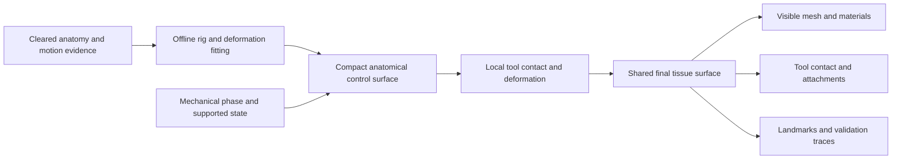

# OHS-PROPOSAL-002 — Android Heart, Animation & Instrument Realism

**مقترح أندرويد: واقعية القلب وحركته والأدوات الجراحية**

| Field | Value |
|---|---|
| Proposal | OHS-PROPOSAL-002-ANDROID-REALISM, revision 1 |
| Date / author | 2026-11-03 / Codex with focused engine review assistance |
| Requirement | Android application; very high realism and sustained performance |
| Current scope | Heart animation, anatomy/instrument assets, rendering engine and tool–tissue contact |
| Supersedes | Desktop-first platform, rendering and input assumptions in OHS-PROPOSAL-001 |
| Status | Researched proposal; engine choice and fidelity require implementation evidence |
| Evidence baseline | Review checkpoint `6e37271`; two coronary STL samples inspected structurally |

## الخلاصة بالعربية

المقترح السابق يحتاج تعديلًا جوهريًا لأن أندرويد هو المنصة المطلوبة. التوصية الحالية هي اختبار **Godot Mobile/Vulkan مع Blender** كبداية مفتوحة المصدر، مع اختبار واضح لخامة القلب؛ فالمحرك المحمول لا يوفّر تشتت الضوء داخل الأنسجة جاهزًا. لا نعتمد المحرك قبل مقارنة الجودة وثبات الأداء على هواتف فعلية.

القلب الواقعي يحتاج حركة إقليمية: قِصرًا طوليًا، تغيرًا محيطيًا، زيادة سماكة الجدار، التفافًا وانفراجًا، مع اختلاف حركة الحجرات والقاعدة والقمة. ثم تُضاف حركة التنفس والتحميل والمسك بالأدوات ضمن مجال تمت مراجعته. الشرايين والخيوط ونقاط التماس تتبع السطح نفسه، ولا تتحرك كل طبقة باستقلال عشوائي.

الأداة الواقعية تحتاج قياسات صحيحة، مفصلًا وفكوكًا أو حافة فعالة، ونموذج تماس يطابق شكلها المرئي. الملقط يمسك منطقة نسيج محددة؛ الإبرة تتبع انحناءها مع نقاط دخول وخروج محفوظة؛ المشبك يغيّر الضغط الموضعي وحالة الوعاء الممثلة؛ والقطع يُظهر سطحًا داخليًا مستمرًا. الإحساس بقوة الأنسجة لا توفره شاشة اللمس، لذلك تُسجّل مساعدات التحكم بوضوح.

هدف «أفضل محاكاة في تاريخ البشرية» يُحفظ كطموح. إثبات التفوق يحتاج مقارنة منشورة ومراجعة مختصين واختبارات هاتف، وليس وصفًا تسويقيًا. هذه النسخة تحدد مواصفات الوصول إلى واقعية عالية، وما يجب قياسه قبل ادعائها. لم يبدأ تنفيذ التطبيق.

## 1. Review verdict and changes

| Earlier proposal | Revised Android decision | Reason |
|---|---|---|
| Desktop-first Unreal recommendation | Godot Mobile/Vulkan is the first **candidate**, subject to a tissue/material gate and device comparison | Open-source preference plus mobile cost/feature constraints |
| Generic heartbeat rig/blend-shape recommendation | Reviewed regional motion basis plus state transitions and local contact | Anatomical motion and contact must agree |
| Broad asset catalogue | Small traceable anatomy/motion/instrument set plus original surgical geometry | Inspection and functional topology matter more than catalogue size |
| Mouse-oriented control assumptions | Touch/stylus precision interface with explicit assistance | Screen occlusion and degrees of freedom change the task |
| Desktop performance budgets | Named Android device tiers, frame pacing, input latency and thermal soak | Short cold-device FPS does not establish sustained quality |
| Full-case simulator roadmap | A focused heart-and-two-tools demonstrator before broader expansion | Proves this request's core realism without conflating it with every clinical subsystem |

The earlier proposal remains available for historical comparison. Its clinical workflow research is not discarded, but this review does not reapprove its physiology backend for Android.

## 2. Engine decision with an actual exit test

The primary route is **Godot Mobile/Vulkan + Blender + a small independently testable native interaction module if profiling justifies it**. Godot is MIT; asset licenses remain separate. Mobile lacks built-in subsurface scattering and screen-space reflections, so a realistic tissue material requires an explicit alternative. [Godot renderer matrix](https://docs.godotengine.org/en/stable/tutorials/rendering/renderers.html).

Test an opaque tissue material with regional color, thickness-informed diffuse/backlighting, controlled wet specular response, micro-normal detail and environment reflections. Inspect it under multiple light directions and exposures, especially beside epicardial fat and small vessels. It must preserve anatomy readability, moving highlights and contact cues. Transparent red shading alone is not an accepted tissue model.

If that route fails the visual/performance gate after a bounded repair attempt, compare **Unity URP** only if proprietary engine terms are acceptable. URP package source is not an open-source license for the Unity editor. **Filament**, licensed Apache-2.0, is the alternative open renderer, but would require more application/editor/interaction work. Unreal's mobile renderer remains a measured alternative rather than a desktop-quality assumption. Detailed capability and license evidence is in the [engine review](../plan/android-review/01-engine-rendering.md).

Do not choose an engine from a still image or a desktop demo. Export the same source anatomy and replay the same camera, light and contact workload in the candidate builds. Record different approximations rather than pretending renderer features are identical. The winner must pass appearance, motion, contact, thermal, input and licensing gates together.

## 3. How the heart should look and move

### Anatomy and surface specification

Create a coherent adult anatomy with named coronary routes, great-vessel connections, chamber orientation, pericardial relationships and operative landmarks. Inspect the visible exterior and the local tissue/lumen exposed by a supported interaction. Preserve variation intentionally; do not combine different atlas donors without registration and review.

Use distinct material regions for myocardium, epicardial fat, vessels, pericardium and exposed tissue. Wetness changes roughness/specular appearance according to state, not random noise. Fine vessels and tissue boundaries must remain legible at the closest permitted view, including compressed mobile textures. Baked source color should not contain highlights that stay fixed while the light moves.

### Animation specification

Use regional contraction and relaxation with source-specific timing, base/apex behavior and chamber differences. CMR evidence supports a more complex movement than global scaling; amplitudes from one healthy cohort cannot be assigned universally to an exposed supported heart. [Primary CMR study](https://pubmed.ncbi.nlm.nih.gov/20716369/).

Required motion inputs are mechanical state, cycle phase, supported loading state, respiratory phase, surgical positioning and local contact. Electrical rhythm is a separate signal. An arrested heart loses active contraction but still responds to contact/loading. Fibrillation is a distinct reviewed motion state, not faster normal beating. Transitions preserve geometry and attachments.

Coronaries, fat, sutures and landmarks follow stable anatomical/material mappings. Protect cavity and wall geometry separately: chamber volume changes are not the same thing as compressing away tissue material. A cut, puncture or attachment remains attached to its region through motion and quality changes.

### Runtime ownership

Evaluate a compact control cage/deformation basis on the CPU where practical, with visual interpolation on the GPU. Reuse the same geometry mapping for contacts. Avoid full-mesh synchronous GPU readback. A GPU-only beating surface with a stationary collider is a blocking defect.

Keep the baseline supported state space small enough to validate. Offline FEM or measured-motion fitting can improve the reference basis, but neither becomes clinical truth automatically. Arbitrary deformation outside the basis needs a defined limit and later evidence. The [animation review](../plan/android-review/02-heart-animation.md) specifies representation tradeoffs and fixtures.

## 4. How surgical tools should behave

Each tool has a measured functional model in addition to artwork: dimensions, contact tips, jaw/hinge or spring axes, opening/locking states, needle grasp location, cutting edges, collision proxies and a validated export transform.

| Interaction | Required visible and mechanical agreement |
|---|---|
| Forceps grasp | Tissue attaches to the actual jaws, deforms locally, and releases without a hidden constraint |
| Needle holder and needle | Holder articulation controls the grasped needle; curved passage preserves the tip path and tissue anchors |
| Scissors/scalpel | Tissue change follows the supported active edge/sweep; a persistent cut surface and collider are created |
| Clamp | Jaw compression and the selected vessel's modeled lumen/connection state agree |
| Retraction | Contact displacement follows anatomical attachments and the permitted local deformation envelope |
| Suction | The active tip changes the available pool through a defined route; visuals follow the same fluid bookkeeping |
| Suture | Thread, anchors, edge approximation and tension abstraction remain consistent; assistance is identified |

Use a bounded local contact region first, with continuous/swept collision checks for thin structures and fast motion. Numerical methods and model parameters must be tested independently. Published needle-force and XPBD-suturing work informs mechanism selection, not device performance or human coronary calibration. See the [tool/contact review](../plan/android-review/04-instruments-contact.md).

### Android controls

Prototype an offset touch control area with a magnified surgical view, separate depth/roll/jaw controls, explicit active tool and camera mode, and optional stylus support. A second tool can be held by a declared assistant constraint. Compare this with a two-zone bimanual interface in user sessions.

Record snapping, gain, trajectory guidance and assisted knot completion. Stylus pressure is device input, not a measured tissue force. Camera gestures, pointer loss and app resume must not create unintended cuts. The visible response and accepted contact event use the same ordered input history.

## 5. Assets: what is actually reusable

The [fresh asset review](../plan/android-review/03-assets-licenses.md) records exact sources and licenses. The main candidates are direct BodyParts3D and HRA geometry, a versioned CC BY 4.0 coronary-motion dataset, Sunnybrook cine-MRI under CC0 with an unresolved download route, and explicitly licensed instrument references. Original coronary-wall, tip/jaw and tissue-patch authoring remains necessary when those sources lack the required structure.

Two coronary phase files were structurally inspected. Their counts match, but their first-occurrence-indexed connectivity hashes differ; direct index-to-index morphing is not verified. Both also contain boundary edges, and STL does not declare units. These findings make scale, correspondence and wall reconstruction explicit gates. [Inspection record](../plan/android-review/motion-sample-inspection.json).

This inspection does not establish clinical accuracy, motion quality or watertight tissue. The raw files remain outside the repo. All other new candidates were inspected at page/metadata level only. A source license, geometric inspection and runtime acceptance are separate status fields.

For every future asset: preserve creator, exact release/file, hash, license evidence, credits, changes, coordinate system, anatomy IDs, motion mapping, derivative/export lineage and reviewer status. Public redistribution must be allowed even when the intended use is personal. Noncommercial material remains clearly marked; no asset or engine is called open source merely because it costs nothing.

## 6. Android quality and performance contract

No device model was supplied. The working assumption is **high-end Android first**, with a deliberately tested reduced tier if required; this is not a claim that every phone will deliver the same output. Select at least an Adreno device, a Mali/Immortalis device, and the eventual minimum device before setting support claims.

**Proposed engineering target:** sustained 60 FPS on the selected high tier, with 16.67 ms frame deadlines and measured p95/p99 presentation intervals. A 30 FPS tier is a separate product/usability decision, not an invisible fallback. Rendering resolution, memory budget and latency limits must be recorded per device after an initial profile, before final acceptance.

Run cold and 30-minute normal-mode tests at recorded brightness, ambient conditions, charge state, driver, OS and scene version. Capture CPU/GPU work, missed presentation deadlines, touch-to-visible response, thermal state, memory growth, startup/shader stalls and resume behavior. Use supported profiling tools and ADPF where integration is available. [Android ADPF](https://developer.android.com/games/optimize/adpf), [Android GPU Inspector](https://developer.android.com/agi).

When reducing workload, reduce background detail, excess effects/shadows and render resolution within readability limits before changing anatomical contact meaning. Preserve active-region collision, stable IDs and authoritative event behavior. Pause/report unsupported overload instead of silently letting tools penetrate while maintaining a high FPS counter.

## 7. Acceptance gates for high realism

| Gate | Evidence required |
|---|---|
| Anatomy | Annotated landmarks, source registration and specialist review; blocking errors resolved |
| Motion | Held-out regional trajectories/phase and state-transition review, with documented uncertainty and tolerances |
| Materials | Neutral and surgical-light comparisons, moving highlights, fat/vessel separation and macro readability |
| Instrument function | Measured dimensions/articulation plus normal/fast-motion contact fixtures |
| Animation/contact agreement | Tip-to-surface error traced through the cycle, contact, cut and LOD transitions |
| Touch usability | Targeting, curved passage, two-tool exposure, gesture interruption and assistance logs |
| Sustained Android behavior | Named physical-device reports, thermal soak and fixed-script repeatability |
| Rights | Every shipped file/dependency cleared for its actual redistribution route |
| Comparative claim | Preregistered comparison criteria, named product/build/device versions, equivalent tasks and review method |

Do not collapse these into one “realism score” before the measures are justified. For a superiority claim, compare available relevant Android applications under stated conditions and report limitations or missing equivalents. Desktop haptic systems and phone applications represent different input capabilities. No current source review establishes that this project is already the best.

## 8. First production slice and decision sequence

1. **Reference pack:** select coherent anatomy, source motion, physical units and one coronary target; resolve asset rights and correspondence.
2. **One heart, two tools:** author a low-cost rig/control surface, fine holder/forceps and needle; verify contact during beating and arrest.
3. **Material gate:** evaluate tissue/fat/blood-film/tool materials under controlled lighting on the candidate Android renderer.
4. **Interaction gate:** grasp/release, indentation, curved passage and one bounded tissue transition; assisted knot explicitly identified.
5. **Device gate:** package to selected phones, profile cold/warm operation, input and lifecycle; compare the fallback only when a diagnosed failure warrants it.
6. **Review gate:** inspect anatomy/motion/tool behavior and blind comparison clips where appropriate; publish findings and a revised choice before expanding scope.

This is a future implementation sequence, not work already performed. The present changes are planning documents and an inspection record. No Android APK, engine project, shader, rig or playable interaction has been built.

## 9. Instructions for the next reviewing agent

Treat Android as a fixed user requirement. Read the four focused reports and the inspection record before recommending a stack. Challenge this proposal using exact sources and reproducible scene/device evidence. Distinguish a missing engine feature from a feasible custom approximation, and a plausible animation from validated motion.

For each alternative, state which gate it improves, what it costs in performance/content work/rights, and the experiment that would decide. Preserve the previous proposal for comparison. Do not silently promote a desktop feature, a static mesh, a source-code demo, or a noncardiac haptic study into proof of Android surgical realism.
